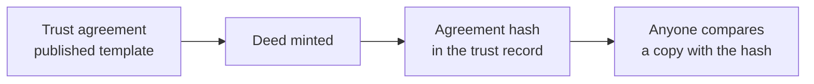

# Legal agreements

Clear's public agreements are published in the [protocol-agreements](https://github.com/Deed3Labs/protocol-agreements) repository on GitHub, with a [changelog](https://github.com/Deed3Labs/protocol-agreements/blob/main/legal/CHANGELOG.md) of every change.

Reading an agreement is not legal advice. Ask your own lawyer about your situation.

## Digital Deed trust agreements

Every Digital Deed is governed by the trust agreement attached to it when it was minted. A later version of a template does not change the agreement of a deed that already exists.

| Region | Agreement | Status |
| --- | --- | --- |
| United States | [Trust agreement](https://github.com/Deed3Labs/protocol-agreements/blob/main/legal/Americas/US/trust-agreement.md) | Current template for existing Digital Deeds |
| United States | [Real property trust agreement, v1.0](https://github.com/Deed3Labs/protocol-agreements/blob/main/legal/Americas/US/real-property-trust-agreement-v1-draft.md) | Draft for comment. Not for use |
| United States | [Vehicles and equipment trust agreement, v1.0](https://github.com/Deed3Labs/protocol-agreements/blob/main/legal/Americas/US/vehicles-and-equipment-trust-agreement-v1-draft.md) | Draft for comment. Not for use |
| Canada | [Trust agreement](https://github.com/Deed3Labs/protocol-agreements/blob/main/legal/Americas/CAD/trust-agreement.md) | Template |
| Mexico | [Trust agreement](https://github.com/Deed3Labs/protocol-agreements/blob/main/legal/Americas/MX/trust-agreement.md) | Template |
| European Union | [Trust agreement](https://github.com/Deed3Labs/protocol-agreements/blob/main/legal/Europe/EU/trust-agreement.md) | Template |
| United Kingdom | [Trust agreement](https://github.com/Deed3Labs/protocol-agreements/blob/main/legal/Europe/UK/trust-agreement.md) | Template |
| Russia | [Trust agreement](https://github.com/Deed3Labs/protocol-agreements/blob/main/legal/Europe/RU/trust-agreement.md) | Template |
| Indonesia | [Trust agreement](https://github.com/Deed3Labs/protocol-agreements/blob/main/legal/Asia/IDN/trust-agreement.md) | Template |
| Japan | [Trust agreement](https://github.com/Deed3Labs/protocol-agreements/blob/main/legal/Asia/JP/trust-agreement.md) | Template |

## How a deed records its agreement

Land and estate deeds are held in trust. Each one stores the hash of its trust agreement, and of any riders, in its trust record on chain, so anyone can check that a copy of the agreement is the one the deed is held under. `DeedNFT.trustRecordOf(tokenId)` returns the record, and the hashes are also among the deed's traits.

Only the holder can move a deed to a new version, with `electAgreementVersion`, and only to a version the deed's validator has adopted for that asset type. If the deed records a protector whose consent is required, the protector must agree too. No admin, validator or trustee can change a deed's agreement.

Every deed also carries the address of its operating agreement. The [validation system](../protocol/deed-track/validation-system.md#operating-agreements) explains how a validator recognizes it.

## Member and merchant terms

Not available yet.

## Investor terms

Investor agreements are shared after sign-in, in **Terms and agreements** under [Investors](../investors/README.md).
