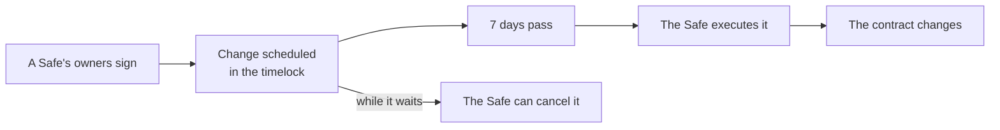

# On-chain authority

Who can do what to the Clear Protocol's contracts: the kinds of authority, the four timelocks that
hold admin power, the wallets that do each day-to-day job, the Ops Safe, and who can upgrade or pause
a contract. Each contract's address, functions and the role each function needs are in the
[Contract reference](../protocol/contracts/README.md). Deploying the contracts and handing over the
keys follows these rules; the steps are in [Deploying the contracts](../operators/deploying-contracts.md).

## Three kinds of authority

| Kind | What it can do | Who holds it |
|---|---|---|
| **Admin** | Grant and take away roles, upgrade a contract, change its governed settings, change who owns it | A timelock. A Safe proposes the change, 7 days pass, and the same Safe executes it |
| **Operational** | One day-to-day job: open a credit line, set a term limit, settle a send, submit a member's signed deposit | A wallet dedicated to that job, or the Ops Safe for jobs that only change settings. Some jobs need two different holders to act together |
| **Contract-to-contract** | One contract calling another: the savings vault minting CLRUSD, a credit issuer writing to the ledger | The contract that needs it |

**When the contracts are deployed, the deployer key holds every admin and operational role.** The
hand-overs move them off it: operational roles to the wallets that do each job, then admin power to
the timelocks. On Base Sepolia, the test network, the hand-overs ran on November 17, 2026, when the
testnet rollout began. Every admin change since then waits out a timelock's 7-day delay. Where a
hand-over is still waiting out its delay, or a contract was deployed after day 0 (the fresh
OffersIssuer), the deployer holds that power until the hand-over completes.

## The four timelocks

**Admin power over the credit, Earn, reserve and savings contracts sits with four timelocks.** Each
is an OpenZeppelin `TimelockController` with a minimum delay of 7 days. One Safe, a multi-signature
wallet, proposes changes to it and executes them once the delay has passed; the same Safe can cancel
a change while it waits. No timelock has an admin of its own, so its delay can only change through a
proposal that waits out the delay itself.

| Timelock | Proposes and executes | What it governs |
|---|---|---|
| [CreditTimelock](../protocol/contracts/CreditTimelock.md) | The Ops Safe | The credit ledger (through the `AccessManager`, whose admin is the ledger's admin), `RevolvingIssuer`, `TermIssuer`, `OffersIssuer`, `RateSchedule`, `NetworkRegistry`, `CollateralRegistry`, `LimitCalculator`, `Liquidator`, `MerchantRegistry`, `PayoutPool`, `ClaimEscrow` and `MembershipRegistry` |
| [EarnTimelock](../protocol/contracts/EarnTimelock.md) | Clear Lending's Safe | The lending pool on Earn (`LendingPool`), `EarnControls`, `BondVault`, `CollateralAgent`, and the bond collections and bond factories |
| [AssuranceTimelock](../protocol/contracts/AssuranceTimelock.md) | The co-op board's Safe | The co-op's reserve, the `AssurancePool`. Two of the pool's own signers must also approve each exact call first |
| [VaultTimelock](../protocol/contracts/VaultTimelock.md) | Clear Financial Co.'s Safe | The savings vault (`ESADepositVault`), CLRUSD (`ClearUSDUpgradeable`) and the cross-chain CLRUSD pool |

**A waiting change never blocks a member's way out.** CLRUSD transfers, savings redemptions,
withdrawals from the lending pool on Earn and its queue, and bond settlements carry on while a change
waits in any timelock.

**Anyone can see a change coming.** A timelock records every scheduled change in a `CallScheduled`
event, with the exact call and its delay, before it can run. `isOperationPending(id)` and
`getTimestamp(id)` on the timelock say whether a change is waiting and when it can execute.

Once a timelock holds a contract's admin power, granting any of that contract's roles to a new holder
is an admin change too: a Safe proposal that waits 7 days.

The Deed track is governed apart from the four timelocks. On Base Sepolia its admin roles are held by
the key that deployed it. Nothing mints T-Deeds.

## The `AccessManager`

The credit contracts take their answer to "who may do this?" from one contract, the access manager
(`AccessManager`). Its admin is the credit timelock.

| Role | Granted by | What it allows | Held by |
|---|---|---|---|
| Admin | The admin | Upgrading the credit ledger, changing its settings, granting every role below. The admin passes every credit check | The credit timelock |
| `CREDIT_LINES_ROLE` | The admin | Opening credit lines and split plans, extending a credit period, closing a plan for a refund, granting new-member offers | The credit operator |
| `CREDIT_LIMITS_ROLE` | The admin | Setting term limits and revolving tier capacities, within the issuers' daily caps, and reinstating a member who has not repaid in full | The credit operator, and the `LimitCalculator` contract |
| `CREDIT_SETTINGS_ROLE` | The admin | Revolving tiers and their rates, treasuries, card settlers, card and daily caps, offer terms. Changing where Clear Lending's fee is paid takes two different holders | Two named signers, so a two-person change has two people to make it. The credit timelock, as admin, also passes every credit check |
| `OPERATOR` | The admin | Writing to the ledger from another contract. It passes none of the three credit roles above. A holder also counts as a member | The credit issuers, the ledger, the `Liquidator` and the `LimitCalculator`, and the credit operator wallet |
| `MEMBER` | An operator | Being treated as a member by the credit contracts. An active record in the membership registry counts too ([Protocol → Access](../protocol/credit.md#access)) | Members, as their lines open |

The credit issuers also have a `CREDIT_ATTESTER_ROLE`. Its holders record the things that change a
member's line by attestation: a cure notice, an income pause, a workout and a line's closing. One
holder proposes and a different one approves.

Other contracts (the savings vault, the collateral registry, the shop registry, the pools) keep their
own roles. The full list per contract is in [Credit](../protocol/credit.md),
[Savings and send](../protocol/savings.md), [Settlement](../protocol/settlement.md) and
[The reserve](../protocol/reserve.md).

## The wallets that do each job

**Each job signs with its own key, or the job does not run.** Clear's server never falls back to the
deployer key for any of them.

| Job | Roles it holds | What it does |
|---|---|---|
| **Credit operator** | `AccessManager` `CREDIT_LINES_ROLE` and `CREDIT_LIMITS_ROLE`; `MembershipRegistry` `REGISTRAR_ROLE` unless a separate registrar is set | Opens credit lines and plans, sets term limits, closes plans for refunds, grants offers, reinstates members, writes membership records |
| **State attester** | `NetworkRegistry` `STATE_ATTESTER_ROLE`, granted through the credit timelock | Records the US state a member lives in, once their identity check has passed. No credit line opens until it has, and the state decides which credit products the member can be offered |
| **Savings relayer** | `ESADepositVault` `RELAYER_ROLE`; `SavingsIntentFactory` `SETTLER_ROLE`; `CollateralRegistry` `OPERATOR_ROLE` | Submits members' signed deposits, redemptions and autopay; settles savings intents; records pledged savings |
| **Send relayer** | `ClaimEscrow` `SETTLER_ROLE` | Holds link-based sends in escrow and releases them when claimed |
| **Card settler** | The card-settler slot on `RevolvingIssuer` | Records card spending on the ledger. It borrows nothing from the lending pool on Earn, and nothing does |
| **Payout top-up wallet** | `PayoutPool` `FUNDER_ROLE`, and a spending limit on Clear Lending's operating Safe | Tops up the payout pool when it is short, within a limit set on chain by that Safe's owners ([Payouts](../merchants/payouts.md#how-the-payout-pool-is-kept-funded)) |
| **The Ops Safe** | `MerchantRegistry` `OPERATOR_ROLE`; `PayoutPool` `FUNDER_ROLE` and `OPERATOR_ROLE`; `OPERATOR_ROLE` on `NetworkRegistry`, `Liquidator` and `LimitCalculator`; the Deed track's fee, criteria and validator roles | Credit settings, shop terms, payout pool top-ups by hand, validator fees. It is also the credit timelock's proposer |

**Upkeep needs no role.** Some contract upkeep happens only when someone calls a function: rolling a
credit line into its next cycle, declaring a default the issuer has already computed, settling
pledged pool shares and bonds, and filling the lending pool's withdrawal queue. Those functions are
open to anyone, and the contract decides whether the call does anything. Clear's server runs keepers
that make these calls on time; they hold no role.

**Some operational roles also cover settings.** An operational role is one switch for a whole
contract, so the wallet that does a day-to-day job there can also use the rest of that role:

- The savings relayer's `CollateralRegistry` role also sets the haircut and price on each kind of
  collateral.
- The savings relayer's `RELAYER_ROLE` can also cancel a member's autopay mandate.

**Some roles need two different holders to act.** Each of these is held by at least two keys, and an
action takes effect only when a second holder makes the identical call or approves the first:

| Contract | Roles | What they do |
|---|---|---|
| `ESADepositVault` | `PAUSER_ROLE`, `PILOT_ROLE` | Pause deposits and redemptions; pause new CLRUSD mints in California |
| `ClearUSDUpgradeable` | `FRAUD_ROLE`, `SECURITY_ROLE`, `LISTING_ROLE` | Pause one account's sending; pause all sending; de-list or re-list a wallet |
| `RevolvingIssuer`, `TermIssuer` | `CREDIT_ATTESTER_ROLE` | Cure notices, income pauses, workouts, closing a line |
| `Liquidator` | `HOLD_ROLE` | Place and clear a hold that stops enforcement against a member |
| `LendingPool` | `DEPLOYER_ROLE`, `VALUATION_ROLE`, `SUSPENSION_ROLE`, `CCO_ROLE`, `TREASURER_ROLE` | Lend to Clear Lending as a recorded Deployment; post valuations and loss charges; suspend the pool or place a legal hold |
| `EarnControls` | `PAUSE_ROLE`, `SUCCESSOR_ROLE`, `ELIGIBILITY_ROLE`, `LADDER_ROLE`, `FUNDING_ROLE`, `WIND_DOWN_ROLE` | Earn's pauses, successors, eligibility, the bond terms on offer, funding and wind-down |
| `AssurancePool` | The pool's signers | Draws, Member Assurance grants, transfers between compartments, the monthly floor inputs, the pause, and approving every governed call |

The `LendingPool`'s deployment and valuation signers are kept apart: no one holds both. Roles on
`EarnControls` are granted only with a Lending Board resolution, recorded with the grant.

Roles that nothing off the chain uses are given up rather than moved: `AccessManager` `MEMBER`,
`LendingPool` `LOSS_REPORTER_ROLE` and `OPERATOR_ROLE`, `BondVault` `OPERATOR_ROLE`,
`LimitCalculator` `ATTESTOR_ROLE`, `SavingsIntentFactory` `CREATOR_ROLE`, the minting and validator
roles on `DeedNFT`, and a few that no function checks.

## The Ops Safe

**The Ops Safe is the co-op's multi-signature wallet.** A transaction from it needs signatures from
more than one of its owners, so no one person's key can change a shop's terms, propose an upgrade or
move the co-op's money on the chain.

It acts in two ways:

- **Directly**, through the operational roles it holds: shop terms and switching a shop on or off,
  payout pool top-ups by hand, the credit settings, validator fees. These take effect when the Safe's
  transaction executes.
- **Through the credit timelock**, as its only proposer and executor: upgrades, admin settings and
  role grants on every contract the credit timelock governs. These wait 7 days.

The hand-overs run in a fixed order:

1. **Operational roles to the wallets that do each job, and to the Ops Safe.** This runs first, while
   the deployer can still grant.
2. **Admin to the timelocks:** the credit stack to the credit timelock, the savings vault and CLRUSD
   to the vault timelock, and the Earn contracts to the Earn timelock. Each step grants first, and the
   deployer gives up its roles only once the timelock is seen to hold them. The `AssurancePool` needs
   no hand-over: it is governed by the Assurance timelock from its first block.

Two hand-overs need the receiving Safe to finish them. CLRUSD's admin passes in two timed steps: the
deployer begins the transfer, and the vault timelock accepts it after CLRUSD's own admin delay,
through a Safe proposal that waits 7 days. Ownership of the cross-chain CLRUSD pool is accepted the
same way.

The hand-overs are rehearsed against a copy of the live network before they run. The rehearsal checks
that each timelock ends up with every admin role and ownership it should hold, and that the deployer
ends with none.

People sign Safe transactions with their own wallets. How the Command Center prepares the Ops Safe's
transactions is in [The Command Center](./command-center.md#ops-safe-transactions).

## Who holds each role today

**Who holds a role on a network is state on the chain.** It changes with each grant and hand-over,
and anyone can read it. Each of these is a public function, callable from a block explorer's "Read
contract" tab without a wallet:

| To check | Call |
|---|---|
| Whether an address holds a role | `hasRole(role, address)` on the contract. A role's id is the value of its getter, such as `OPERATOR_ROLE()`; `DEFAULT_ADMIN_ROLE` is zero |
| A credit role | `hasCreditRole(role, address)` on `AccessManager`, which is true for the admin too. `isAdmin(address)` and `isMember(address)` answer the other two questions |
| Who owns a contract that has an owner (the credit issuers, `RateSchedule`, the bond collections and factories) | `owner()`, and `pendingOwner()` where ownership is accepted in a second step |
| Who is CLRUSD's admin | `defaultAdmin()` and `pendingDefaultAdmin()` on `ClearUSDUpgradeable`. Its `owner()` only repeats the default admin |
| Who governs the reserve, and who signs for it | `governance()`, `isSigner(address)` and `signerCount()` on the `AssurancePool` |
| A timelock's delay, and who proposes to it | `getMinDelay()`, and `hasRole(PROPOSER_ROLE(), address)` on the timelock |
| Who can sign for a Safe | `getOwners()` and `getThreshold()` on the Safe. The Command Center reads the same two from the chain |

`hasRole` answers for one address at a time: the contracts do not keep a list of a role's holders.
To see every grant and removal, read the contract's `RoleGranted` and `RoleRevoked` events.

## Who can upgrade a contract

**An upgrade keeps a contract's address and replaces its code.** The right to do it sits with each
contract's admin. For every contract outside the Deed track that admin is, once its hand-over
completes, a timelock, so an upgrade is a Safe proposal that waits 7 days.

| Contracts | Upgraded by |
|---|---|
| `ClearCredit` (the credit ledger) | An `AccessManager` admin: the credit timelock |
| `RevolvingIssuer`, `TermIssuer`, `OffersIssuer`, `RateSchedule` | Their owner: the credit timelock |
| `NetworkRegistry`, `CollateralRegistry`, `LimitCalculator`, `Liquidator`, `MerchantRegistry`, `PayoutPool`, `ClaimEscrow` | `DEFAULT_ADMIN_ROLE`: the credit timelock |
| `AccessManager`, `MembershipRegistry` | The owner of their proxy admin: the credit timelock |
| `LendingPool`, `EarnControls`, `BondVault`, `CollateralAgent` | `DEFAULT_ADMIN_ROLE`: the Earn timelock |
| `AssurancePool` | The Assurance timelock, once two pool signers approve the exact upgrade. The pool refuses a timelock with a delay under 7 days |
| `ESADepositVault` | `DEFAULT_ADMIN_ROLE`: the vault timelock |
| `ClearUSDUpgradeable` (CLRUSD) | `UPGRADER_ROLE`: the vault timelock |
| The Deed track | Each contract's admin role or owner |
| `ClearUSD` (the original CLRUSD), `SavingsIntentFactory`, `PauseClock`, `HolderDirections` | Cannot be upgraded |

How an upgrade is run is in [Deploying the contracts](../operators/deploying-contracts.md#upgrades).

## Pausing

**Every pause takes two people, and every pause ends on its own.**

- **The savings vault.** Two `PAUSER_ROLE` holders making the identical call stop deposits,
  redemptions and autopay runs. The pause lapses after 72 hours unless renewed, and no chain of
  pauses runs past 30 days unless a legal basis is recorded with it. It does not stop the vault's
  settings from being changed.
- **CLRUSD.** Two `FRAUD_ROLE` holders can pause one account's sending; two `SECURITY_ROLE` holders
  can pause everyone's. The same 72-hour and 30-day limits apply.
- **The reserve.** Two `AssurancePool` signers can pause releases and transfers for 72 hours, and two
  must renew it. Deposits and draw requests carry on.
- **The lending pool on Earn.** Two authorized people, one of them the CCO or the treasurer, can
  suspend it or place a legal hold.

**A pause never causes a credit default.** The `PauseClock` counts how long a savings or CLRUSD pause
was in force for each member, and the credit contracts push due points and grace periods back by
that time. It has no owner and no setter.

`ClaimEscrow`, the link-based send escrow, cannot be paused. `MembershipRegistry` has a pauser of its
own.

## What no role can do

- **Take the savings.** The savings vault releases USDC only when the holder of the CLRUSD redeems
  it. There is no admin withdrawal.
- **Take savings that were not drawn against.** After a default, the CLRUSD contract limits seizure
  to what the member drew against their pledged savings.
- **Move the reserve's money outside its rules.** The `AssurancePool` has no sweep, rescue or admin
  withdrawal. Money leaves only as a draw to Clear Lending's registered loss-reserve address or a
  Member Assurance grant to the co-op's disbursement address, each by two signers.
- **Upgrade a credit, Earn, reserve or savings contract at once.** Every such upgrade waits 7 days
  in a timelock, in public.
- **Hold equity credits.** No contract does; Clear's server keeps them
  ([Parameters](./parameters.md#equity-credits)).
