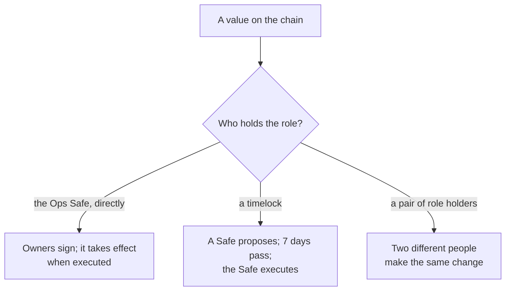

# Parameters and who sets them

The numbers the system runs on, where each one lives, who can change it, and how a rule changes.
Figures under **Today** are the values set at deployment or by the server's current rules. A value on
the chain may since have been changed by whoever holds the role; read the contract for the current
one.

"The Ops Safe" below means the co-op's multi-signature wallet. "The credit timelock", "the Earn
timelock", "the Assurance timelock" and "the vault timelock" each hold a group of contracts' admin
power: a change through one is proposed by its Safe and waits 7 days before it can run. Which Safe
proposes to which timelock is in [On-chain authority](./on-chain-authority.md#the-four-timelocks).

## Savings

| Parameter | Lives in | Set by | Today |
|---|---|---|---|
| Which tokens can be deposited | `ESADepositVault.setAcceptedToken` | The vault's admin: the vault timelock | USDC |
| Which CLRUSD the vault issues | `ESADepositVault.setClrusd` | The vault timelock. Refused while any of the old CLRUSD is still out | — |
| What locks savings behind drawn credit | `ClearUSDUpgradeable.setEncumbranceSource` | CLRUSD's admin: the vault timelock. Setting it to none lifts the lock for everyone | The collateral registry, which records pledged savings |
| Pausing deposits and redemptions | `ESADepositVault.pause` | Two `PAUSER_ROLE` holders making the identical call | Lapses after 72 hours unless renewed; never past 30 days in a row without a recorded legal basis |

Savings pay no interest; there is no rate to set.

## Equity credits

**Equity credits are kept by Clear's server, not by any contract.** Their rules are set in the
server's software, so they change only through a software change (see
[How a rule changes](#how-a-rule-changes)).

| Rule | Today |
|---|---|
| Match on savings | 1 credit for each whole dollar deposited, up to 1,500 credits a calendar month |
| Match if the deposit leaves early | Redeem within 30 days and the matching credits still waiting are cancelled |
| Rent paid on time | 200 credits, times your multiplier |
| Other bills paid on time | 10% of the payment in credits, at most 500, times your multiplier |
| On time | Paid no more than 3 days after the due date. A late payment earns nothing |
| Vesting | 30 days from the payment or deposit |
| Multiplier | 1×, plus 0.25× for every 6 months in a row with an on-time payment, up to 1.5× |
| Test networks | Credits earned there are recorded separately from live ones |

The multiplier applies to rent and bills, not to the savings match. Equity credits can never be
withdrawn or redeemed for cash; no rule above can change that.

## Assurance and the Clear Deed

Each protection unlocks at a number of equity credits, whatever the member's plan. The member app
sets these thresholds and draws the path toward the Clear Deed from them.

| Protection | Unlocks at |
|---|---|
| Cycle assurance: one cycle a year can close short | From the start |
| Home repair: up to $1,000 a year, paid to the contractor or supplier | 1,500 credits |
| Hardship grant: up to $1,000 a year toward rent or a housing payment, paid to the landlord or lender | 1,500 credits |
| Income: nothing is due for up to three cycles after a documented hardship | 4,000 credits |

The app's progress bar toward the Clear Deed ends at 15,000 credits, where a member can apply for an
ELPA. The ELPA prices a Clear home at its cost plus 15%, fixed at signing. A claim is filed in the
app and read by a person, who moves it on by hand.

## Credit

| Parameter | Lives in | Set by | Today |
|---|---|---|---|
| Which credit products are offered in each US state, and the caps on their rates | `RateSchedule.setProduct` | Its owner: the credit timelock | Set state by state. A state with no product has no credit |
| A member's state of residence | `NetworkRegistry.attestStateCode` | `STATE_ATTESTER_ROLE` | Recorded once the member's identity check has passed. No line opens without it |
| A member's split-plan limit | `TermIssuer.setTermLimit` | `CREDIT_LIMITS_ROLE` (the credit operator), within the issuer's daily caps | The automatic rule below |
| Instalment choices | `TermIssuer`, fixed in the contract | A contract upgrade | 1, 2, 4, 6 or 12 |
| When a split plan can be declared in default | `TermIssuer`, fixed in the contract | A contract upgrade | Two instalment periods after the first unpaid one |
| How often a member may re-spread a plan | `TermIssuer`, fixed in the contract | A contract upgrade | Three times, not while behind, and not within one instalment period of the last |
| Revolving tiers and their rates | `RevolvingIssuer.addTier`, `setTierRate` | `CREDIT_SETTINGS_ROLE` (two named signers) | Each tier's rate is at least the one before it |
| A member's revolving capacity | `RevolvingIssuer.setTierCapacity`, or `LimitCalculator` from pledged collateral | `CREDIT_LIMITS_ROLE`, within the daily caps; `LimitCalculator` writes it from collateral for anyone who calls | — |
| Daily caps on new limits and card spending, card settlers, treasuries | The credit issuers | `CREDIT_SETTINGS_ROLE` (two named signers) | — |
| Collateral haircuts and prices | `CollateralRegistry.setCollateralTerms` | The registry's `OPERATOR_ROLE` (the savings relayer) | Bonds registered as collateral at 95% at deployment |

**The automatic split-plan limit.** Clear's server sets term limits by a rule:

- $500.00 to start, once the member's identity check has passed.
- $250.00 more for every three instalments paid without a late mark.
- Growth above $500.00 is capped at half of the member's estimated monthly deposits.
- $5,000.00 is the most the rule will set. Anything higher is an operator's decision.
- It only ever raises a limit. Nothing is set for a member who is suspended, in default or behind.

The rule runs on its own on Base Sepolia, the test network. On any other network it is off until it
is switched on in the server's settings. The figures are proposed and not yet signed off.

## The reserve

**The co-op's reserve is the `AssurancePool`, in two compartments.** The Credit Backstop stands
behind Clear Lending's charged-off credit; Member Assurance pays members' Assurance grants. Each
compartment has its own balance, and money moves between them only by a transfer the pool's signers
make.

| Parameter | Lives in | Set by | Today |
|---|---|---|---|
| The Credit Backstop's floor, as a share of the credit it covers | `AssurancePool.setFloorBps` | Governed: two pool signers approve the exact call, then the Assurance timelock makes it | 5% at launch |
| The month's floor inputs: the timing buffer, the coverage cap and the attested covered book | `AssurancePool.setFloorInputs` | Two pool signers, each month, with evidence | — |
| How money paid in is split between the compartments, above the floor | `AssurancePool.setAllocation` | Governed | Half and half at launch. Within a program year, the Credit Backstop's share may rise but never fall |
| The wait on a transfer between compartments | `AssurancePool.setTransferDelay` | Governed | At least 14 days. A transfer into the Credit Backstop needs no wait |
| Who may pay in, and under which source | `AssurancePool.setPayer` | Governed | — |
| Clear Lending's draw and loss-reserve addresses, and the co-op's Assurance disbursement address | `setLendingCoAddresses`, `setAssuranceDisbursementAddress` | Governed | — |
| The pool's signers | `AssurancePool.setSigner` | Governed. The pool keeps a minimum number of signers | — |

Money paid in fills the Credit Backstop up to its floor first, and the rest is split by the
allocation. A draw from the Credit Backstop is requested by Clear Lending's registered draw address,
approved by one signer and released by a different one, never above the coverage available. A Member
Assurance grant takes two signers. How the reserve works:
[The reserve](../protocol/reserve.md).

## Shops

| Parameter | Lives in | Set by | Today |
|---|---|---|---|
| A shop's discount on a plan paid over time, Clear Lending's fee | `MerchantRegistry` terms | `MerchantRegistry` `OPERATOR_ROLE` (the Ops Safe) | 2.5% by default when a shop is registered. Never above 100% |
| The cap on that fee | `TermIssuer.setFeeTerms` | `CREDIT_SETTINGS_ROLE` | $50.00 a plan, or $75.00 on a plan over $2,500.00 |
| Who receives the fee | `TermIssuer` `feeRecipient` | Two `CREDIT_SETTINGS_ROLE` holders: one proposes, another approves | Meant to be Clear Lending's account. The contract refuses only zero and the payout pool. On Base Sepolia it is set to the Clear Treasury Safe |
| A shop's approval cap: the largest Clear charge it can take | `MerchantRegistry` terms | Same | Set per shop. Zero means no cap |
| A shop's payout window | `MerchantRegistry` terms | Same | The default window unless set |
| The default payout window | `MerchantRegistry.setDefaultPayoutWindow` | Same | 30 days, set at deploy |
| A shop's terms for a plan paid over time: the discount for each number of instalments, and what the shop takes off the member's rate | `MerchantRegistry.setSplitTerms` | Same | None set: the shop's flat discount applies |
| Plans short enough to be free to the member at a shop | `MerchantRegistry.setFreeSplitMax` | Same | Off |
| Whether a shop has agreed not to surcharge Clear | `MerchantRegistry.setNoSurcharge` | Same | — |
| Switching a shop off or on | `MerchantRegistry.setActive` | Same | Active when registered |

The contracts enforce the payout window and whether a shop is active. Clear's server checks the
approval cap and applies the discount on every charge. The Command Center prepares cap changes and
switching a shop on or off as Safe transactions ([The Command Center](./command-center.md)).

**The payout pool** pays shops what they are owed. Its settings (where the co-op's share goes, which
contracts it draws on) belong to its admin, the credit timelock. Topping it up takes `FUNDER_ROLE`,
held by the Ops Safe and by the payout top-up wallet. The top-up wallet moves Clear Lending's money
into the pool when it is short, never more in a period than a limit Clear Lending's Safe owners set
on chain.

## New-member offers

| Parameter | Lives in | Set by | Today |
|---|---|---|---|
| Size of each offer | `OffersIssuer.setTerms` | Its owner (the credit timelock) or `CREDIT_SETTINGS_ROLE` (two named signers) | $10.00, set at deploy |
| How long an unspent offer lasts | `OffersIssuer.setTerms` | Same | 90 days, set at deploy |
| Total offers the line can carry | `OffersIssuer.setCap` | Same | No offer is granted beyond it |
| Where the money to settle offers comes from | `OffersIssuer.setTreasury` | Its owner: the credit timelock | — |

## The lending pool on Earn

| Parameter | Lives in | Set by |
|---|---|---|
| The year's funding limit, and the offering's cap and capacity | `EarnControls.setFundingLimit`, `setOfferingLimits` | Its admin, the Earn timelock, with a Lending Board resolution recorded with each |
| The most one holder may hold | `EarnControls.setHolderCapBps` | The Earn timelock |
| Accounts refused as payers | `EarnControls.setRefused` | The Earn timelock |
| The bond terms on offer | `EarnControls.scheduleRung`, `setRung` | Two `LADDER_ROLE` holders make the same call, and it takes effect 48 hours later; or the Earn timelock |
| The pool's own settings and upgrades | `LendingPool` | The Earn timelock |

Clear's own contracts are refused as payers into the lending pool on Earn. How the pool works:
[Settlement](../protocol/settlement.md).

## Membership

Standard, every member's plan, is free. Accelerated, an optional paid plan, is not available yet.
See [Membership and the co-op](./membership.md).

## How a rule changes

**There are four kinds of rule, and each changes a different way.**

1. **A value on the chain**: everything in the tables above marked as living in a contract. It
   changes by a transaction from whoever holds the role.
   - Where that is the Ops Safe acting directly (shop terms), the change needs
     signatures from more than one of the Safe's owners, and takes effect when it executes. The
     Command Center can prepare the transaction and collect signatures; it is executed in
     Safe{Wallet}.
   - Where that is a timelock, a Safe proposes the change, it waits 7 days in public, and the same
     Safe executes it.
   - Where it is a pair of role holders, two different people make the change together.
2. **A rule fixed in a contract**: the instalment choices, when a default can be declared. It
   changes only by upgrading the contract, which goes through the contract's timelock
   ([Who can upgrade a contract](./on-chain-authority.md#who-can-upgrade-a-contract)).
3. **A rule in the server or the app**: equity credits, the automatic term limit, the protections.
   It changes through a reviewed change to the software that passes the automated checks, and
   reaches the live apps when it is released to production.
4. **A Command Center setting**: for example, the amount above which a refund or a purchase needs a
   second person. A change is a proposal that someone else must approve
   ([The Command Center](./command-center.md#settings)).

Rules that belong to the members, such as the bylaws and anything decided by member vote, have no
process in the software yet ([Membership and the co-op](./membership.md)).
