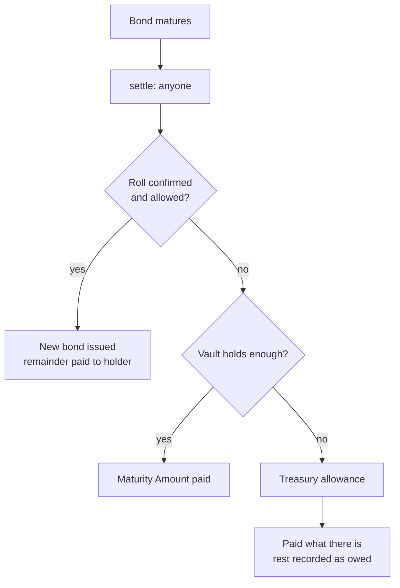

# BurnerBonds

A BurnerBond is a zero-coupon bond: the buyer pays less than face value today, and whoever holds the
bond when it matures is paid face value, its Maturity Amount. Nothing is paid in between. Each bond
is its own token on the chain, with its own number.

The money paid for bonds is held in the bond vault (the `BondVault` contract), not in the
AssurancePool. The contracts' full behaviour is in [Bonds](../protocol/bonds.md), and their
addresses are on the [BurnerBond](../protocol/contracts/BurnerBond.md) and
[BondVault](../protocol/contracts/BondVault.md) contract pages.

## Buying a bond

**A bond is bought on a quote.** The quote names the payer, the holder, the Maturity Amount, the
term and its rate, and the buyer signs it. A purchase happens in one transaction: the price goes
straight to the bond vault, the bond is issued to the holder, and the vault records what it owes. If
any step fails, nothing happens.

**Terms and rates come from the Ladder.** The Ladder lists the terms on offer, from 12 to 36 months
(up to 60 if the Earn timelock allows it), each with its rate. An offered longer term never has a
lower rate than an offered shorter one. A Ladder change takes effect 48 hours after two signers
schedule it, and is published on the chain when scheduled.

A purchase is refused when:

- the quote is more than 15 minutes old, has been used, or does not match the Ladder's rate for its
  term when it was given;
- the price is under $250;
- the payer has no eligibility attestation in force, or the payer's Earn holdings at purchase price
  would exceed 10% of the net worth the attestation records;
- the payer is not the holder's own account, or is one of the co-op's own contracts;
- the term is not on offer, or the purchase would pass the Funding Limit or the offering cap that
  bonds and lending pool subscriptions share;
- purchases are paused: for a Reserve Shortfall in the vault, the Equity Cushion pause, a Collateral
  Agent's Enforcement Notice, or a wind-down;
- the bond series has been closed to new sales by its owner (bonds already sold still settle).

### How the price is set

The price is the Maturity Amount discounted at the term's rate, compounded once a year:

```
price          = Maturity Amount ÷ (1 + rate) ^ (days to maturity ÷ 365)
Accreted Value = the same formula, on any later day; the Maturity Amount from maturity on
```

Days are whole days, a part day counted as a day, and amounts are rounded down to the cent. The
Accreted Value is what a bond is worth today: it rises from the price to the Maturity Amount over
the term.

**What a bondholder receives is fixed when they buy:** the Maturity Amount at maturity, against the
price paid. Nothing the co-op earns on the money changes it.

## Where the proceeds go

**The bond vault keeps back a Redemption Reserve, and only the rest can leave.** The reserve is the
larger of:

- a glide schedule: each outstanding bond's Maturity Amount at a percentage set by how far it is
  from maturity, and never less than a floor across all bonds outstanding (30% at least; the floor
  can only be raised);
- 100% of every bond due within 90 days, except a bond whose holder has confirmed a roll that can go
  ahead.

Maturity payments recorded as owed, and amounts waiting to be claimed from a Collateral Agent
distribution, are added on top.

**The reserve is worked out, not set by hand.** It rises by itself as bonds come closer to maturity.
When the vault holds less than the reserve it is in Reserve Shortfall: new bond purchases and new
lending pool subscriptions stop, and nothing above the reserve can leave, until it is cured. Anyone
can top the vault up.

**What the vault holds above the reserve is its deployable excess.** It leaves only to Clear
Lending's single registered multisig, through the Collateral Agent, proposed and sent by two
different treasury signers, and never while an Enforcement Notice is in force. No contract governs
what Clear Lending does with it once it arrives. The vault lends nothing.

## Payment at maturity

**Once a bond has matured, anyone can settle it.** An unpledged bond whose holder has not confirmed
a roll is paid its Maturity Amount. If the vault holds less, it draws on the treasury, up to the
allowance the treasury has given the vault and no more than the treasury holds. If the two together
still fall short, the bond is paid what there is, and the rest is recorded as owed. What is owed is
kept back ahead of any excess, and anyone can trigger its payment as money arrives.



**A holder cannot exit early.** A holder has no way to redeem before maturity. Bonds move only
between two accounts of the same holder, or to an approved successor, so the contracts provide no
market for them. Two other ways out exist:

- **A buyback.** Someone outside the vault pays the holder a price the holder signs for, no more
  than the bond's Accreted Value, and the bond is retired. It is refused for a pledged bond, during a
  Reserve Shortfall, and while any maturity payment is still owed.
- **A wind-down.** Two signers can set the wind-down flag, which stops purchases at once. Thirty days
  later anyone can start paying every bond its Accreted Value; no bond rolls after that.

## Rolling

**A bond rolls only if its holder confirms it.** At least 20 days before maturity a Roll Notice is
posted for the bond, with its new term, its rate and a Roll Deadline no later than seven days
before maturity. The holder confirms with a signature, and can withdraw the confirmation before the
deadline. Transferring the bond withdraws it.

At maturity a confirmed bond rolls into a new one issued at the old maturity date:

- for the same term, or the nearest shorter term on offer;
- at the notice's rate, or the Ladder's rate for that term if higher;
- with no new cash: the old Maturity Amount buys as large a new bond as it can, to the cent, and
  anything left over is paid to the holder.

A confirmed bond is paid instead of rolled when the holder is flagged ineligible or has no
eligibility attestation in force, no term of that length or shorter is on offer, the new bond would
pass the Funding Limit, or a wind-down has started. If a pledged bond rolls, the pledge moves to the
new bond.

## Bonds as collateral

**A member can pledge a bond against credit.** A pledged bond counts at 95% of its Accreted Value.
Limits and haircuts are in
[Credit → Collateral and the ceiling](../protocol/credit.md#collateral-and-the-ceiling).

- A pledged bond cannot be transferred or bought back. The member signs a maturity instruction when
  pledging it.
- At maturity, a pledged bond that does not roll pays first whatever part of the member's
  asset-backed debt its value was covering, then the rest to the member.
- After a default, or a shortfall left open past its wait, a pledged bond can be paid early at its
  Accreted Value, toward the debt it secures, with the rest going to the member. Nothing seizes a
  bond.

## The Collateral Agent

**Bondholders have a Collateral Agent over the bond vault.** It can issue an Enforcement Notice.
While one is in force, purchases, rolls and every payment out of the vault stop, except the Agent's
own distributions: each bond's amount due is fixed at that moment (its Accreted Value, or its
Maturity Amount if matured), and the vault's money is paid out in rounds in proportion to those
amounts. A bond paid in full this way is retired. Holders of more than half of the bonds by
Accreted Value, not counting the co-op's insiders, sign some of the Agent's decisions themselves.

## Who controls the bonds

- **The bond vault's admin is the Earn timelock.** Every upgrade, role, setting or destination change
  also needs the Collateral Agent's co-signature: two treasury signers propose and confirm it, the
  Agent approves it, and it waits 7 days from the confirmation.
- **The Earn controls** set the Ladder, the Funding Limit, the offering cap and the purchase pauses.
- **Roll Notices** are posted by a signer the Earn controls name.
- **Two wind-down signers** set the wind-down flag.
- **The bond factory's owner** can close a bond series to new sales.

Bond series cannot be upgraded. A change to the contracts a series uses also needs the Collateral
Agent's co-signature, and a new liquidator waits a week before it takes effect. Who holds each
permission is in [Governance → On-chain authority](../governance/on-chain-authority.md).
