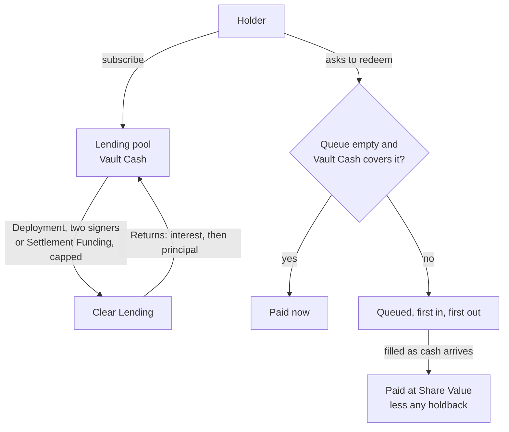

# The lending pool

The lending pool on Earn (the `LendingPool` contract) holds money that holders subscribe, and
deploys it to Clear Lending, the co-op's lending company, to fund members' credit. Clear Lending
pays it back as Returns: interest at the Funding Rate first, then the amount deployed. The pool
holds and pays out a single token: USDC, in the deployed setup.

The pool follows ERC-4626, a common standard for vaults on Ethereum-compatible chains, so standard
wallets and block explorers can read it. Its full behaviour is in
[Settlement and the float](../protocol/settlement.md#lendingpool), and its address is on its
[contract page](../protocol/contracts/LendingPool.md).

## Shares and what they are worth

**A holder receives Pool Shares. Each share is a claim on everything the pool counts as its
assets.** The pool counts its assets (Pool Assets) as:

- its Vault Cash: the USDC it holds, less amounts held back from earlier redemptions and cash
  already owed to others;
- plus its Deployed Balance: what it has deployed to Clear Lending and not had back;
- plus Pool Interest accrued and not yet paid.

The Share Value is Pool Assets divided by the shares outstanding. It rises as Pool Interest accrues
and falls when a loss charge is posted ([Losses](#losses)). USDC sent straight to the pool counts as
Vault Cash and raises the Share Value at once.

## Subscribing

**Every subscription is checked by the Earn controls (the `EarnControls` contract), which the
lending pool and the bonds share.** A subscription is refused when:

- it is under $250;
- the payer has no eligibility attestation in force, signed by an approved attester and valid for
  at most 12 months, or the payer's Earn holdings at purchase price would exceed 10% of the net worth
  that attestation records;
- the payer and the receiving account are not the same holder, or the payer is one of the co-op's
  own contracts;
- it would take the pool past its capacity, the Funding Limit, or the offering cap that bonds and
  subscriptions share;
- the holder's household would hold more than its cap: 10% of the greater of Pool Assets and a
  floor, when set up;
- subscriptions are paused, for a Reserve Shortfall in the bond vault, the Equity Cushion pause, or
  Utilization below 50% for 30 days in a row while that rule is switched on. These pauses stop new
  subscriptions only, never a redemption;
- the pool is suspended, a loss charge is being applied, or the pool has reached its Final Maturity
  Date, 20 years after its first subscription.

The Funding Limit counts outstanding bonds at their Maturity Amount, outstanding Pool Shares at their
Share Value, and Clear Lending's other borrowings as last posted.

Pool Shares move only between two accounts of the same holder, or, when a holder dies, becomes
incapacitated, divorces or goes bankrupt, to the person entitled, once two signers have approved it;
that move is still signed from the holder's own account. Every other transfer is refused.

## What the pool funds

**The pool deploys only to its registered deployment account, Clear Lending's operating Safe.** Two
paths lead there.

**A Deployment** takes two different deployment signers: one proposes it and another sends it. It is
refused unless, at that moment:

- no withdrawal request is waiting in the queue;
- the pool is not suspended and no loss charge is pending;
- Utilization afterwards, the Deployed Balance divided by the Deployed Balance plus Vault Cash, is at
  most 90%;
- the Deployed Balance afterwards is within the Pool Tier principal: the outstanding principal of the
  credit the pool funds, plus what the pool has advanced to the savings-backed settlement margin and
  not had back, as two valuation signers last posted it. Nothing can be deployed before it
  is posted.

The credit the pool funds is the savings-backed, income-based and Boost tiers, and open term plans.
Credit backed by pledged bonds or pool shares is not part of it.

**Settlement Funding** pays for members' card credit just before each card settlement is due. A
single registered settlement funder deploys through a settlement lane, and a forwarder on Clear
Lending's Safe moves exactly that amount on to an off-ramp that pays only the account card purchases
settle from. The lane:

- has the same conditions as a Deployment: no queued request, no suspension or pending loss charge,
  Utilization at most 90% afterwards;
- may take the Deployed Balance above the posted Pool Tier principal by up to the Settlement
  Headroom, to cover credit authorized and not yet settled;
- is capped per period. Two deployment signers set the funder, the cap, the period and the headroom;
  the forwarder's own allowance on Clear Lending's Safe is set by that Safe's owners;
- stops at once on a single call from any deployment signer or compliance signer, and restarts only
  when two deployment signers set it again.

Cash left over after a settlement goes back to the pool as a Return. The settlement lane arrives
with an upgrade of the pool that takes effect only after the Earn timelock's 7-day delay, and it
starts with no funder and no cap.

## How holders are paid

**What raises the Share Value is Pool Interest: interest on the Deployed Balance at the Funding
Rate.** It accrues every second, on a 365-day year. At the end of each month (Pacific time) the
interest accrued is billed, due by the fifth weekday after. Whatever is still unpaid then is added to
the Deployed Balance and accrues interest itself.

Anyone can make a Return. A Return pays accrued interest first, the billed month's first, then the
Deployed Balance; anything above both stays in the pool as cash.

**The Funding Rate rises with Utilization.** It follows a curve with a kink, set by the pool's
admin. A change takes effect 48 hours after it is proposed, or 30 days after for a change that lowers
the rate anywhere, and the rate can be lowered at most once a calendar quarter. The current curve,
and any change waiting, can be read on the chain
([What anyone can read](./on-chain-data.md#the-lending-pool)).

Nothing is weighted by time. Interest raises the value of every share as it accrues, so whoever holds
shares at that moment shares in it.

## Withdrawing

**A holder can redeem on demand only while no request is waiting in the queue, the pool is not
suspended, no loss charge is pending, and Vault Cash covers the whole amount.** The pool's figures
for the most a holder can take out now (`maxRedeem`, `maxWithdraw`) show zero while the queue is
open. Otherwise the holder queues: redeem-or-queue pays what it can now and queues the rest, and a
withdrawal request queues all of it.

- **First in, first out.** Requests are filled strictly in order. Anyone can fill the queue, and a
  request can be filled in part.
- **Queued shares stay shares.** They wait in the pool, keep earning Pool Interest and bear any
  loss charge until filled. Each fill pays the Share Value at the moment of the fill, less any loss
  holdback then in force.
- **Cash goes to the queue first.** While any request waits, the pool makes no new Deployments, and
  on-demand redemptions stop.
- **A holder can cancel** a queued request at any time.
- A payment the token refuses is kept for the payee to claim, so it never blocks the queue.

There is no date by which a queued request is filled. It is filled as Returns and new subscriptions
bring in cash.

Requests queued before the current version of the pool were fixed in USDC when they were made, and
are still paid to their owners.

## Losses

**Losses reach holders through two postings, each made by two valuation signers with evidence.**

- **A loss allowance** sets a holdback percentage. While it is above zero, every redemption and
  queue fill pays the gross amount less that percentage, and records the rest to the holder. When a
  lower allowance is posted, or after 540 days, the held amount is released to the holder.
- **A loss charge** is applied first to the open holdbacks, in proportion, and what they absorb
  moves into Vault Cash. The whole charge then lowers the Deployed Balance, then accrued interest,
  so the Share Value falls for every share outstanding, queued shares included. A charge larger
  than the Deployed Balance and accrued interest together is paid out of the pool's cash to Clear
  Lending.

A recovery, posted the same way, adds back to the Deployed Balance up to the charges not yet
restored. Nothing in the contracts passes a loss to the AssurancePool or any other reserve
([Risks](./risks.md#credit-losses)).

## Suspensions and holds

- **A suspension** stops subscriptions, redemptions, queue fills and Deployments; cancellations go on
  and interest keeps accruing. Two different authorized people start it, for a loss event, a legal
  order, a USDC or network problem, or a pending valuation. It lasts 72 hours (48 for a pending
  valuation), can be renewed by a different signer, and never runs past 30 days in total except
  under a legal order.
- **A legal hold** freezes only the named shares of one holder, for a legal order, until two signers
  release it or the order's stated expiry passes.

## Shares as collateral

**A member can pledge Pool Shares against credit.** Pledged shares count at 70% of their Share
Value. Limits and haircuts are in
[Credit → Collateral and the ceiling](../protocol/credit.md#collateral-and-the-ceiling).

- Pledged shares cannot be transferred, redeemed or queued by the holder. If the record of pledges
  cannot be read, a holder last seen with pledged shares is treated as fully pledged.
- Pledged shares are never seized. After a default, or a shortfall left open past its wait, an
  enforcement request queues only the shares still needed, in the ordinary queue. When it fills, the
  proceeds go to the member's debt, and the rest to the member.

## Who controls the pool

- **The pool's admin is the Earn timelock.** Every upgrade, role grant and admin setting (the
  deployment account, the Earn controls, the rate curve) waits 7 days there before it takes effect.
- **Two deployment signers** make Deployments and set the settlement lane.
- **Two valuation signers** post the Pool Tier principal, loss allowances, loss charges and
  recoveries.
- **Two authorized people** start a suspension or a legal hold.
- **The settlement funder** deploys through the settlement lane, within its cap.
- **The pool-share enforcer** queues pledged shares after a default or shortfall.

Anyone can fill the queue, make a Return, or release holdbacks that are due. Who holds each
permission is in [Governance → On-chain authority](../governance/on-chain-authority.md).
