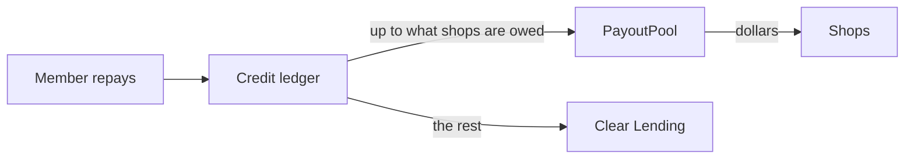

# How the money works

Where each dollar sits, in plain terms. The full account, with the reasons for each choice, is
[the contract build plan](../protocol/clear-contracts-build-plan.md); the pages under
[Protocol](../protocol/README.md) describe the contracts as they are.

## Two kinds of balance, kept apart on purpose

**Your savings are money. Your credit is a record of what you owe.** Clear keeps them in two
different places and never mixes them.

| | What it is | Where it lives |
|---|---|---|
| **Savings** | CLRUSD, one for every dollar of USDC you deposited | Your own account, backed by the USDC held in `ESADepositVault` |
| **Credit** | A running balance: below zero when you owe, above zero when you are owed | `ClearCredit`, the credit ledger |

If they were merged, part of every CLRUSD would be backed by dollars and part by somebody's promise
to pay, and nobody could tell which part was which. Kept apart, every CLRUSD is backed by a dollar.

## Savings

**Every CLRUSD is backed one for one by USDC in the vault.** You deposit USDC and the vault creates
the same amount of CLRUSD for you. You hand CLRUSD back and the vault destroys it and returns the
USDC. Redeeming is the only way USDC leaves the vault: there is no admin withdrawal and no sweep, and
the vault lends nothing.

Savings pay no interest. Nothing in CLRUSD or the vault pays anything to the people who hold it.

**You can save without paying the network's fee yourself.** You sign; a Clear wallet called a
relayer submits the transaction and pays the fee.

**CLRUSD moves only between members.** A transfer must be received by a member's wallet. A wallet
taken off that list can still send and redeem what it holds.

**One limit on taking savings out.** If your savings back your credit line and you have drawn on
them, the CLRUSD contract holds back the part covering what you drew until you pay it back. The rest
of your savings stays free.

**Pauses are short and take two people.** The vault can be paused in an emergency, which stops
deposits and redemptions. Pausing takes two people, a pause lapses after 72 hours unless it is
renewed, and nothing keeps it going past 30 days except a court order or other legal process. While
a pause is in force it never counts against your credit: due dates and grace periods move back by
the time it lasted. Who holds these powers is in [Governance](../governance/on-chain-authority.md).

## Equity credits

Equity credits are a count Clear's server keeps for you, not money and not a token. New credits wait
30 days before they count as yours ("vesting"). They can only go toward your Clear Deed; there is no
way to withdraw them or turn them into cash. The rules for earning them are in
[Parameters and who sets them](../governance/parameters.md).

## Buying at a partner shop

**A purchase paid over time at a partner shop is three entries on the ledger that add up to zero.**
Nobody lends anything at the moment you buy. Say a shop has agreed to a 3% discount and you pay for
$100 over time:

| | On the ledger |
|---|---|
| You | **−100** — you owe $100 |
| The shop | **+97** — the co-op owes the shop $97 |
| Clear Lending | **+3** — the discount: its fee for funding the plan |

No dollars move at that moment. The shop's positive balance is the record of what the co-op owes it,
kept on the chain where the shop can see it. The shop gives up the discount; you never pay it. It is
capped at $50.00 a plan, or $75.00 on a plan over $2,500.00.

## Paying the shop

**Cash is needed only when the shop turns its balance into dollars.** The shop asks to be paid; its
request joins a queue, oldest first, and is due by the end of its payout window (thirty days unless
the shop's terms say otherwise). The `PayoutPool` pays it.

When members have not yet repaid enough to cover what is coming due, **Clear Lending**, which funds
the credit book, tops up the PayoutPool. It does this automatically, well before a payment is due,
and never more in a week than a limit that the owners of its account set on the chain. The co-op's
treasury can also put money in. Whoever puts up the cash takes over the shop's claim and is repaid as
members repay. The lending pool on Earn does not lend to the PayoutPool, and the reserve never pays
shops.

A shop that also owes the co-op is paid down first: money reaching it by transfer clears its own debt
before anything is left to cash out.

## The Clear Visa card

**A Clear Visa card swipe at a shop outside the Clear network needs real dollars, because that shop
is not on the ledger.** The part covered by your own card cash is paid from it. The part on credit is
paid by Clear Lending, through an account with the card provider. The swipe shows straight away in
your app as a hold; it is written to the ledger only once the payment clears, usually one to three
days later, because the amount can still change until then (a tip, a fuel pump, a cancelled sale).

Clear Lending funds that credit with money it draws from the lending pool on Earn. Each draw is
recorded on the chain, and the pool refuses one that would leave more than 90% of it lent out.
Funding each card settlement from the pool automatically, within a cap the pool enforces: Not
available yet.

The purchase step by step: [How a Visa card purchase works](../protocol/visa-card-purchases.md).

## Repaying

Unless you pay a particular split plan, a repayment clears your most expensive balance first. On the
chain, a repayment goes first to the PayoutPool, up to what it needs to pay shops, and anything
beyond that goes to Clear Lending.

## Carry: what credit costs

**Credit has a cost, called carry.** It builds up on what you have drawn, separately for each part of
your line and each split plan. Savings do not earn carry and do not pay it, and drawing on your own
savings carries none.

Carry is paid to the PayoutPool and shared out by who put up the cash behind each shop's payment;
what is left goes to the co-op. The lending pool on Earn is paid separately: Clear Lending pays it
interest on what it has drawn, at the pool's Funding Rate, which rises as more of the pool is lent
out.

## The reserve

**The reserve is the co-op's `AssurancePool`.** It belongs to the co-op and holds USDC in two
compartments that never share a balance:

| Compartment | What it is for |
|---|---|
| **Credit Backstop** | Credit that Clear Lending has written off as lost |
| **Member Assurance** | Members' Assurance grants, such as rent paid for you if you lose your job |

Money comes in only from named payers: the fee Clear Lending pays for the cover, recoveries on
written-off credit, and money the co-op puts in. Recoveries go to the Credit Backstop. Everything
else fills the Credit Backstop up to its floor first, and the rest is split between the two by an
allocation the co-op sets each year.

**The Credit Backstop has a floor**: 5% of the credit it covers. Income-backed credit, Clear Boost
and split plans count in full, asset-backed credit counts only for the part its backing would not
repay, and **debt backed by a member's own savings does not count at all**, because the savings
already cover it. With no unsecured credit live, the floor is zero.

**Nothing else can reach it.** No credit, savings, payout or bond contract holds the pool's address,
so no redemption, payout, refund or liquidation can take money from it. It lends nothing. Every
action takes two different people, and a change to its rules or its code also waits 7 days.

## When someone cannot repay

1. **Falling behind.** On split plans, a missed installment stops new split plans until the member
   is caught up. On the credit line, a cycle that ends with its unsecured balance unpaid halves the
   income-backed and Boost part of the line until a cycle ends at zero. Nothing is taken for a
   missed cycle.
2. **Default.** Once a split-plan payment has stayed unpaid for two further instalment periods,
   anyone can declare the member in default. Their plans close and their split-plan limit goes to
   zero. A credit line defaults only after two missed cycles in a row, a cure notice that two people
   record on the chain, and a grace period that ends with that amount still unpaid. Paying it cancels
   the notice.
3. **Collateral.** Only what was past due can be collected from what the member pledged. Pledged
   bonds are paid early, pledged pool shares are redeemed through the pool's queue and never seized,
   and savings are used only for what was drawn against savings. Anything beyond what is owed goes
   back to the member. Savings that were never drawn against cannot be touched.
4. **Loss.** What is left is written off. Clear Lending bears the loss, and can draw on the Credit
   Backstop for it: one person at the co-op approves each draw and a different one releases it.

## What cannot happen

- Nobody can take USDC out of the savings vault except by redeeming CLRUSD.
- Your savings never cover another member's credit.
- Nothing that handles credit, savings, shop payouts or bonds can take money from the reserve.
- Equity credits cannot be cashed out, by you or by anyone else.
- Savings do not earn interest, and Clear does not promise any return on them.
