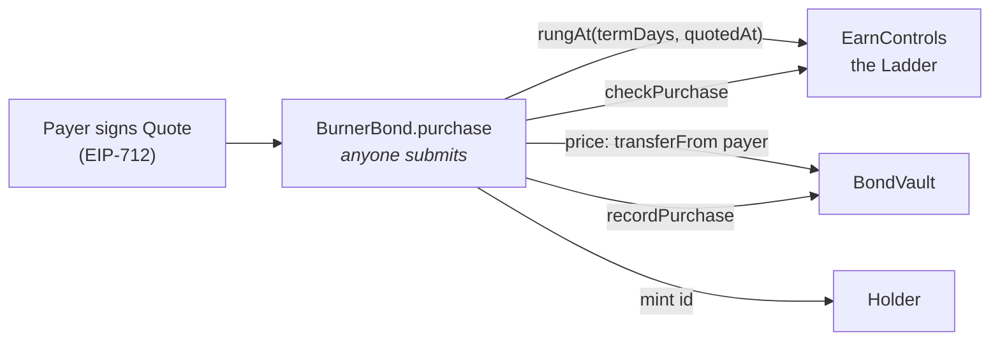
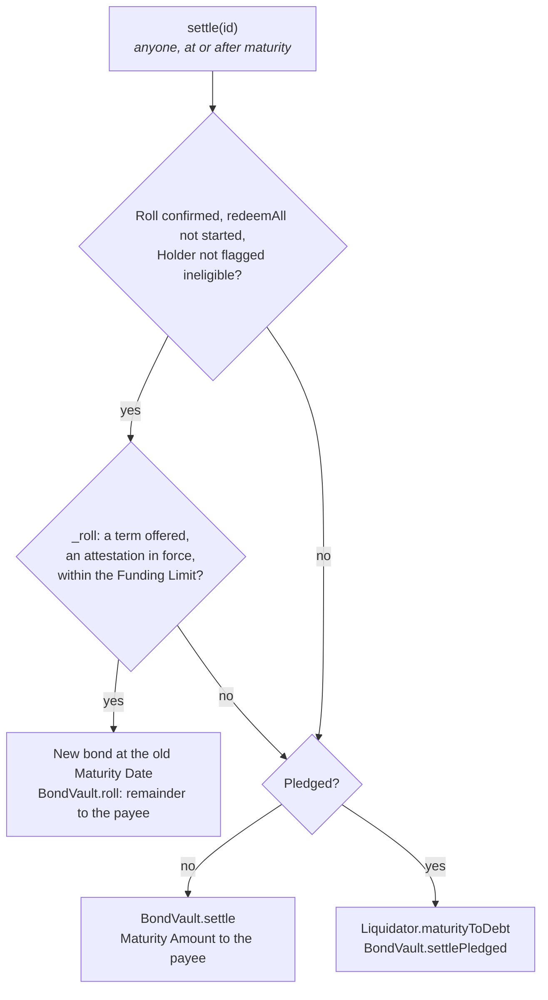
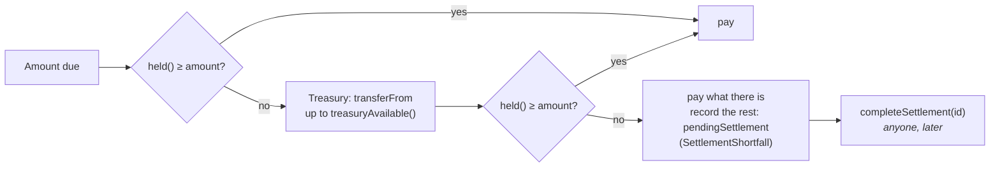

# Bonds

BurnerBonds are zero-coupon bonds: a buyer pays less than the Maturity Amount today and is paid the
Maturity Amount at maturity. Each bond is one ERC-1155 token, quantity one, with its own id. There
is one collection per underlying token, cloned by a factory, and every collection pays out of one
`BondVault`. This page describes the Phase 2f collection: bonds sold on a signed quote at the
Ladder's rate, valued at a compounding Accreted Value, reserved for by a glide schedule, settled at
maturity by anyone, rolled only on the Holder's confirmation, and held under a Collateral Agent.

Deployed addresses are in the root [`README.md`](../../README.md) (**Deployed addresses**). Every
live function and who may call it is on the generated contract pages:
[BurnerBond](./contracts/BurnerBond.md), [BondVault](./contracts/BondVault.md),
[CollateralAgent](./contracts/CollateralAgent.md), [HolderDirections](./contracts/HolderDirections.md),
[EarnControls](./contracts/EarnControls.md).

| Contract | Role |
|---|---|
| `BurnerBondFactory.sol` | Opens a collection per whitelisted token as a clone of a prebuilt implementation, and can deactivate one |
| `BurnerBond.sol` | The collection: storage (`BurnerBondBase`), views, owner settings. Everything else runs in two delegatecall modules it pins |
| `BurnerBondPledges.sol` | Module: `settle` (payment, the pledged split or a confirmed roll), `payPledged`, `buyback`, `redeemUnderWindDown` |
| `BurnerBondIssue.sol` | Module: `purchase` by quote, Roll Notices and confirmations, the wind-down flag and `redeemAll`, `burnPaid` |
| `BondVault.sol` | Where proceeds live: per-bond obligations, the Redemption Reserve, settlement, and the Collateral Agent's hooks |
| `CollateralAgent.sol` | The Agent Role over the vault (IV-10 Exhibit A): Enforcement Notices, distribution rounds, costs, co-signed changes, excess withdrawal |
| `HolderDirections.sol` | Required-Holder Directions, signed by Holders and counted against the bond register |
| `EarnControls.sol` | The shared Earn controls: the Ladder, eligibility, the Funding Limit, the offering cap, purchase pauses, transfers and payees |
| `BondValuer.sol` | Tells `CollateralRegistry` what a member's pledged bonds are worth today |
| `BondTraits.sol` | Shared ERC-7496 display metadata, keyed by collection |
| `Accretion.sol` (library) | Accreted Value, purchase price and roll terms |

## Buying a bond

**A bond is sold on a quote the payer signed, and its price goes straight to the BondVault.**
`purchase(quote, sig, attestation)` takes a `Quote(payer, holder, maturityAmount, termDays,
yieldBps, quotedAt, nonce)` signed under EIP-712 (domain `BurnerBond`, version `2`, the
collection's address), checked with `SignatureChecker` so a Smart Account signs through EIP-1271.
Anyone may submit it; the USDC is pulled from the payer, who must have approved the collection.



1. The collection refuses while the wind-down flag is set or `redeemAll` has started, and while the
   factory has deactivated it (`BurnerBondWindDown`).
2. The quote must be no older than `QUOTE_LIFETIME` (15 minutes, FIXED), unused (`quoteUsed`), and
   its term and rate must equal the Ladder's at `quotedAt` (`EarnControls.rungAt`), offered then
   (`BurnerBondBadQuote`). A Ladder change never alters a quote already given (decision 31).
3. The price is `quotePrice(maturityAmount, termDays, yieldBps)`: the Accreted Value at issue,
   floored to the cent.
4. `EarnControls.checkPurchase` (the collection holds its `BOND_ROLE`) refuses while
   `purchasesPaused()` (a Reserve Shortfall in the vault, the `RESERVE_SHORTFALL` or
   `EQUITY_CUSHION` flag, or an Enforcement Notice), for a refused or ineligible payer, a holder who
   is not the payer's own Holder, a price under `MIN_PURCHASE_DOLLARS` ($250, FIXED), a term not
   offered, or a purchase that would pass the Funding Limit or the offering cap that bonds and
   LendingPool subscriptions share (decision 38). It returns the exemption code of the payer's
   eligibility attestation, which the bond stores; `attestation` records a new one first, or is
   empty to use the one on file.
5. The price moves from the payer to the vault, the bond is minted to the holder, and
   `BondVault.recordPurchase(bondId, principal, faceValue, maturity, yieldBps, termDays)` books the
   obligation, its Series and its place in the register, in the same transaction.

The bond matures `termDays` days after the purchase. Its cost basis (the price) is carried through
rolls and taken off the Holder's Earn total when the bond leaves (`recordBondExit`).

**The Ladder** is EarnControls': terms of 12 to 36 months (60 at most, by the Earn timelock's
`setMaxTermMonths`), counted in days of a 365-day year, each with its rate. A longer offered term
never has a lower rate than a shorter one (`EarnControlsLadderOrder`). Changes are scheduled and
applied 48 hours later (`scheduleRungs`, `applyRungs`). `deploy/23` sets the Ladder from
`deploy/config/earn-controls.json` where a term is not yet offered.

## Accreted Value

**A bond's value compounds at its own rate.** `accretedValue(id)` (also `presentValueOf(id)`, the
name the pledge module's valuer reads) is `Accretion.accretedValue`:

```
Accreted Value = Maturity Amount ÷ (1 + yieldBps / 10,000) ^ (days to maturity ÷ 365)
```

Days to maturity are whole days, a part day counted as a day, so the value is constant within a day
and steps up at each day boundary. It is rounded down. From the Maturity Date on it is the Maturity
Amount, and it is 0 for a bond that has left or never existed. It is what a pledged bond counts for
as collateral, what `payPledged` and `redeemUnderWindDown` pay, the ceiling on a buyback price, and
what a Required-Holder Direction counts.

There is no discount curve: the collection has no `calculateDiscount`, `mintBond`, `redeemBond`,
`rollBond`, `setAutoRollOptOut` or `setRollTerm` (C7, decision 8).

## Where the money lives — BondVault

**The Redemption Reserve is derived, not set.** `BondVault.requiredReserve()` is the larger of:

- `glideReserve()`: each outstanding bond's Maturity Amount at the ratio of its time-to-maturity
  band, never below the floor `minReserveBps`, rounded up. The bands (`setGlideSchedule`, at most
  `MAX_GLIDE_BANDS` = 8, read with `glideSchedule()`) are raise-only: a change may add or raise
  bands, never lower the ratio at any time to maturity (`BondVaultBadGlide`). No deploy script sets
  bands, so the glide reserve is the floor alone. The floor starts at `MIN_RESERVE_FLOOR_BPS`
  (3,000, FIXED) and only `raiseReserveFloor` moves it, upward, to at most 10,000;
- `nearTermReserve()`: 100% of every bond due within `RESERVE_WINDOW` (90 days, FIXED), less
  confirmed rolls that can roll (`faceDueWithin − rollingDueWithin`);

plus `totalSettlementOwed` (maturity payments recorded as owed) and the Collateral Agent's
`unclaimedDistributions()`.

Both near-term figures come from Fenwick trees over daily maturity buckets. A confirmed bond counts
as rolling only while its Holder is not flagged ineligible and a term of its length or shorter is
offered. A withdrawn confirmation, a Holder flagged ineligible (`holderEligibilityChanged`) or a
term change (`termOfferChanged`), each called by EarnControls, moves the reserve in the same
transaction.

**Below the reserve the vault is in Reserve Shortfall** (`inReserveShortfall()`): EarnControls
pauses purchases, buybacks are refused and `deployableExcess()` is 0. Rolls and settlements go on.
`shortfallSince` records when it began; every state-changing call and the permissionless
`pokeReserve()` update it (`ReserveShortfall`, `ReserveShortfallCured`). Anyone may cure it with
`topUp(amount)`.

**`deployableExcess()` is `held() − requiredReserve()`, floored at zero**, where `held()` is the
vault's balance of its single `reserveToken` (USDC). Money leaves the vault only this way:

| Outflow | Caller | Limit |
|---|---|---|
| `settle`, `settlePledged`, `settleAt` | `BOND_ROLE` (the collection) | The bond's Maturity Amount (its Accreted Value under `redeemAll`); what cannot be paid is recorded |
| `settleEarly` | `BOND_ROLE`, for `payPledged` | The bond's Accreted Value, to the pledge module, in full or a revert |
| `roll` | `BOND_ROLE` | The roll's remainder only, to the Holder's payee |
| `completeSettlement(id)` | Anyone | What `pendingSettlement[id]` still owes, debt part first |
| `agentTransfer` | The Collateral Agent | Distributions, the Collateral Deposit Account and capped costs, during an Enforcement Period |
| `agentWithdrawExcess(to, amount)` | The Collateral Agent | `deployableExcess()`, only to the Agent's registered `excessDestination`, never during enforcement |

Payments to a Holder go to `EarnControls.payeeOf(holder)`: a registered payment Successor after its
7 days, otherwise the Holder.

`withdrawDeployable`, `setReserveTerms` and the vault's loans are gone (C1, decision 3).
`lendToPayoutPool(uint256)` survives only as a stub that returns 0 and moves nothing, so
PayoutPool's unchanged draw path skips the vault rather than reverting until its vault leg is
switched off (`PayoutPool.setBondVault(0)`). `repayFromPayoutPool` (the named `payoutPool` only)
still takes back what was lent before Phase 2f, reducing `lentToPayoutPool` and keeping any carry
in the vault; `setBackstops(treasury, 0)` clears the payout pool once `lentToPayoutPool` is 0
(decision 48), and reverts with `BondVaultLoanOutstanding` before.

`coversNearTermMaturities()` reports whether `held()` covers everything due inside 90 days, and
`uncoveredNearTerm()` what of it neither the vault nor `treasuryAvailable()` could pay.

## Redemption

**Once a bond has matured, anyone may settle it.** `settle(id)` (in `BurnerBondPledges`) reverts
before the Maturity Date (`BurnerBondNotSettleable`). A Holder has no redemption of their own and no
early exit: `redeemBond` and batch redemption are gone.



What the vault pays, it covers in this order (`BondVault._coverUpTo`):



The treasury is the Safe, named with `setBackstops(treasury, payoutPool)`. Its contribution is
whatever allowance its owners have given the vault, capped at its balance. Since section 13 the
vault names no AssurancePool and nothing on the bond side can reach one.

**A settlement never waits for funds.** `_settle` pays what the vault and the treasury hold and
records the rest in `pendingSettlement[id]` (holder, debt recipient, debt owed, holder owed) and
`totalSettlementOwed`, which is added to the reserve ahead of any excess. The permissionless
`completeSettlement(id)` pays it as money arrives: the rest of the debt part first (the vault then
calls the Liquidator's `applyMaturityInstruction`), then the Holder's, to the recipients fixed at
settlement. `settleEarly` (for `payPledged`) and a roll's remainder are the exceptions: they pay in
full or revert with `BondVaultInsufficientFunds`.

An unpledged settlement refuses a bond the registry still reports encumbered
(`BondVaultBondPledged`). Every settlement path, `completeSettlement` included, reverts while an
Enforcement Notice is in force (`BondVaultEnforcementInForce`).

## Seniority

**The vault has no path to or from the AssurancePool, the Loss Reserve or the ESA.** It holds no
AssurancePool address (`retiredAssurancePool` is a renamed, unread slot), borrows from nothing and
lends to nothing. Bondholders are creditors of the vault: its USDC is the BurnerBond Collateral,
under the Collateral Agent's first lien (IV-10), and leaves only to a Holder (or, for a pledged
bond, to the Holder's own secured debt: C3, decision 5), through the Agent, or as deployable excess
to the Agent's registered destination.

## Rolling

**A bond rolls only on its Holder's confirmed Roll Notice** (Earn §4A; IV-01 §§5.1–5.5). Nothing
rolls on its own.

1. **Notice.** `postRollNotice(id, noticeHash, rollDeadline, termDays, yieldBps)`, by an
   EarnControls `ROLL_NOTICE_ROLE` holder, once per bond, at least `NOTICE_LEAD` (20 days, FIXED)
   before maturity. `rollDeadline` must be in the future and no later than `latestRollDeadline`:
   the end of the day (Pacific) seven calendar days before the Maturity Date (FIXED). The term must
   be `EarnControls.rollTermFor(term)` now, and the rate at least the Ladder's for it
   (`ladderYieldBps`) and at most `Accretion.MAX_YIELD_BPS`.
2. **Confirmation.** `confirmRoll(id, noticeHash, sig)`, or `confirmRolls` for several bonds, each
   with its own signature. The Holder signs `ConfirmRoll(bondId, noticeHash, rollDeadline, nonce)`
   (`confirmRollDigest(id)`) from the account holding the bond; anyone may submit it, before the
   deadline. `nonce` counts confirmations given or withdrawn, so a withdrawn one cannot be
   replayed. A confirmed bond that can roll leaves the vault's 90-day 100% reserve
   (`setRollConfirmation`, `RollConfirmationSet`).
3. **Withdrawal.** `withdrawRollConfirmation(id)`, the Holder only, before the deadline. A transfer
   withdraws it too. The bond returns to the reserve in the same transaction.
4. **At maturity**, `settle(id)` rolls a confirmed bond unless the Holder is flagged ineligible
   (`holderIneligible`), `redeemAll` has started, no term of the same length or shorter is offered,
   the Holder has no eligibility attestation in force (`eligibleCode`, decision 44), or the larger
   Maturity Amount would pass the Funding Limit. In any of those cases it is paid instead.

**The roll's terms** (`_roll`, IV-01 §5.2): the same term or the nearest shorter one offered
(`rollTermFor`); the notice's rate, or the Ladder's for that term if higher (`rollYieldFor`). The
new Maturity Amount is `Accretion.rollTerms`: the old Maturity Amount divided by the new price per
dollar, rounded down to the cent, and the remainder is paid to the Holder's payee
(`RollRemainderPaid`). No other USDC leaves. The replacement is issued at the old Maturity Date, so
a late `settle` costs the Holder no accretion; it starts with no notice, keeps the cost basis, takes
the exemption code of the attestation in force, and is not counted against the offering cap.
`BondVault.roll` moves the obligation (`Rolled`); the collection emits `BondRolled`.

**A rolled bond keeps its pledge.** If the old bond was pledged, the collection calls
`CollateralRegistry.rollItem(holder, kind, oldId, newId)` in the same transaction, which moves the
pledge, its Maturity Instruction hash and its advance rate to the new id. The collection needs
`ITEM_ROLLER_ROLE` on the registry, which `deploy/23` grants; without it every roll of a pledged
bond reverts.

No roll executes while an Enforcement Notice is in force, even a confirmed one (decision 19).

## Buyback and wind-down

**`buyback(id, price, deadline, sig)`** (Earn §4(a)). Any caller pays `price` from its own funds to
the Holder's payee, on the Holder's EIP-712 signature over `Buyback(bondId, price, deadline)`
(`buybackDigest`). `price` may not exceed the Accreted Value. It is refused for a pledged bond,
after the deadline, during a Reserve Shortfall, while any settlement shortfall is owed
(`totalSettlementOwed() != 0`, decision 43) and during enforcement. The bond burns and
`BondVault.retireUnpaid` drops the obligation; the vault pays nothing (`BondBoughtBack`,
`BondRetired`).

**Wind-down** (Earn §4(c), R5). Two different EarnControls `WIND_DOWN_ROLE` holders make the same
`setWindDown(true, reasonHash)` call (`WindDownProposed`, then `WindDownSet`); purchases stop at
once. The flag can be cleared the same way until `redeemAll` starts. `WIND_DOWN_DELAY` (30 days,
FIXED) after it was set, anyone may call `redeemAll()`, which is irreversible and refused during
enforcement (`RedeemAllStarted`). From then no bond rolls or is sold, and anyone may call
`redeemUnderWindDown(id)`, which pays a bond its Accreted Value through `settleAt`: all to the
payee for an unpledged bond, or split for a pledged one, with `Liquidator.maturityToDebt` asked with
the Accreted Value in place of the Maturity Amount (decision 14). A short vault records the rest as
owed, as at maturity.

## Transfers

**A bond moves only between a Holder's own accounts, or to an approved Successor.**
`_beforeTokenTransfer` refuses a transfer (not a mint or burn) of a pledged bond
(`BurnerBondPledged`), of a bond that has left, or one `EarnControls.transferAllowed(from, to)`
refuses (`BurnerBondTransferNotAllowed`): it allows two Smart Accounts of the same Holder
(`sameHolder`), or the Successor path within 30 days of its approval. `setApprovalForAll` always
reverts (`BurnerBondNoOperators`), so no operator can move a bond. A transfer withdraws any roll
confirmation, because the new holder did not sign it. `holderOf(id)` records who holds each bond.

## Bonds as collateral

**A pledged bond is valued at its Accreted Value today.** `BondValuer.valueOfItems(holder, ids)`
sums `presentValueOf` over the ids the holder still holds; a bond they no longer hold is worth 0.
One valuer is deployed per collection (`deploy/23`).

| Kind | Registered by | Backing | Advance rate (stored per pledge) | Valued by |
|---|---|---|---|---|
| `BOND` | `deploy/20` (`deploy/23` if missing) | `AssetInternal` | 95% (`9_500`) of Accreted Value | `BondValuer`; unit price 0 |
| `POOL_SHARE` | `deploy/20` (`deploy/22` if missing) | `AssetInternal` | 70% (`7_000`) of Pool Share Value | Unit price `1e18` |

**A bond pledge carries a signed Maturity Instruction (Phase 2e, section 9).**
`CollateralRegistry.pledgeItem(member, kind, itemId, maturityInstruction, deadline, signature)`
(`OPERATOR_ROLE`) takes the member's EIP-712 signature over `PledgeItem(member, kind, itemId,
maturityInstruction, nonce, deadline)`; a zero `maturityInstruction` reverts
`CollateralRegistryNoMaturityInstruction`. The registry stores the instruction's hash
(`maturityInstructionOf`) and the kind's advance rate at that moment (`itemAdvanceBpsOf`); a later
`setCollateralTerms` reaches new pledges, not this one. A roll moves both to the replacement.

**A pledged bond stays put.** `setSources` names the registry as the collection's
`encumbranceSource` with kind `BOND`, and `_beforeTokenTransfer` refuses to move a bond while
`isItemPledged` is true, whether or not anything is drawn. Burns are allowed: they are the exits. A
pledged bond leaves only by `settle` (the split or a roll), `payPledged`, `redeemUnderWindDown` or
the Collateral Agent's distributions, or is released first (`releaseItem`, once nothing is drawn
under the kind). It cannot be bought back. Limits are in [Credit](./credit.md).

**`payPledged(id)`: the pledge payment term (IV-01 §4.9, founder answer G).** Anyone may call it. It
pays only a pledged bond, only when the collection's `liquidator` (the `Liquidator`, the pledge
module's enforcement side) reports through `pledgePaymentDue(holder, id)` that MB-05 permits
enforcement against it — a Defaulted Amount recorded on chain with a trusted issuer that the pool
shares already queued for enforcement will not pay (bonds come before pool shares on a default), or a
Shortfall noticed at least `shortfallWait` (72 hours or more, longer by paused time) ago that all the
member's pledged pool shares could not end (pool shares come first on a Shortfall) — that no
Liquidation Hold or pause is in force, and that this is the bond next in MB-05 §7.1's order: the
first still pledged in the member's own order (`CollateralRegistry.setEnforcementOrder`, signed
before any notice), else the one nearest maturity (Phase 2f, decision 20). The bond is paid its
`accretedValue(id)` in that block, in full, through `BondVault.settleEarly` to the Liquidator, which
applies it (`applyPledgePayment`): on a default only to Defaulted Amounts (decision 22) — the line's
past-due Secured Minimum on `BOND` then `POOL_SHARE`, then the member's defaulted secured plans
oldest first, then the unpaid Rebalance Amount on `BOOST` then `INCOME`, never `SAVINGS`; on a
Shortfall to the asset-backed tiers until it ends (decision 21). The surplus goes to the holder. The
pledge is released (`releaseRetiredItem`) and the bond burns. It emits `PledgePaid(id, holder,
amount, toDebt, toHolder)`. There is no `seizeBond` or `redeemEarly`, and the Liquidator takes no
bond. Not while an Enforcement Notice is in force (C3, decision 5).

**`settle(id)` on a pledged bond: the Maturity Instruction split (MB-05 §5.6).** A matured pledged
bond that does not roll is split: `toDebt = min(face, max(0, drawn − limitWithout))`
(`Liquidator.maturityToDebt`), where `drawn` is the holder's Asset-Backed Drawn (the `BOND` and
`POOL_SHARE` tiers with the Liquidator's trusted issuers) and `limitWithout` their Asset-Backed
Limit without this bond (their other pledged bonds and their pool shares, each at the higher of its
stored and current advance rate; MB-05 §§1.3, 5.3, 5.6). `BondVault.settlePledged` pays `toDebt` to
the Liquidator first, which applies it to the `BOND`, then the `POOL_SHARE`, tier as the holder's
own instruction (`applyMaturityInstruction`; no Liquidation Hold stops it), then the rest to the
holder's payee. What the vault and the treasury cannot pay is recorded and paid by
`completeSettlement`, as for any settlement. The pledge releases and the bond burns;
`PledgedMaturitySplit(id, toDebt, toHolder)`.

## The Collateral Agent

**The Agent Role over the vault is a contract** (`CollateralAgent`, IV-10 Exhibit A; Phase 2f,
decisions 18 and 19). It holds the Enforcement Notice, the distribution rounds, the cost cap, the
change co-signatures, the Agent Key and Clear Lending's treasury role, and is the only thing the
vault lets move USDC outside settlement.

**The Agent Key** (an address, not a role) has seven powers: `enforce`, `releaseEnforcement`,
`postDistribution`, `toCollateralAccount`, `postCostStatement` with `withdrawCosts`,
`approveChange` and `rotateAgentKey` (effective after `ROTATION_DELAY`, 48 hours). It cannot pay
anyone but a Holder through a round, the Collateral Deposit Account or the cost address within the
cap, cannot withdraw excess, and cannot change a setting alone.

**Enforcement.** `enforce(reasonCode, noticeHash)` records an Enforcement Notice. While it is in
force (`enforcementInForce()`), every vault outflow but the Agent's own reverts, and so do
purchases and rolls. Then:

1. `snapshotBonds(maxCount)` (anyone, batched) fixes each outstanding bond's amount due at the
   enforcement time: its Accreted Value then (`BondVault.amountDueAt`), or its Maturity Amount if
   matured, less what earlier periods paid or still owe it.
2. `postDistribution(amount, roundId)` (the Agent Key) posts a round. The Agent sets only the total;
   each bond's share is its amount due over the total due.
3. `claimDistribution(id)` (anyone) pays a bond its share of every posted round to the Holder's
   payee. A pledged bond's share goes first to the pledge module (`routeDistribution`;
   `Liquidator.applyDistribution`), up to the Holder's Defaulted Amounts, only while
   `enforcementPermitted` (decision 19). A bond paid in full is burned through
   `BondVault.burnPaid`, which releases any pledge (`BondPaidThroughDistributions`).

Enforcement costs go to the registered cost address only, at least `STATEMENT_WAIT` (7 days) after
an on-chain cost statement, within the cap: the greater of $50,000 and 2% of the vault's assets at
the start of the Enforcement Period, plus what the Required Holders approve. `releaseEnforcement`
withdraws the notice; posted rounds stay claimable.

**Clear Lending's treasury role** (`TREASURY_ROLE` on the Agent) can only withdraw deployable excess
to the registered `excessDestination` (`proposeExcessWithdrawal`, then `executeExcessWithdrawal` by
a different signer, never during enforcement, keeping unclaimed distributions in the vault), propose
and confirm changes, and propose replacements of the Agent Key or the Collateral Deposit Account
(approved by a second signer, executed by anyone 7 days later unless the Required Holders block it).

**Changes are co-signed.** Once the Agent is named on the vault (`setEarnSources`) or a collection
(`setSources`), every upgrade, role grant or revocation, setting and destination change there also
needs a treasury proposal (`proposeChange`), a second treasury signer's confirmation
(`confirmChange`), the Agent's `approveChange` and `CHANGE_DELAY` (7 days) from the confirmation.
The changed contract calls `consumeChange(keccak256(msg.data))`, so the co-signature covers the
exact call. Naming the Agent for the first time is the admin's alone.

## Required-Holder Directions

**Required Holders** (IV-01 §1) hold more than 50% (`REQUIRED_BPS`) of the aggregate Accreted Value
of the bonds outstanding at the record time, not counting bonds held by accounts with EarnControls
`EXCLUDED_HOLDER_ROLE` (Clear's insiders, granted by resolution through the Earn timelock).
`HolderDirections` counts their Directions on chain (decision 30); the CollateralAgent's
`recordCostApproval` and `recordHolderBlock` accept only this contract:

1. `open(kind, subject, directionHash)` (anyone) opens a cost approval (`COST_APPROVAL`, during an
   Enforcement Period) or a block on a pending replacement (`BLOCK_REPLACEMENT`). The record time is
   the time of opening.
2. `sign(id, holder, bondIds, sig)` adds each bond's Accreted Value at the record time, on the
   Holder's EIP-712 `Direction(directionId, bondIds)` (domain `HolderDirections`, version `1`). A
   bond counts once, must have been outstanding at the record time and must still be held by the
   signer.
3. `tally(id, maxCount)` (anyone, batched) sums the total over the vault's register
   (`registerLength`, `registerAt`, `registerEntry`).
4. `execute(id)` records the Direction on the Agent once the signed value exceeds half the total. A
   cost approval raises the cap 7 days after it is recorded.

`HolderDirections` has no admin, no setter and no upgrade.

## Collections

`createCollection` is open to the factory's owner and to the factory's deposit contract only
(audit X-19), one collection per token, and refuses a token the `TokenRegistry` does not
whitelist. Each collection is a clone of `bondImplementation`, a prebuilt BurnerBond whose pinned
`BurnerBondPledges` module must report `BurnerBondPledges.v2` (the factory's constructor checks it).
The clone is initialised with the factory, the token, its name and symbol, the shared `bondTraits`
store and the IV-01 §4.12 legend (`legendHash`, `legendURI`, carried in `contractURI()`), and
ownership passes to the factory owner. `deactivateCollection` / `reactivateCollection` flip
`isActive`: a deactivated collection sells nothing, and its bonds still settle.

The modules are chained through fallbacks: `BurnerBond` → `BurnerBondPledges` → `BurnerBondIssue`,
each pinned in the constructor of the one before and checked by `extensionKind()`
(`BurnerBondPledges.v2`, `BurnerBondIssue.v1`). `deploy/bondModules.ts` builds them and gives the
joined ABI (`bondAt`, `bondAbi`).

A collection settles nothing until its owner calls `setSources(vault, encumbrance, kind, controls,
agent)` (the vault must use the same token) and the vault grants it `BOND_ROLE`, and it sells
nothing until EarnControls grants it `BOND_ROLE`, which `deploy/23` does.

**A replacement collection shares the vault without sharing ids.** `BondVault` and
`CollateralRegistry` key a bond by its id alone, so a collection built to replace another calls
`setFirstBondId` (owner, before its first sale) to start above every id the old one issued.
`REPLACE_BOND_FACTORY=1` on `deploy/22` keeps the old records as `*Pre2f` and deploys the new
factory, and `FIRST_BOND_ID` on `deploy/23` sets the new collection's first id (it refuses to go on
without one while an older collection is on record). Decision 48 (b): `deploy/23` revokes every
BondVault role a retired collection or deposit contract still holds. Pre-2f collections cannot
record into, or settle through, the upgraded vault.

## Traits

`BondTraits` stores display metadata keyed by `msg.sender`, so a collection writes only its own
bonds' traits. The Phase 2f collection writes none on mint, transfer or redemption; the owner's
`setBondTrait` remains, and the getters read the store. A bond's data is in `getBondInfo(id)`
(Maturity Amount, price, cost basis, amount paid, issue and maturity dates, term, rate, whether it
has left, exemption code), `rollNotice(id)` and the events.

## Unreachable paths

- **`BurnerBondDeposit`.** The factory still clones and registers one, but its `makeDeposit` calls
  `mintBond` and `getDiscountForMaturity`, which the Phase 2f collection does not have, and the
  vault's old four-argument `recordPurchase`, so it always reverts. `processDeposit`,
  `batchProcessDeposits` and `refundDeposit` act only on an unprocessed deposit, of which there are
  none.
- **The factory's pricing parameters** (`maxDiscount`, `minDiscount`, `maxMaturity`, `minMaturity`,
  `minFaceValue`, `maxFaceValue` and their setters) are read only by `BurnerBondDeposit`. Terms and
  the minimum purchase are EarnControls'.
- **`BondDiscountCurve`** is no longer used by any collection or deploy script.
- **`BondVault.lendToPayoutPool`** returns 0. `OPERATOR_ROLE` and `TREASURY_ROLE` on the vault gate
  nothing; they remain so existing grants still read.

## Authority

| Contract | Gate | Held by | Functions |
|---|---|---|---|
| `BurnerBondFactory` | `onlyOwner` | Deployer, then the Earn timelock (`earn_timelock_handover.ts`) | `createCollection`, `deactivateCollection`, `reactivateCollection`, `setTokenRegistry`, `setBaseURI`, the unread pricing parameters, `emergencyRecover` |
| `BurnerBond` | `onlyOwner` | Factory owner, then the Earn timelock; co-signed once the Agent is named | `setSources`, `setLiquidator` and `executeLiquidatorChange` (7-day delay once bonds exist, audit M-6, not co-signed), `setFirstBondId` (before the first sale), `setBondTrait`, `setURI`, `emergencyRecover` (not the underlying) |
| `BurnerBond` | EarnControls `ROLL_NOTICE_ROLE` | Granted by resolution | `postRollNotice` |
| `BurnerBond` | Two EarnControls `WIND_DOWN_ROLE` holders | Granted by resolution | `setWindDown` |
| `BurnerBond` | The Holder | — | `withdrawRollConfirmation`; signatures for `confirmRoll(s)` and `buyback` |
| `BurnerBond` | Anyone | — | `purchase` (on the payer's signed quote), `confirmRoll(s)` (on the Holder's signature), `settle`, `payPledged`, `buyback` (on the Holder's signature), `redeemAll` (30 days after the flag), `redeemUnderWindDown` |
| `BondVault` | `DEFAULT_ADMIN_ROLE` | The Earn timelock; co-signed once the Agent is named | Roles, UUPS upgrades, `setBackstops`, `setEncumbranceSource`, `setEarnSources`, `raiseReserveFloor`, `setGlideSchedule` |
| `BondVault` | `BOND_ROLE` | Each collection | `recordPurchase`, `settle`, `settlePledged`, `settleAt`, `settleEarly`, `roll`, `retireUnpaid`, `setRollConfirmation` |
| `BondVault` | The Collateral Agent | — | `agentTransfer`, `agentWithdrawExcess`, `burnPaid` |
| `BondVault` | EarnControls | — | `holderEligibilityChanged`, `termOfferChanged` |
| `BondVault` | The named `payoutPool` | — | `repayFromPayoutPool` |
| `BondVault` | Anyone | — | `completeSettlement`, `pokeReserve`, `topUp` |
| `CollateralAgent` | The Agent Key | — | `enforce`, `releaseEnforcement`, `postDistribution`, `toCollateralAccount`, `postCostStatement`, `withdrawCosts`, `approveChange`, `rotateAgentKey` |
| `CollateralAgent` | `TREASURY_ROLE` | Clear Lending's signers | Excess withdrawal, changes, replacements |
| `CollateralAgent` | `DEFAULT_ADMIN_ROLE`, co-signed | The Earn timelock | `setVault`, `setBondBook`, `setPledgeModule`, `setPayeeSource`, `setHolderDirections`, `setCostAddress`, `setExcessDestination`, roles, upgrades |
| `CollateralAgent` | `HolderDirections` | — | `recordCostApproval`, `recordHolderBlock` |
| `CollateralRegistry` | `ITEM_ROLLER_ROLE` | Each bond collection (`deploy/23`) | `rollItem`, `releaseRetiredItem` |

`BondVault` and `CollateralAgent` are UUPS proxies; the vault's Phase 2f fields come from its
storage gap, and `reserveWindow`, `assurancePool` and `owedToReserve` are renamed, unread slots.
`BurnerBond` collections are clones, not upgradeable proxies, so a collection keeps the modules its
implementation pinned. `HolderDirections`, `BondValuer` and `BondTraits` are plain deployments.
