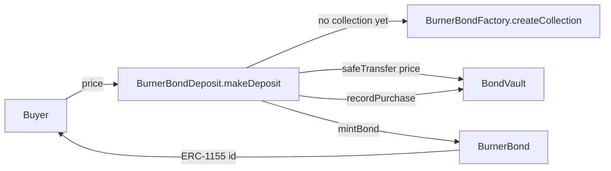
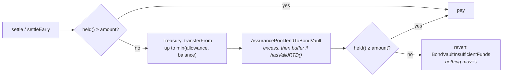

# Bonds

BurnerBonds are zero-coupon bonds: a buyer pays less than face value today and is paid face value at
maturity. Each bond is one ERC-1155 token with its own id. There is one collection per underlying
token, made by a factory, and every collection pays out of one `BondVault`.

Deployed addresses are in the root [`README.md`](../../README.md) (**Deployed addresses**).

| Contract | Role |
|---|---|
| `BurnerBondFactory.sol` | Opens a collection per whitelisted token as a clone, and holds the global parameters every collection reads |
| `BurnerBondDeposit.sol` | The one entry point for buying: takes the price, sends it to the vault, mints, books the obligation |
| `BurnerBond.sol` | The collection. Mints, redeems, rolls, values a bond today, and refuses to move a pledged one |
| `BondVault.sol` | Where proceeds live. Per-bond obligations, a derived redemption reserve, and the backstops behind it |
| `BondDiscountCurve.sol` | Shared pricing policy: discount as a function of term |
| `BondValuer.sol` | Tells `CollateralRegistry` what a member's pledged bonds are worth today |
| `BondTraits.sol` | Shared ERC-7496 display metadata, keyed by collection |

## Buying a bond

**Proceeds go to the BondVault, never to the AssurancePool.** `BurnerBondDeposit.makeDeposit(token,
faceValue, maturityDate, discountPercentage)` does everything in one transaction:



1. The token must be `BondVault`'s `reserveToken` (`"Not the vault's reserve token"`): the vault holds
   and pays out in that one token, so proceeds in anything else would sit there uncounted. If it has
   no collection yet, `_createCollectionViaFactory` opens one; the factory refuses a token
   `AssuranceOracle.isTokenWhitelisted` does not accept. A collection the factory has deactivated
   refuses the sale (`"Collection inactive"`).
2. Face value must sit within the factory's bounds and maturity within `maxMaturity`.
3. The price is `calculateRequiredDeposit`: face less `face × discount / 10000`, the discount read
   from the curve for the time to maturity.
4. The price moves from the buyer to the deposit contract and straight on to `BondVault`. The call
   reverts with `"Bond vault not set"` if there is none.
5. `BurnerBond.mintBond` (only the deposit contract may call it) re-checks the bounds and mints the
   next id to the buyer — from 1, or from wherever `setFirstBondId` started the collection. `BondVault.recordPurchase` books principal, face and maturity in the same call.

`discountPercentage` must not exceed the curve's discount for that maturity. It is stored on the bond
and its traits, but the price charged is the curve's, whatever was passed.

| Factory parameter | Default | Setter and bounds |
|---|---|---|
| `maxDiscount` / `minDiscount` | 5,000 / 0 bps | `updateGlobalParameters`: max ≤ 5,000, min < max; `setMinDiscount` |
| `maxMaturity` | 30 years | `updateGlobalParameters`: ≥ `minMaturity`, ≤ 50 years |
| `minMaturity` | 1 day | `updateMinMaturity`: ≥ 60 s, ≤ `maxMaturity` |
| `minFaceValue` / `maxFaceValue` | 100e6 / 1,000,000e6 raw units | `updateFaceValueLimits`: min > 0, max > min, max ≤ 10,000,000e6 |

`deploy/23` sets the curve bounds to 3,200 bps over five years (`BOND_MAX_DISCOUNT`,
`BOND_MAX_MATURITY`). Face-value bounds are raw token units, so they read as dollars only for a
six-decimal token.

All setters are `onlyOwner` on the factory, and every collection reads them from there. The
collection and the deposit contract have no setters of their own for these.

## The discount curve

`BondDiscountCurve.discountFor` returns 0 below `minMaturity`, caps the term at `maxMaturity`, and
reads the calling collection's curve (`curveOf`, LINEAR at 10,000 until configured). For LINEAR:

```
discount = minDiscount + (term / maxMaturity) × (maxDiscount − minDiscount)
```

With `deploy/23`'s bounds a bond maturing 365 days out is priced at a 640 bps discount.

`BurnerBond.setDiscountCurve(curveType, parameter)` (collection owner) sets the shape; the bounds it
is drawn between are the factory's, and its `DiscountCurveUpdated` event reports them. The parameter
is on a 10,000 scale (10,000 = 1.0), which `setCurve` validates and `discountFor` converts to 1e18
before the maths. With `t = term / maxMaturity`:

| Curve | Parameter | Discount, as a share of the range |
|---|---|---|
| LINEAR | 10,000 | `t` |
| BONDING | steepness `s`, 10,000–50,000 | `1 − (1 − t)^s`, fractional `s` as given |
| LOGARITHMIC | base `b`, 15,000–100,000 | `log_b(1 + t(b − 1))` |

Powers and logarithms use fixed-point `log2` and `exp2`. Every shape runs from `minDiscount` at
`minMaturity` to `maxDiscount` at `maxMaturity`. CUSTOM reverts. No deploy script configures a
curve, so collections run LINEAR.

## Where the money lives — BondVault

**The redemption reserve is derived, not set.** `BondVault.requiredReserve()` is the larger of:

- `faceDueWithin(reserveWindow)` — face value of every outstanding bond maturing inside the window;
- `totalFaceOutstanding × minReserveBps / 10000` — a floor across everything outstanding.

It rises by itself as maturities come into the window. `deploy/22` initialises the window at 90 days;
`minReserveBps` starts at 3,000. `setReserveTerms` (`OPERATOR_ROLE`) can change both, with the floor
bounded to `MIN_RESERVE_FLOOR_BPS = 2,000` … `MAX_RESERVE_FLOOR_BPS = 10,000`. The window is not
bounded: any `uint64` is accepted, zero included.

`deployableExcess()` is `held() − (requiredReserve() + owedToReserve)`, floored at zero. It is the
only money that leaves the vault other than to a bondholder:

| Outflow | Caller | Limit |
|---|---|---|
| `settle`, `settleEarly` | `BOND_ROLE` (the collection) | The bond's face, or its present value |
| `withdrawDeployable(amount, to)` | `TREASURY_ROLE` | `deployableExcess()`, after `_repayReserve()`; reverts `BondVaultWouldBreachReserve` |
| `lendToPayoutPool(amount)` | The named `payoutPool` | `deployableExcess()` |
| `_repayReserve` | Internal / `repayReserve()` | `held() − requiredReserve()`, up to `owedToReserve` |

`held()` is the vault's balance of its single `reserveToken`, and `settle` pays face in that token.
That is why `makeDeposit` sells only in it.

`coversNearTermMaturities()` reports whether `held()` covers everything due inside the window — a
timing test, not an aggregate one.

## Redemption

`redeemBond(id)` and `batchRedeemBonds(ids)` (at most 50) run the same `_redeem`: the caller must
hold the bond, it must be mature (`block.timestamp >= maturityDate`) and not yet redeemed. It is
marked redeemed, burned, and `BondVault.settle(id, holder)` pays face value. A bond is transferable,
so whoever holds it at maturity is paid.

**A bond the vault cannot pay alone draws on the treasury, then the reserve.** `BondVault._cover`:



The treasury is the Safe, named with `setBackstops(treasury, payoutPool)` (`OPERATOR_ROLE`). The
vault names no AssurancePool: since section 13 nothing on the bond side can reach it. Its
contribution is whatever allowance the Safe's owners have given the vault, and it is not repaid as a
loan: it comes back as deployable excess.

What the AssurancePool lends is recorded in `owedToReserve`. It comes off `deployableExcess()`, so
the Safe cannot take it, and it is repaid from anything above `requiredReserve()` —
`withdrawDeployable` repays first, and `repayReserve()` is permissionless. The pool's side of the loan
— excess then buffer, never primary, repaid buffer-first — is in [The Reserve](./reserve.md).

The pool measures the gap it backs. `BondVault.uncoveredNearTerm()` is face due inside the window
less `held() + treasuryAvailable()`, and `AssurancePool.bondExposure()` adds it to the RTD
denominator.

## Seniority

The vault calls the AssurancePool only to borrow (`lendToBondVault`) and to repay what it borrowed
(`repayFromBondVault`, through `_repayReserve`). The pool has no function that pulls from the vault. Redemption goes
`BurnerBond → BondVault.settle` and does not call the AssurancePool unless the vault and the treasury
are short.

The vault lends to the PayoutPool from `deployableExcess()` only, never from the redemption reserve.
`repayFromPayoutPool` reduces `lentToPayoutPool` by the principal part and keeps any carry in the
vault, where it adds to `held()`. Money out with the PayoutPool is not in `held()` while it is out,
and `requiredReserve()` does not wait for it.

## Rolling

`rollBond(id)` replaces a mature bond with a new one instead of paying it. The caller must hold the
bond, must not be the `liquidator`, and the bond must not be opted out (`setAutoRollOptOut`, holder
only). The new bond matures at `now + rollTerm` (365 days by default; `setRollTerm` within the
factory's maturity bounds). Its face is `oldFace × 10000 / (10000 − discount)`, its recorded purchase
price is the old face, and `BondVault.roll` moves the obligation with no cash.

Nothing rolls on its own. `willAutoRoll` is a flag that `rollBond` checks; `redeemBond` ignores it.
**A rolled bond keeps its pledge.** If the collection has an encumbrance source, `rollBond` calls
`CollateralRegistry.rollItem(holder, kind, oldId, newId)`, which moves a pledge on the old id to the
new one and refreshes the holder's limit; it does nothing for a bond that was not pledged. The
collection needs `ITEM_ROLLER_ROLE` on the registry for this, which `deploy/23` grants — without it
every roll of that collection reverts.

## Bonds as collateral

**A pledged bond is valued at what it is worth today.** `BurnerBond.presentValueOf(id)` accretes
straight-line from the purchase price at `issuedAt` to face at maturity, returns face from maturity
on, and 0 for a redeemed or unknown id. `BondValuer.valueOfItems(holder, ids)` sums it over the ids
the holder still holds; a bond they no longer hold is worth 0. One valuer is deployed per collection.

| Kind | Registered by | Backing | Counted at | Valued by |
|---|---|---|---|---|
| `BOND` | `deploy/23` | `AssetInternal` | 95% (`9_500`) | `BondValuer`; unit price 0 |
| `POOL_SHARE` | `deploy/22` | `AssetInternal` | 70% (`7_000`) | Unit price `1e18` |

`CollateralRegistry.pledgeItem` (`OPERATOR_ROLE`) records a bond id against a member.
`deploy/23` sets the collection's `encumbranceSource` to the registry with kind `BOND`, so
`_beforeTokenTransfer` refuses to move a bond while `isItemEncumbered` is true — pledged and with
credit drawn under the kind. Burns are exempt, and so is a transfer the liquidator operates.
**Redemption is stopped at the vault instead:** `BondVault.settle` asks its `encumbranceSource` (the
registry, set by `deploy/23`) and reverts `BondVaultBondPledged` for a bond still backing drawn
credit, so the burn unwinds with it. Rolling is not affected — the pledge moves to the new bond. The
member app shows such a bond's Redeem as unavailable and offers to roll it. Limits and haircuts are
in [Credit](./credit.md).

`seizeBond(id, from, to)` and `redeemEarly(id)` are restricted to `liquidator` (`setLiquidator`,
collection owner), and `redeemEarly` requires the liquidator to hold the bond. It pays
`presentValueOf` through `BondVault.settleEarly`, which retires the full face value and keeps the
difference in the vault. No deploy script sets a liquidator, and the `Liquidator`
contract does not call either function.

## Collections

`createCollection` is permissionless for an oracle-whitelisted token and allows one collection per
token. Each is a clone of `bondImplementation` initialised with the shared deposit contract,
`bondTraits` and `bondDiscountCurve`; ownership passes to the factory owner. The deposit contract is
itself a clone, created and handed to the deployer in the factory's constructor.
`deactivateCollection` / `reactivateCollection` flip `isActive`, which `hasCollection` and
`getActiveCollections` report and `makeDeposit` enforces.

**A replacement collection shares the vault without sharing ids.** `BondVault` and
`CollateralRegistry` key a bond by its id alone, so a collection built to replace another calls
`setFirstBondId` (owner, before its first sale) to start above every id the old one issued.
`scripts/redeploy_bonds.ts` replaced the Base Sepolia factory and USDC collection this way on
3 Nov 2026, with ids from 1001; the old ones sell nothing, and every bond they
issued has been redeemed.

A new collection redeems nothing until its owner calls `setBondVault` and the vault grants
`BOND_ROLE` to both the collection and the deposit contract, which `deploy/23` does.

## Traits

`BondTraits` stores display metadata keyed by `msg.sender`, so a collection writes only its own
bonds' traits. `mintBond` writes eight: `faceValue`, `maturityDate`, `discountPercentage`,
`purchasePrice`, `creator`, `currentHolder`, `isRedeemed`, `createdAt`. A transfer updates
`currentHolder`; `_redeem` sets `isRedeemed` and `redeemedAt`. `redeemEarly` and `rollBond` write no
traits. `getBondType(maturityDate)` is a view on the remaining term: up to 180 days short-term, up to
540 mid-term, otherwise long-term. Owner functions add, change and remove traits.

## Unreachable paths

`processDeposit`, `batchProcessDeposits` and `refundDeposit` act only on an unprocessed deposit.
`makeDeposit` marks every deposit processed in the transaction that creates it and nothing adds to
`pendingDeposits`, so they always revert. `_processDepositInternal` would deposit into the
AssurancePool's excess reserve. `BurnerBond.assurancePool` and `BurnerBondDeposit.assurancePool` are
stored and settable but no redemption or purchase path reads them.

## Authority

| Contract | Gate | Held at deploy by | Functions |
|---|---|---|---|
| `BurnerBondFactory` | `onlyOwner` | Deployer | Parameters, `deactivateCollection`, `setAssurancePool`, `setAssuranceOracle`, `setBaseURI`, `emergencyRecover` |
| `BurnerBond` | `onlyOwner` | Factory owner | `setBondVault`, `setLiquidator`, `setEncumbranceSource`, `setRollTerm`, `setDiscountCurve`, `setFirstBondId` (before the first sale), traits, `setURI`, `emergencyRecover` (not the underlying) |
| `BurnerBond` | `liquidator` | Unset | `seizeBond`, `redeemEarly` |
| `BurnerBondDeposit` | `onlyOwner` | Deployer | `setBondVault`, `setFactory`, `emergencyRecover` (not a collection token) |
| `BondVault` | `DEFAULT_ADMIN_ROLE` | `initialize` admin | Roles, UUPS upgrades |
| `BondVault` | `OPERATOR_ROLE` | `initialize` admin | `setBackstops`, `setReserveTerms`, `setEncumbranceSource` |
| `BondVault` | `BOND_ROLE` | Collection, deposit contract | `recordPurchase`, `settle`, `settleEarly`, `roll` |
| `BondVault` | `TREASURY_ROLE` | Granted by the admin | `withdrawDeployable` |
| `CollateralRegistry` | `ITEM_ROLLER_ROLE` | Each bond collection (`deploy/23`) | `rollItem` |

`BondVault` is a UUPS proxy; its fields added after deployment come from its storage gap.
`BurnerBond` and `BurnerBondDeposit` are clones, not upgradeable proxies. `BondValuer`, `BondTraits`
and `BondDiscountCurve` are plain deployments.
