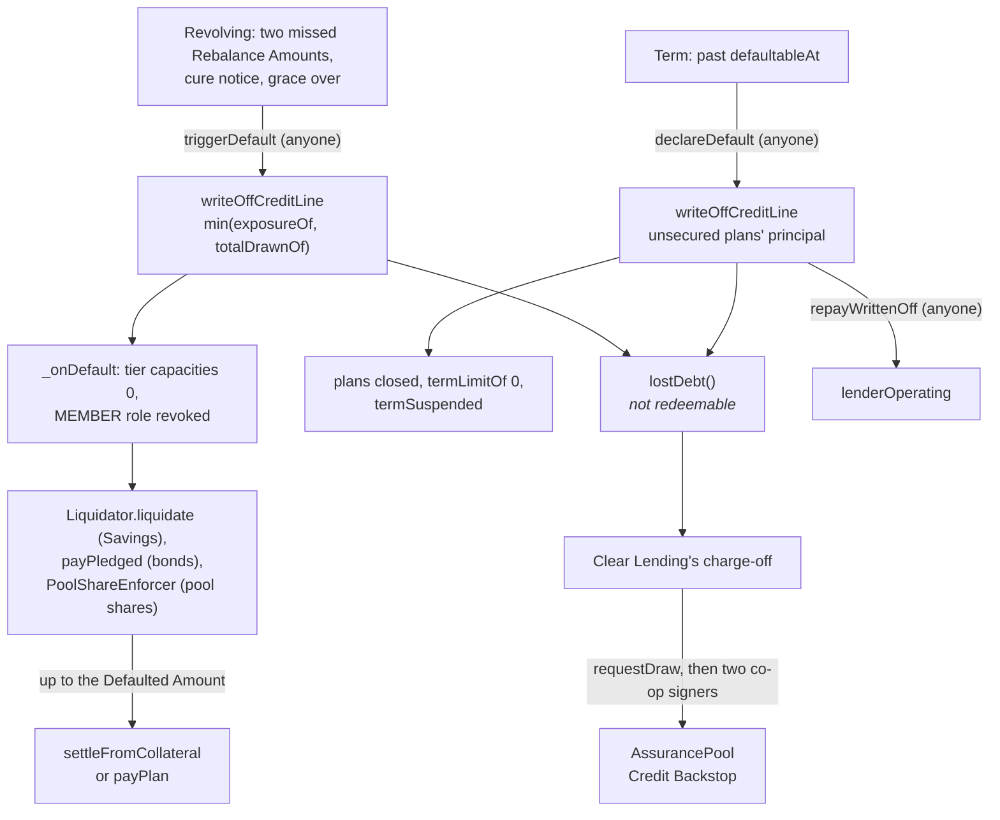

# Credit

**One ledger, several issuers.** `ClearCredit` records what each address owes and holds; the
issuers decide who may draw, how much, at what carry, and when a position has defaulted. All of them
write to the same ledger through the same `NetworkRegistry`. Deployed addresses are in the root
[`README.md`](../../README.md) (**Deployed addresses**).

| Contract | Role |
|---|---|
| `MutualCredit.sol` | ERC-20 base with a credit line per address: mint on overdraw, burn on receipt |
| `StableCredit.sol` | The ledger's rules: issuer gating, the three-party mint, repayment routing, lost debt |
| `ClearCredit.sol` | The deployable ledger. Adds an external `initialize` to `StableCredit` and nothing else |
| `CreditIssuer.sol` | Base issuer: credit periods, compliance, freeze, default, write-off, ITD |
| `RevolvingIssuer.sol` | The tiered revolving line and card settlement; calendar cycles and dues (with `RevolvingIssuerExtension`, `RevolvingIssuerCycles`, `RevolvingIssuerTerms` by delegatecall) |
| `PacificCalendar.sol` | Calendar dates and US Pacific time for revolving cycle ends |
| `TermIssuer.sol` | Term plans with split schedules, under their own `termLimitOf` |
| `OffersIssuer.sol` | A capped line the co-op draws to give new members a one-time offer |
| `CollateralRegistry.sol` | Pledges per member, exposure per member, the CLRUSD lock |
| `LimitCalculator.sol` | Collateral value × haircut, or an attested figure, written onto the revolving tiers |
| `Liquidator.sol` | Seizes pledged CLRUSD and settles the savings tier; applies pool-share proceeds, a pledged bond's own payments and its share of a Collateral Agent distribution to the tiers they back |
| `AccessManager.sol` | Admin, operator and member roles, and the scoped credit roles (`CREDIT_LINES_ROLE`, `CREDIT_LIMITS_ROLE`, `CREDIT_SETTINGS_ROLE`) |
| `MembershipRegistry.sol`, `NetworkRegistry.sol` | Membership records `AccessManager.isMember` reads; issuer → ledger, member → issuers, and the money-path list |
| `CreditPool.sol` | Legacy: credits deposited for reserve token at `discountRate`, serviced from a queue. No deploy script or spec uses it |
| `CarryIndex.sol`, `ExposureMath.sol` | Each tier's and plan's rate and cycle length (carry itself accrues per second in the issuers); the share of a position no collateral covers |

---

## The ledger

**Each address has two figures: credits held (`balanceOf`) and credits owed (`creditBalanceOf`).**
Held credits are claims on the network — a merchant's balance is what it is owed. The token has 6
decimals; `creditLimitOf` is the ceiling. A transfer nets the two. `MutualCredit._beforeTransfer` mints whatever the sender's held balance
does not cover, and raises their `creditBalance` by the same amount, reverting with
`Insufficient credit` past `creditLimitLeftOf`. `_afterTransfer` burns whatever arrives against
the recipient's `creditBalance` first. Mints that are not transfers do not net:
`_accrueCredit` raises an obligation and mints the matching claim to someone else, without
consulting what the obligor already holds, so an address can hold credits and owe at once.

### Entries that are not transfers

| Function | Caller | Effect |
|---|---|---|
| `originatePurchase(member, purchase, merchant, payout, coop, discount)` | issuer | Asserts `purchase == payout + discount` and `owed + purchase <= creditLimitOf`, then mints to the merchant and to the third leg, `coop` (on a plan, `TermIssuer.feeRecipient`), each first settling any refund that recipient owes (`_accrueToRecipient`) |
| `reversePurchase(...)` | issuer | Same netting check. Burns the third leg's share from that recipient (reverts if it holds less) and as much of the merchant's payout as it holds; the rest moves to the merchant with `_transferObligation` and is recorded as a refund receivable (`RefundOwedByMerchant`) |
| `repayRefund(member, paid, merchant, merchantShare, coop, coopShare, carryWithheld)` | issuer | Takes each share back (burn, else an obligation on the holder), then `payoutPool.payRefund(member, paid − carryWithheld)` |
| `accrueCarry(member, recipient, amount)` | issuer | `_accrueCredit`: the member owes more, the recipient holds more. Not limit-checked |
| `settleClaim(holder, amount)` | PayoutPool only | Burns a claim the pool paid with a member's repayment |
| `writeOffCreditLine(member, amount)` | issuer | Moves up to `amount` of the member's debt to the ledger's own line, adds it to `lostDebt()`, and zeroes the caller's ceiling allocation |

Origination is capital-free: three entries that sum to zero and no reserve token moves. The refund
arithmetic is in [Refunds and repayments](./refund-repayment-plan.md).

### Who may write, and the ceiling

`onlyCreditIssuer` admits a caller only when `networkRegistry.isIssuerOf(caller, address(this))`.
A transfer requires the sender to be a member, an operator or the payout pool (`senderIsMember`),
then asks every issuer either party is enrolled with (`_validateAcrossIssuers`); one refusal reverts
with `StableCreditTransactionInvalid`. `_systemTransfer` — opening a line, an undirected repayment
— and `_writeOffTransfer` — a write-off — notify issuers through `syncCreditPositions` and cannot be
refused.

**The ceiling is a sum.** `issuerCreditLimit[issuer][member]` is each issuer's part, set by
`createCreditLine` (which enrols the member and grants the MEMBER role if needed) and
`updateCreditLimit` (which refuses a total below what is owed). `_syncCreditLimit` rewrites
`creditLimitOf` as the sum over `networkRegistry.issuersOf(member)` on every change.

### Repayment

`repayCreditBalance(member, amount)` (anyone, in reserve token) and credits sent to a member who
owes are undirected: the waterfall below attributes them. `repayCreditBalanceFor(payer, member,
amount)` is issuer-only and directed: the calling issuer records it and no other is told.

**Reserve token goes to the payout pool, then to Clear Lending.** `_routeRepayment` offers the
payout pool what `_payoutPoolNeeds()` returns: its payables (`totalSupply() +
payoutPool.refundsOwed()`) less what members' repayments have already funded
(`payoutPool.memberFunded()`), floored at zero, through `payoutPool.receiveRepayment`. The rest
goes to `lenderOperating`, Clear Lending's operating address (`setLenderOperating`, admin), and all
of it does when no payout pool is set; a remainder with no operating address named reverts
(`StableCreditNoLenderOperating`). Each leg emits `RepaymentRouted`. The ledger holds no
AssurancePool address and calls none (section 13): Clear Lending pays the co-op's Credit Backstop
itself, through the pool's `deposit`. See [`settlement.md`](./settlement.md) and
[`reserve.md`](./reserve.md).

**An undirected repayment clears the dearest position first, across issuers.**
`_settleRepayment` asks each issuer for `nextRepaymentRate(member)`, takes the highest, and offers
the remaining amount to every issuer through `absorbRepayment(member, remaining, band)`. Each takes
positions at or above that rate and returns what it took. The ledger repeats for up to
`MAX_WATERFALL_BANDS` (16) bands. Since Phase 4c, whatever is left after the 16th band goes to a
fallback pass (`_settleBeyondBands`): each issuer still holding a position is offered the rest once
with no band, the one holding the dearest remaining position first, and takes it against all its
positions in its own repayment order. So a member with more than 16 distinct rates never leaves part
of a repayment unattributed. Anything still unattributed after that means the issuers hold less than
the ledger says is owed; it stays visible as a gap between the ledger and the issuers rather than
being corrected.

Since Phase 4b (re-review L-G) the rate is the **effective** monthly rate at the moment of
repayment, after the caps, not the configured tier or plan rate: monthly basis points times
`RATE_SCALE` (1e18). `RateSchedule.revolvingRatesOf` prices each revolving tier (its own rate, or
its list rate trimmed by the member-level ceiling, dearest priced tier first, as accrual trims it),
and `RateSchedule.termRateOf` prices each plan (min(list, the cap on the plan and on the member's
CFL aggregate), the annual cap once large, less the merchant's subsidy, stated per month). Pending
counsel on what "most expensive" means for a capped position.

**Lost debt.** The ledger's own address has a credit line of `type(uint128).max − 1`.
`writeOffCreditLine` transfers from it to the member, burning their debt and leaving the credits
they spent in circulation. `lostDebtOutstanding` (read as `lostDebt()`) rises only there and nothing
lowers it. Lost debt is not redeemable: `burnLostDebt` always reverts with
`StableCreditLostDebtNotRedeemable` (section 13, decision 3). A write-off is Clear Lending's
charge-off, which it may recover through its own draw on the AssurancePool's Credit Backstop
compartment ([`reserve.md`](./reserve.md)); no credit path calls the AssurancePool.

---

## Issuers

### CreditIssuer — the base

A credit period (`issuedAt`, `expiration`, `graceLength`, `paused`) is set by
`initializeCreditLine` or `updateCreditPeriod` (`CREDIT_LINES_ROLE`).

| State | Test | Effect on a transfer |
|---|---|---|
| Active | before `expiration` | Allowed |
| Frozen | in grace and `!inCompliance` | Refused as recipient; refused as sender drawing on credit unless the period is paused |
| Default | grace over and `!inCompliance` | Refused as recipient; as sender, runs `expireCreditPeriod` |

The base `inCompliance` is `creditBalanceOf(member) == 0`. A sender spending only what they hold
always passes. `expireCreditPeriod` deletes the period; in default it also records `defaultedAt`
(read by `hasDefaulted`, so the fact outlives the period), calls `writeOffCreditLine(member,
_writeOffAmount(member))` and `_onDefault`, which in the base revokes the MEMBER role. On a
defaulted sender's transfer it returns false and the ledger reverts everything, write-off included;
the permissionless `syncCreditPeriod(member)` runs the same check without a transfer and is the call
that makes a default stick. `itdOf` and `meetsITD` expose an income-to-debt ratio that nothing
enforces.

### RevolvingIssuer — the tiered line

**One balance, one ceiling, composed of tiers ordered by ascending rate.** `addTier` reverts with
`RevolvingIssuerRatesMustAscend` below the previous tier's rate and `RevolvingIssuerCycleMismatch`
on a different cycle length; `setTierRate` keeps the order both ways and checkpoints the index.
`setTierActive(false)` stops new draws only. `openLine` sets a capacity per tier, opens the ledger
line at their sum and starts a period of one cycle when `periodLength` is 0. `setTierCapacity`
(`CREDIT_LIMITS_ROLE`) reverts below what is drawn and writes the new total to the ledger.

**Draw cheapest first, repay dearest first.** On a transfer, `_syncCreditPositions` materialises
both parties' carry, then `_draw`s the sender's shortfall into active tiers in order, each up to
its headroom (`capacity − drawnOf`, carry included). `_absorbRepayment` walks the tiers from the
top, skipping any below the band the ledger offered.

Carry accrues per second as simple interest on principal at the tier's monthly rate × 12 / 365,
trimmed to the legal caps and the Combined Ceiling, and never bears carry itself. Principal and
carry are tracked apart (`tierPrincipal`, `tierCarry`, `carryOutstandingOf`). `_materialiseCarry` —
on every interaction, and public as `materialiseCarry(member)` — writes accrued carry to the ledger.

**Card settlement.** A swipe outside the network is paid from the co-op's float and recorded at
clearing, with the whole claim minted to the operator-set `cardSettlementAccount` and no discount
leg. Every card function requires `isCardSettler[msg.sender]`. `settleCardSpend`, `repayCardSpend` and
`repayForMember` accept a given `ref` (the card issuer's transaction reference, hashed) once;
`reverseCardSpend` may be called on a settled `ref` until its amount is used up.

| Function | Effect |
|---|---|
| `authorizeCardSpend(ref, member, amount)` | Records what the card issuer approved, when it approved it. Refused for a member who is frozen, in default or has defaulted, or for more than the line could hold then |
| `settleCardSpend(ref, member, amount)` | A purchase with no card credit fee. Settles only against a matching authorization for the same member, and never above it (audit M-2). Bound by `cardTxCap`, the daily `cardSpendCap` and the per-member cap; refused after a default on the current line; Savings draws only up to `savingsDrawAllowance`. Reverts unless active-tier headroom covers all of `amount`. `_draw`s the tiers, then `originatePurchase(member, amount, cardSettlementAccount, amount, cardSettlementAccount, 0)` |
| `settleCardSpendWithFee(ref, member, amount, fee)` | The same, with the card credit fee on top (decision 55; after the CF upgrade). Every check above applies to `amount + fee`: the authorization, `cardTxCap`, the daily and per-member caps, the line's headroom. `fee` must be above zero and at most `maxCardCreditFee`, else `RevolvingIssuerCardFeeZero` / `RevolvingIssuerCardFeeAboveMax`. Draws `amount + fee` cheapest first, all or nothing, then `originatePurchase(member, amount + fee, cardSettlementAccount, amount, cardSettlementAccount, fee)`: both legs to the card settlement account. `cardSettlementOf(ref)` stays the purchase alone; the fee is recorded per `ref` (`cardCreditFeeOf`) and emitted as `CardCreditFeeCharged` |
| `reverseCardSpend(ref, amount)` | Up to what `ref` settled. Clears tiers dearest first and `reversePurchase` from the float. A partial refund keeps the fee; the reversal that brings the purchase to zero also credits back what is left of it, once (`CardCreditFeeReturned`) |
| `returnCardCreditFee(ref, amount)` | Credits back part of a purchase's fee (the CFL cap trim, MB-04 §5.4(f)): at most the fee less what has been returned, else `RevolvingIssuerCardFeeReturnExceedsLeft`. Releases tiers dearest first and `reversePurchase(member, amount, cardSettlementAccount, 0, cardSettlementAccount, amount)` |
| `repayCardSpend(ref, member, amount)` | A fiat repayment. Requires `amount <= totalPrincipalOf(member)` and the float to hold `amount`, then clears tiers and burns the float's claim against the member's obligation with `reversePurchase`. No reserve token moves |
| `repayForMember(ref, member, amount, payer)` | Automatic Clearing (below). The settler delivers the cash, then `repayCreditBalanceFor(address(this), member, …)`. Refused in `hybridMode` or for an excluded payer. Clears at the member's chosen level |

**The card credit fee (decision 55, `docs/audit/specs/card-credit-fee.md`).** Bounded by
`maxCardCreditFee`, in ledger units (30 cents is 300000), which one `CREDIT_SETTINGS_ROLE` signer sets
with `setMaxCardCreditFee` (`MaxCardCreditFeeUpdated`), never above `CARD_CREDIT_FEE_CEILING` ($5.00;
`RevolvingIssuerCardFeeAboveCeiling`). The CF upgrade sets it in the same call (`upgradeToAndCall`), so the fee is on
from the upgrade; zero refuses every fee, so setting it back to zero is the off switch, and it never holds
up a credit-back of a fee already charged. The fee is
drawn like the purchase, so it is principal and carries like it; `repayCardSpend` clears it with the rest
(the float holds its claim). `cardCreditFeeOf(ref)` returns the fee charged and the amount credited back.
The state is in its own ERC-7201 namespace, `clear.storage.RevolvingIssuer.CardFee` (slot
`0x1891ea5b85bfa6342db2b66e11acc058002ca00880066dd1e907d492e4433d00`): nothing in the layout moved.
`settleCardSpendWithFee`, `maxCardCreditFee`, `setMaxCardCreditFee` and `cardCreditFeeOf` run in
`RevolvingIssuerWorkouts` (the two views through the fallback, with that module's ABI);
`reverseCardSpend` and `returnCardCreditFee` in `RevolvingIssuerExtension`; one `_settleCard` in the
base serves both settlement entry points. Base Sepolia gets it by the CF signing steps (one CreditTimelock
operation, `upgradeToAndCall` with `setMaxCardCreditFee`); the generated reference page lists the new functions once the deployment
record carries the upgraded ABI.

### Cycles, dues and Automatic Clearing (Addendum 2, Phase 2e)

**A revolving cycle is a calendar month.** Each line has a `cycleEndDay` (1-28) chosen at
`openLine(member, capacities, cycleEndDay)`; 0 takes the default, the day before the opening day or
the 28th. Every cycle ends at 23:59:59 Pacific on that day (UTC−7 from the second Sunday in March to
the first Sunday in November, otherwise UTC−8), computed by `PacificCalendar`. The first ends on the
first Cycle End Day at least 14 days after opening. No role writes or moves a cycle end: the credit
period setters (`updateCreditPeriod`, `setPeriodExpirationOf`, `setGraceLengthOf`, `pausePeriodOf`,
`unpausePeriodOf`, `initializeCreditLine`) revert `RevolvingIssuerCyclesComputed` on this issuer,
and `openLine` refuses a member with a live line. The member alone moves their day, by EIP-712
signature (`setCycleEndDayWithSignature`, type `CycleEndDay(address member,uint8 day,uint256 nonce,
uint256 deadline)`), at most once per rolling 365 days; the running cycle then ends on the first new
Cycle End Day on or after its existing end. Term plans keep 30-day cycles.

**What is due.** At each close the chain fixes, for the next cycle end (the Payment Due Date):

| Figure | Definition |
|---|---|
| Rebalance Amount | The unsecured revolving balance (income-backed and Boost, materialised carry included) at the close |
| Secured Minimum | Asset-backed carry accrued in the cycle, plus — when no unsecured principal is out at the close — `securedMinimumBps` (100) of savings- and asset-backed principal, at least $1 or the secured principal if less. A raise binds only cycles closing 45 days or more after it |

Every repayment of the line counts toward both (`paidSinceClose`). Equilibrium and 12.5 are measured
on the Rebalance Amount only. **A missed Secured Minimum is never a miss**: its only effect is a
computed pause on new savings- and asset-backed draws (those tiers are skipped, unsecured draws go
on), until the payments since that close reach Rebalance Amount + Secured Minimum, lifting in the
same transaction. No role sets it. `duesOf(member)` returns the unpaid Rebalance Amount, the unpaid
Secured Minimum and whether the pause is on; `cycleStateOf(member)` the whole record.

**Cycle Assurance (12.13).** An MB-10 attestation by two `CREDIT_ATTESTER_ROLE` holders
(`proposeGraceEligibility`, then `approveGraceEligibility` by a different one) makes a member eligible;
nothing withdraws it. At a due point where an eligible member's Rebalance Amount is unpaid, a grace is
used automatically (`GraceCycleUsed`) if one is left: at most `graceCyclesPerWindow` (1) per rolling
`graceWindow` (365 days), both governed (`setGraceTerms`). The limit is not halved, nothing settles,
and the cycle does not count toward default. Past the window's graces an unpaid cycle is a miss.

**Income Assurance (12.13).** `incomePause` (at most `incomePauseMaxCycles`, 3) is set by two
`CREDIT_ATTESTER_ROLE` holders (`proposeIncomePause`, then `approveIncomePause` by a different one).
While it is above zero nothing is due, no miss is recorded, no pause arises and nothing counts toward
default; it falls by one at each cycle end, and only expiry or the member (`endIncomePause`) ends it.
A second attestation can only lengthen it. Since Phase 2g (Addendum 4, decision 14) each attestation
records a `hardshipRef` hash of the documented hardship, of any kind; no category is recorded or
checked. One hardship never runs more than `incomePauseMaxCycles` consecutive cycles (a further
attestation for it straight after its pause ran out continues the run), and a different hardship
may start a fresh pause once the running one has ended (`IncomePauseHardship`).

**Pauses never cause a default (10c, Phase 2g).** A `PauseClock` (no owner, no setter) adds
CLRUSD's clock (the security pause or the member's own account pause) to the vault-wide pause's
clock; `setPauseClock` names it once on this issuer and once on the Liquidator. Paused time since a
close pushes that close's due point back by as much, and no due point is judged while a pause is in
force, so a payment the pause prevented is never a miss. A close whose pushed due point falls past
the next cycle end is held (`heldClosedAt`) and judged once it passes, while the next close is
recorded at its own end. 12.5's grace period runs longer by the paused time since the close of the
second missed cycle, and `inDefault` is false while a pause is in force. TermIssuer reads the same
clock through its hold source (the Liquidator): 12.14's 30-day cure runs longer by the paused time
since the notice, and no secured or installment default is declared while a pause is in force. An
unsecured plan's installment default (`defaultableAt`) runs later by the paused time since the plan was
last on time: each plan records the clock at opening and after every payment that leaves it on time
(owner decision 34). The
Liquidator refuses every enforcement path, `payPledged` included, while a pause affecting the member
is in force, and a Shortfall's 72-hour wait runs longer by the paused time since its notice.

**Statement data (12.17, Phase 2g).** Every touch of a live line first closes the cycle ends that
have passed, so a close's figures are as at its end even when it is recorded later. Each close emits
`CycleStatement(member, cycleEnd, recordedAt, startPrincipal[], startCarry[], endPrincipal[],
endCarry[], cycleCarry[], principalSeconds[], rebalanceAmount, securedMinimum, statementRequired,
workoutState, workoutRef)`, one entry per position, the start figures being the last close's end
figures. `principalSeconds` is each position's running principal x seconds, kept on every draw and
payment. The last close is kept for views (`cycleStateOf`: `lastCycleEnd`, `lastRecordedAt`,
`lastStatementRequired`; `positionStatOf(member, tier)` through the workouts module). A statement is
required when any position, secured ones included, ends the cycle with a nonzero balance, carry
included. Draws emit `TierDrawn`; every payment emits `TierPaymentSplit(member, tier, carry,
principal)` for each position it reduces. Collateral changes: `CollateralRegistry`'s `Pledged`,
`Released`, `Seized` (member, kind, amount) and `ItemCollateralChanged` (member, kind, item, value,
pledged); a bond's `PledgePaid`, and the vault's `SettledPledged` and `SettlementCompleted`, each with
the holder and the amounts. Changes in Encumbered CLRUSD follow the SAVINGS position's events.

**Workouts (12.18, Phase 2g).** Set only by two `CREDIT_ATTESTER_ROLE` holders (`proposeWorkout`,
then `approveWorkout` by a different one) with a `workoutRef` hash, at most once per member per
rolling 365 days unless a second, separately attested approval is recorded (`proposeSecondWorkout`,
`approveSecondWorkout`, with its own hash). The functions run in `RevolvingIssuerWorkouts`, reached
at the issuer's address through its fallback. A workout only reduces or delays what is due:

| State | Cycles | Effect |
|---|---|---|
| DEFERRAL (1) | at most 2 | No Rebalance Amount, and no carry on the unsecured positions; secured carry and the Secured Minimum unchanged |
| REDUCED (2) | at most 3 | The Rebalance Amount is at most the attested amount |
| PLAN (3) | at most 12 payments | The unsecured revolving balances (principal and carry) move to the 0% `WORKOUT` position, with no mint, fee or merchant, repaid in equal cycle payments (`payWorkoutPlan`), the last taking the rounding |

The running cycle is the first one covered. While any state is set, unsecured draws are refused. The
member ends a DEFERRAL or REDUCED early (`endWorkout`, or by signature); a PLAN ends when it is paid
off. Three consecutive REDUCED or PLAN cycles paid as required reset the miss count (the re-age), at
most once per rolling 365 days and twice per rolling 5 years. A PLAN's default follows 12.14's timing
(a payment 60 days past due, a two-person notice, 30 days, longer by paused time, no pause in force)
and writes off the plan's own position only (`declareWorkoutDefault`); no default of the line is
recorded, so nothing reaches Savings or other collateral. The plan's principal is outside the
Combined Ceiling.

**Automatic Clearing (12.2).** The member's authorization runs to the Bank (the bank that holds the
member's Spendable account), Clear Financial Co. and Clear Lending. It is set at line opening from
the member's own choice on a separate screen: "Approve automatic clearing" signs `AutoClear(address member,bool on,uint8 level,bytes32 authHash,uint256
nonce,uint256 deadline)`, which sets it on and records `autoClearAuthHash`; "Turn off" signs nothing.
The member changes it any time (`setAutoClear(on, level, authHash)` or the signature); no role does,
and the governed `autoClearOffGlobal` is no longer read. `repayForMember(ref, member, amount, payer)`
is the settler recording a deposit that landed in Spendable:

| Level | Clears |
|---|---|
| 0 `UNSECURED` (default) | Boost and income-backed, dearest first, then any unpaid Secured Minimum from the secured tiers, and stops |
| 1 `EVERYTHING` (the old ALL) | Every tier, dearest first; the rest stays in Spendable |
| 2 `DUE_ONLY` | Exactly the unpaid Rebalance Amount, then any unpaid Secured Minimum |

It reverts while the member's `hybridMode` is on (the only switch besides the member's own; it never
changes a cycle), and for an excluded payer: federal benefit originators are excluded by default
(`addDefaultExcludedPayer`, add-only), and only the member's signature removes one
(`setPayerExclusionWithSignature`). A sweep that names no payer is refused. Ready to allocate USDC and
CLRUSD are never swept: the settler delivers the cash. The ledger order — each deposit posts to
Spendable first, and the clearing is a separate debit after posting and before availability — is the
bank's, off chain.

**Permissions (12.12).** The Automatic Clearing authorization is its own screen at line opening,
revocable any time and listed on the Permissions page; the onboarding line is notice only, sets
nothing and is never listed among required permissions.

**Default (12.5, 10b).** See [Default](#default): two consecutive missed Rebalance Amounts, a
two-person cure-notice timestamp for the second, and the grace period.

**The card (Phase 4c items 1, 2 and 7).** `settleCardSpend` also counts against a governed
per-member daily cap (`cardMemberDailyCap`, set with `setDueTerms`). Authorization and settlement
refuse a member whose current line defaulted (`hasDefaultedOnCurrentLine`), so a re-onboarded member
can use the card. `repayCardSpend`, `reverseCardSpend` and Automatic Clearing clear tiers dearest
first by what each costs now after the caps, the same order as the ledger's band walk.

### TermIssuer — plans

**A plan is a purchase with its own rate, clock and schedule.** `openPlan(terms, signature)` is
submitted by a `CREDIT_LINES_ROLE` holder with the member's EIP-712 signature over the
`PlanTerms` they were shown (audit H-4). It reverts unless `installments` is 1, 2, 4, 6 or 12
(`isOfferedSplit`; 13 for a large loan), the member is neither
suspended nor behind on any plan, and `totalPrincipalOf(member) + purchase <= termLimitOf[member]`.
It records the plan's rate and cycle length, fixes its schedule, and calls `originatePurchase(member,
purchase, merchant, payout, _feeRecipient(), purchase − payout)`.

**The schedule is fixed when it opens.** `_fixSchedule` computes the level installment itself
(`installmentAmount`, rounded up) and sets `scheduleTotal` to `installmentAmount × installments`. `installmentsDue` runs on wall-clock time.
`scheduledPrincipalDue` is `scheduleFloor + installmentAmount × due`, or `scheduleFloor +
scheduleTotal` once every installment is due. `arrearsOf` is that figure less `plan.repaid`.

`setSplit(planId, installments)` re-spreads what is outstanding from now. Arrears are not spread:
they go into `scheduleFloor` and are due at once. A member's own re-split reverts while behind, after
`MAX_SPLIT_CHANGES` (3), or within one `installmentLength` of the last; a `CREDIT_LINES_ROLE`
holder's does not.

| Payment | Caller | Notes |
|---|---|---|
| `payPlan(planId, amount)` | anyone, paying | Directed: `repayCreditBalanceFor`, then the plan records it |
| `collectForMember(ref, member, amount)` | nobody | Retired in Phase 2d: it reverts `TermIssuerWalletCollectionRetired`. Recovery never takes Ready to allocate USDC from a member's wallet (10f); term dues are cleared from Spendable at the bank |
| `payResidualCarry(member, amount)` | anyone, paying | Clears `residualCarryOf`: what the member owes beyond every open plan and revolving tier. Zero until `mandateSource` is set |
| undirected repayment | — | `_absorbRepayment` takes plans at or above the band, oldest first |

**Late handling.** `inCompliance` is overridden to `totalArrearsOf(member) == 0`. TermIssuer's own
functions never open a credit period, so falling behind refuses new plans and the member's own
re-splits but not ledger transfers. `delinquentSince` is the due date of the oldest installment not
yet covered; `defaultableAt` adds `DEFAULT_AFTER_INSTALLMENTS` (2) installment lengths, after which
anyone may call `declareDefault(member)` — see [Default](#default). A plan the member has secured
under MB-05 (`securePlanWithSignature`) is left out of that rule and follows 12.14 instead.

**Refunds.** `closePlanForRefund(planId, amount, merchant, payout)` (`CREDIT_LINES_ROLE`) reverses up to
the principal still owed and pays back, in cash, up to what was repaid and not already refunded
(`refundedOf`). Carry materialised in the call is withheld from the cash, up to the cash. The plan
closes once what is outstanding is no more than that carry.

**The fee leg (12.16, Addendum 2).** The third leg of each purchase is Clear Lending's fee, minted to
`feeRecipient` — meant to be Clear Lending's own multisig, or an account Clear Financial holds as its
agent. The contract refuses only zero and `carryTreasury` (`_checkFeeRecipient`); on Base Sepolia it
is set to the Clear Treasury Safe. fee = min(`discountBpsBySplit` × amount, cap), the cap $50 up to $2,500 and $75
above (`setFeeTerms`); the merchant is paid the amount less the fee and the member is never charged
it. A plan with a fee will not open while no recipient is named. Changing it takes two
`CREDIT_SETTINGS_ROLE` holders (`proposeFeeRecipient(recipient, reasonCode)`, then
`approveFeeRecipient` by a different one), emits `FeeRecipientChanged`, and applies to later charges
only: each plan records where its fee went (`pricingOf(planId).feeTo`), and a refund or reversal
reverses the fee pro rata from there. Plans opened before Phase 2e reverse from `feeRecipient`, or
the carry treasury while it was unset, as before.

**Carry (decision C, Addendum 2).** A plan is charged its list rate per 30-day cycle on remaining
principal ($47.47 on $940 in 4 at 2%), trimmed so it never exceeds the per-second-fitted cap on that
principal, then the Combined Ceiling.

**The Combined Ceiling (12.3).** The unsecured revolving tiers and every plan opened under $2,500 are
one loan: their monthly carry never exceeds the graduated schedule on their combined principal (1% a
month on every dollar above $1,650). The revolving tiers keep theirs (they are held to the schedule on
their own principal, Boost trimmed first); what is left is shared by the plans oldest first, so the
excess comes off the newest plan first. Clear Cash of $2,500 or more is outside it. It is permanent:
`setCombinedCeiling` (term issuer) and `setTermIssuer` (revolving issuer) are each set once, and
DECISIONS #7's switch is gone. Every plan of a member is brought to now together
(`materialiseMember`), and the revolving line calls it before it changes the member's unsecured
principal, so the shares hold over every stretch they are applied to. `combinedPlanCarryOf(member)`
reads each plan's monthly figure.

### Two lines, not one

**A split plan draws only on `termLimitOf`. The revolving tiers are a separate line.**

| | Revolving | Term |
|---|---|---|
| Ceiling | Sum of `tierCapacity`, written by `setTierCapacity` / `LimitCalculator.pushCapacities` | `termLimitOf[member]`, written by `setTermLimit` (`CREDIT_LIMITS_ROLE`) |
| Underwritten on | Pledged collateral, or an attestation (`LimitCalculator.attest`) | An operator-entered figure; nothing on-chain reads collateral for it |
| Drawn by | A ledger transfer or `settleCardSpend` | `openPlan` only |

`originatePurchase` mints rather than transfers, so no issuer's `_syncCreditPositions` runs and a
plan never touches a tier. `LimitCalculator` writes only to the revolving issuer it is pointed at.
The ledger, though, sees one number. `creditLimitOf` is the sum of both allocations, and
`originatePurchase` also checks `creditBalanceOf + purchase <= creditLimitOf`, so a plan inside
`termLimitOf` still reverts with `StableCreditCeilingExceeded` when the member's combined debt
already fills the combined ceiling. A plain ledger transfer is checked only against that combined
ceiling: `_draw` places what the tiers have headroom for and does not refuse the rest.
`settleCardSpend` checks tier headroom itself.

### OffersIssuer — the offers line

**The co-op owes itself, on a capped line of its own.** `setCap` (owner or operator) opens or
resizes this contract's ledger line: `cap()` is its `creditLimitOf`, `owed()` its `creditBalanceOf`.

| Function | Caller | Effect |
|---|---|---|
| `grant(member)` | `CREDIT_LINES_ROLE` | Once per member, never past `cap()`. Enrols the member here at a zero limit, then transfers `offerAmount` from this line |
| `expire(member)` | anyone | After `grantedAt + expiryWindow`, takes back the unspent part, capped at what the member holds and what the line owes, with `reversePurchase(this, amount, member, amount, address(0), 0)` |
| `settle()` | anyone | Pulls USDC from `treasury` up to its allowance and balance (`treasuryAvailable`) and repays the line with `repayCreditBalance`, which routes it like any repayment |

Members are enrolled only so `_syncCreditPositions` can count spending against `unspentOf`;
`_validateCreditTransaction` always returns true. **It is not exposure:** `debtByKind` returns
nothing, so the line adds nothing to `CollateralRegistry.exposureOf`.

---

## Carry

**Carry accrues per second, simple, on principal only.** Each tier and plan accrues at its monthly
rate × 12 / 365 a day from the `RateSchedule` snapshot it took, trimmed to the legal caps and the
Combined Ceiling; carry never bears carry. Principal and carry are held apart, and
`materialiseCarry` writes accrued carry to the ledger. `CarryIndex` now only stores each tier's or
plan's rate and cycle length: its `currentIndex` and `normalizeUp` are not used by the issuers.

Carry reaches the ledger only when an issuer materialises it through `accrueCarry`, which is not
limit-checked: a member may come to owe more than their ceiling, and `creditLimitLeftOf` is then 0.

**Where carry goes.** A revolving tier's carry is minted to `tierCarryRecipient[tier]`, or the
issuer's `carryTreasury` when unset; a plan's to `TermIssuer.carryTreasury`. All are set by a
`CREDIT_SETTINGS_ROLE` holder, and neither treasury can be zero. What the PayoutPool does with carry it holds is in
[`settlement.md`](./settlement.md).

## Collateral and the ceiling

**A collateralised tier's capacity is the pledge after the same haircut exposure uses.**

`CollateralRegistry` records pledges (`pledge`, `pledgeItem`, `OPERATOR_ROLE`); it does not hold
them. Since Phase 4b (re-review L-I) each pledge carries the member's EIP-712 signature (`Pledge` or
`PledgeItem`, domain `Clear CollateralRegistry` / `1`, with `pledgeNonces(member)` and a deadline);
the operator only submits it. Since Phase 2e an item (bond) pledge's signature also covers the hash
of its Maturity Instruction, which is stored, and every pledge stores its advance rate: the kind's
`haircutBps` when it was made (`itemAdvanceBpsOf`; for an amount, `advanceBpsOf`, blended by units). `collateralValueOf` asks the kind's valuer when one is set — zero if it reverts — and is
otherwise `units × unitPrice / 1e18`. `haircutBps` is the realisable share, at most 10,000.

`LimitCalculator.capacityOf(member, kind)` is `CollateralRegistry.advancedValueOf(member, kind, 0)` —
each pledge's value at the advance rate stored with it (section 9) — when anything is pledged under
that kind, else the attested figure (`attest`, `ATTESTOR_ROLE`), which takes effect
at its `effectiveFrom`. `pushCapacities(member)` is permissionless: it writes every tier through
`setTierCapacity`, reverts with `LimitCalculatorYieldExceedsCarry` when `collateralYieldOf[kind]` is
at or above the tier's rate, and calls `refresh(member)`.

**Savings feed the ceiling as the `SAVINGS` kind.** Pledged CLRUSD is valued and haircut like any
other kind. `clrusdKind` names it, and `encumberedOf(holder)` returns the units
needed to cover what is drawn under it: `drawn × 10_000 / haircutBps`, converted to units. CLRUSD
refuses any transfer out of that amount and lets a `LIQUIDATOR_ROLE` holder `seize` up to it. The
savings side is in [`savings.md`](./savings.md).

`exposureOf(member)` — what a default on everything would leave uncovered, which the
AssurancePool reads through `poolExposure()` for its Credit Backstop floor — applies
`ExposureMath.positionExposure` to each issuer's `debtByKind`: zero for `Savings`, `debt −
collateral × haircut` floored at zero for `AssetExternal` and `AssetInternal`, all of it for
`Unsecured`. An unregistered kind falls back to `ExposureMath.backingOf`: anything but `SAVINGS`,
`ASSET_EXTERNAL` and `ASSET_INTERNAL` is unsecured, including term debt (`TERM`). `totalExposure` is
a running sum that the permissionless `refresh(member)` adjusts. `release` will not free units still
needed; `releaseItem` will not free anything while the kind is drawn.

`deploy/20_deploy_CreditCore.ts` adds five tiers in this order — `SAVINGS` (Savings, 10,000),
`BOND` (AssetInternal, 9,500, valued by a valuer), `POOL_SHARE` (AssetInternal, 7,000), `INCOME` and
`BOOST` (Unsecured) — and sets `clrusdKind` to `SAVINGS`.

## Default

**Revolving default is computed, never declared, and fails closed (12.5, 10b; Addendum 2).** A
line is in default (`inDefault`) only when:

1. two consecutive Rebalance Amounts were missed at their due points;
2. a cure-notice timestamp was recorded for the second by two people: a `CREDIT_ATTESTER_ROLE` holder
   calls `proposeCureNotice(member)` and a different one `approveCureNotice(member)`; the recorded
   time is the approval's block time, never earlier, and it can be recorded only while that amount is
   unpaid;
3. that amount is still unpaid; paying it cancels the timestamp (`CureNoticeCancelled`); and
4. the grace period is over: the later of `cureWindow` (15 days) after the second due point and
   864,000 s after the timestamp.

With no timestamp there is no default. After the second miss the line is frozen until that amount is
paid. Income Assurance, a DEFERRAL or REDUCED workout, and a pause in force hold default off, and
paused time lengthens the grace period (Phase 2g). `triggerDefault(member)` (anyone) records a
computed default and reverts otherwise; the Liquidator's `_currentDefault` reads the same
`inDefault`. A member whose only debt is secured never misses, so never defaults on the revolving
line: an unpaid Secured Minimum only pauses secured draws. Unsecured term plans keep TermIssuer's own
default (below).

**Re-onboarding (Phase 4c item 3).** `openLine` reverts while collateral pledged against an earlier
default's debt is unapplied (a secured tier still owes and the registry values a pledge behind it),
so a new line never cuts that recovery short.

**Revolving.** `_writeOffAmount` is `CollateralRegistry.exposureOf(member)` — which counts every
issuer the member is enrolled with — capped at `totalDrawnOf(member)`, or the whole drawn amount
with no exposure source. `_onDefault` zeroes tier capacities and revokes the MEMBER role; positions
stay.

**A write-off is attributed to the issuer that wrote it off, and to no other (audit X-6).**
`writeOffCreditLine` credits the member through `_writeOffTransfer`: every issuer the member is
enrolled with is told, so what each measures stays in step, but the reduction is offered only to
the calling issuer (`absorbRepayment(member, remaining, 0)`), never through the rate-band
waterfall. A revolving write-off clears that issuer's tiers dearest first — the unsecured ones in
the deployed configuration — and, being only the uncovered share, leaves the collateralised tiers
drawn for enforcement. A term write-off reduces the unsecured plans, which `TermIssuer._onDefault`
then closes; it never clears a revolving tier. Clear Lending is the lender of record and bears the
loss.

**Liquidation (MB-05, Phase 2f stage 2).** Enforcement against collateral runs only on a default
after notice and cure, or on a Shortfall after its wait, and never on a missed cycle alone (C2): a
miss halves the limit and counts toward default, and the registry's excess lock keeps the Earn
pledge in place, but nothing is taken. A default reaches only its **Defaulted Amount** (decision 22):
what was past due when the grace or cure period ended, as the issuer recorded it, less what has been
paid or enforced since.

- On the revolving line that is the past-due Secured Minimum (`pastDueSM`, within `securedPastDue`),
  which the line's secured positions may pay, and the unpaid second Rebalance Amount (`cureAmount`),
  which is unsecured. A default does not by itself make the whole balance due.
- **The line's closing (Phase 2f, decision 37; MB-04 §9.3(a)-(b)).** While the Objective Default
  stands (`inDefault` or `hasDefaultedOnCurrentLine`) and no pause is in force, a
  `CREDIT_ATTESTER_ROLE` holder calls `proposeLineClosing(member)` and a different one
  `approveLineClosing(member)` (both on the issuer's address, in `RevolvingIssuerWorkouts`), which
  records that the line is closed and its full balance demanded (`lineClosedAt(member)`,
  `LineClosed`). It is recorded once per line and counts only for the line open then. From the
  record, while the default stands, the whole balance is a Defaulted Amount: the savings tier's for
  Encumbered CLRUSD, never more than the CLRUSD locked for it (MB-04 §9.4; MB-05 §7.2), and the
  asset-backed and unsecured tiers' for pledged Earn Positions. Without it, behaviour is as above. A
  workout plan's default records no default of the line, so it cannot be closed on it (owner
  decision 35).
- On a plan secured under MB-05 it is what the cure notice concerned (`noticeDue`) less what has
  been repaid, and the plan's whole balance once its schedule has ended.

A pledge secures all of the member's MB-05 secured debt with every trusted issuer (decision 9). The
order is MB-05 §7.1's: Savings only for Savings; on a default, bonds first, then pool shares, paying
the line's past-due Secured Minimum, then the secured plans oldest first, then the unpaid Rebalance
Amount; on a Shortfall, pool shares first, then bonds. Among bonds, the member's own order if they
signed one (`CollateralRegistry.setEnforcementOrder`) before any Default Notice or Shortfall
notice, otherwise the bond nearest maturity (decision 20). The surplus always goes to the Holder.

- `Liquidator.liquidate(member, issuer, tierId, kind)` (anyone) requires `inDefault` or
  `hasDefaultedOnCurrentLine` on a trusted issuer (Phase 4b, re-review M-C: a member who defaulted,
  settled and was given a new line is current on it). It takes the least of the line's open
  Defaulted Amount of secured positions, the savings tier, the CLRUSD held and the registry's lock,
  with `ClearUSD.seize`, redeems it at `ESADepositVault`, and calls `settleFromCollateral`. Because a
  revolving default turns on the unsecured Rebalance Amount, and the Secured Minimum on savings is
  charged only when no unsecured principal is drawn, a default usually leaves little or none of the
  savings tier past due: the rest stays owed and locked until the line's closing is recorded, when
  the whole savings tier may be paid (decision 37).
- `settleFromSavings` lets a member apply their own savings to their own `SAVINGS` tier at a trusted
  issuer at any time, default or not (MB-05 §7.9): an instruction, not enforcement.
- Pledged bonds are paid under their own `payPledged`, which asks `Liquidator.pledgePaymentDue` and
  has the Liquidator apply the payment ([Bonds](./bonds.md)).
- Pledged pool shares are never seized (C5). `PoolShareEnforcer.enforce(member)` (anyone) asks the
  Yield Pool to redeem only the shares still needed, as an enforcement redemption in the queue; when
  it fills, `PoolShareEnforcer.settle(member)` (anyone) hands the proceeds to
  `Liquidator.applyPoolProceeds`, which applies them and pays the rest to the Holder.
  `cancelExcess` (anyone) gives back queued shares no longer needed.
- The Shortfall is one figure (decision 21): Asset-Backed Drawn (the bond and pool-share tiers of
  every trusted line) above the total Asset-Backed Limit. `noticeShortfall(member)` (anyone) starts
  its 72 hours (longer by paused time) or clears a closed one; after the wait it is settled in the
  smallest amount that ends it.
- A Liquidation Hold or a pause in force stops every path, and the proceeds of a fill wait.

The Liquidator needs AccessManager operator (`settleFromCollateral` is `onlyOperator`), the registry's
`OPERATOR_ROLE` and CLRUSD's `LIQUIDATOR_ROLE`. Its Earn rules run in `LiquidatorEnforcement`, a
delegatecall module its constructor creates.

**Term.** `declareDefault` materialises carry on every plan, writes off the principal of the
unsecured open plans, adds it to `writtenOffOf`, closes those plans, sets `termLimitOf` to 0 and
`termSuspended`. Plans secured under MB-05 stay open and owed. Membership is
not revoked. `repayWrittenOff(member, amount)` (anyone, paying) sends reserve token to the ledger's
`lenderOperating` against `writtenOffOf − recoveredOf` (`WrittenOffRepaid`): the write-off was
Clear Lending's loss, so the recovery is its money. If the Credit Backstop covered that loss, Clear
Lending pays the co-op back itself with the pool's `deposit(RECOVERY)`. `reinstate` lifts the
suspension for anyone once that is fully repaid, and for a `CREDIT_LIMITS_ROLE` holder at any time;
a new `setTermLimit` is still needed. The Credit Backstop and its draws are in
[`reserve.md`](./reserve.md).

**Secured term plans (12.14, Phase 2e).** A plan the member has secured under MB-05
(`securePlanWithSignature`, EIP-712 `SecurePlan(uint256 planId,uint256 nonce,uint256 deadline)`)
defaults only when all of these hold:

1. a scheduled payment is at least 60 days past due, counted from its due date;
2. a cure-notice timestamp was recorded for it by two `CREDIT_ATTESTER_ROLE` holders
   (`proposePlanNotice`, then `approvePlanNotice` by a different one). The time recorded is the
   approval's, and it can be recorded only while a payment is past due;
3. 30 days have passed since the timestamp; and
4. what was past due at the notice is still unpaid. Paying it cancels the notice.

`declarePlanDefault(planId)` (anyone) records it and reverts otherwise, and it fails closed. It
reverts while a Liquidation Hold is active, read from `holdSource` (the Liquidator, set once), and
when no hold source is named. It writes nothing off: it records `defaultedAt`, cuts the term limit
to 0 and suspends term credit. `hasDefaultedOnCurrentLine(member)` reports it. A pledged bond of the
member's is then payable (`payPledged`): the Liquidator, which trusts TermIssuer for this path only,
pays the bond's proceeds into the defaulted secured plans (`payPlan`, oldest first) and the surplus to
the Holder. A Liquidation Hold stops it. Every tier path refuses a trusted issuer without tiers, so
CLRUSD, Savings and pool shares are never reached from a term default. There is no on-chain
hardship plan, so a re-split does not cancel a notice. `inDefault` on TermIssuer keeps its
inherited meaning.

## Access

| Contract | Authority it checks |
|---|---|
| `StableCredit` | `access.isAdmin` for setters and UUPS upgrades; `NetworkRegistry.isIssuerOf` for every issuer entry |
| `CreditIssuer` and children | `stableCredit.access().hasCreditRole` with a scoped role (audit H-4): `CREDIT_LINES_ROLE` opens lines and plans, services credit periods and processes refunds; `CREDIT_LIMITS_ROLE` sets term limits and tier capacities; `CREDIT_SETTINGS_ROLE` sets tiers, rates, treasuries, card settlers and caps; `CREDIT_ATTESTER_ROLE` records the two-person attestations. Only `settleFromCollateral` still takes `isOperator` (the Liquidator). Issuer UUPS upgrades by `owner()` |
| `CreditPool` | `stableCredit.access().isOperator` |
| `OffersIssuer` | `grant`: `CREDIT_LINES_ROLE`; `setCap`, `setTerms`: owner or operator; `setTreasury`: owner |
| `CollateralRegistry`, `LimitCalculator`, `Liquidator`, `NetworkRegistry` | Their own `OPERATOR_ROLE` and `DEFAULT_ADMIN_ROLE`; `LimitCalculator` adds `ATTESTOR_ROLE` |
| `MembershipRegistry` | `REGISTRAR_ROLE`, `PAUSER_ROLE` |

`AccessManager.isOperator` is the `"OPERATOR"` role or admin. `hasCreditRole(role, account)` is
that role or admin; the plain operator role passes none of the credit roles. `isMember` is the `"MEMBER"` role, an
operator, or `membershipRegistry.isActiveMember` (ACTIVE, expiry zero or ahead), so `revokeMember`
does not remove a registry member. `grantOperator` is `onlyAdmin`. `grantMember` and `revokeOperator`
pass `onlyOperator`, but the inner `grantRole`/`revokeRole` require the role admin — `"OPERATOR"` for
`"MEMBER"`, `DEFAULT_ADMIN_ROLE` for `"OPERATOR"`.

**Membership records.** The API writes a `MembershipRegistry` record when a membership checkout is
paid through Stripe (`apps/api/src/services/memberBillingService.ts`): plan `YEARLY` as a
subscription whose record expires with the paid period and is revoked when the subscription ends,
or `LIFETIME` as a one-time payment with no expiry. The writer is the registrar
(`MEMBERSHIP_REGISTRY_*`, see [Going live](../operators/going-live.md#stripe)). The member app does
not start that checkout, and onboarding stores `membershipPlan: 'YEARLY'` for every member at no
charge, so app members have no registry record from it. Equity credits treat `LIFETIME` as
Accelerated (1.5× from the start, `payLedgerStore.ts`); everyone else is on the Standard multiplier.
The co-op's own definition of membership (the savings account, as in a credit union) is in
[Governance → Membership](../governance/membership.md); nothing on the chain records it.

`NetworkRegistry.registerIssuer(issuer, stableCredit)` binds an issuer to its ledger and nothing
else (Phase 2c: the old pool and oracle fields stay zero). `listMoneyPath` (admin, once per address,
never undone) lists a system contract as a money path, which the AssurancePool reads
(`isMoneyPath`) to refuse its deposits;
`enrolMember` is open to the issuer, its ledger or an operator; `deregisterIssuer` refuses while
anyone is enrolled. Since Phase 4b (re-review M-E) registering and deregistering an issuer are
`DEFAULT_ADMIN_ROLE` (the credit timelock after the handover), not the operator's. `deploy/20` makes `ClearCredit`, both issuers and `LimitCalculator` AccessManager
operators.
