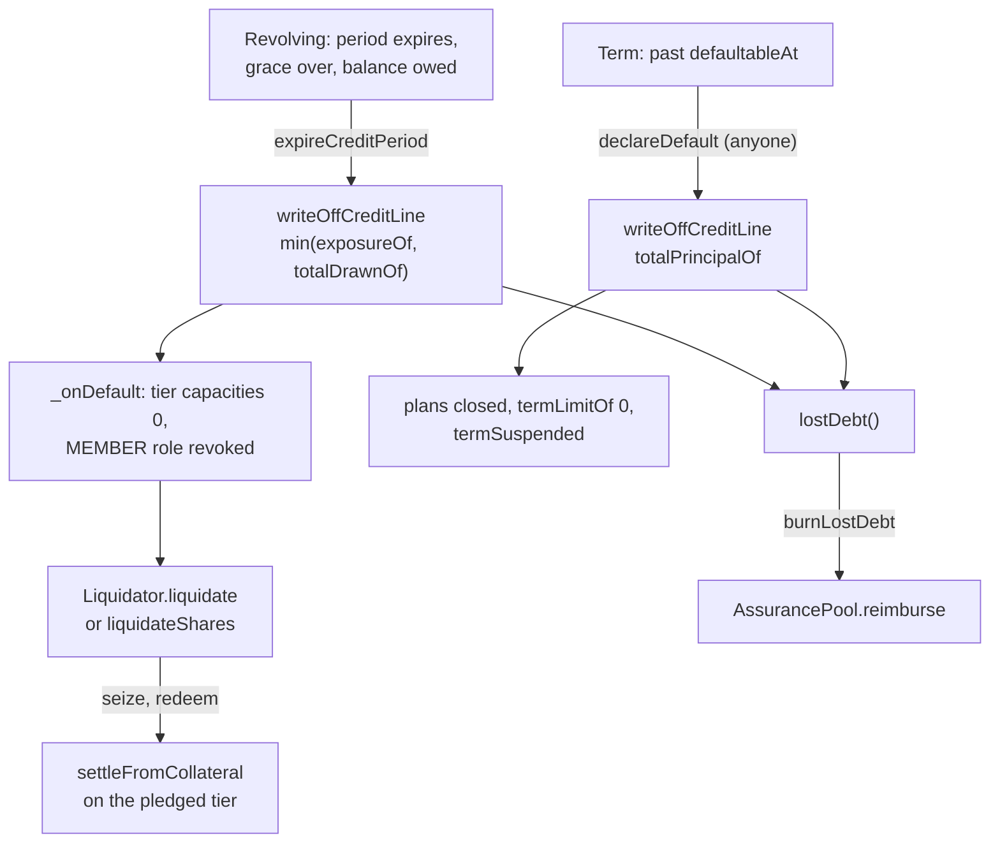

# Credit

**One ledger, several issuers.** `ClearCredit` records what each address owes and holds; the
issuers decide who may draw, how much, at what carry, and when a position has defaulted. All of them
write to the same ledger through the same `NetworkRegistry`. Deployed addresses are in the root
[`README.md`](../../README.md) (**Deployed addresses**).

| Contract | Role |
|---|---|
| `MutualCredit.sol` | ERC-20 base with a credit line per address: mint on overdraw, burn on receipt |
| `StableCredit.sol` | The ledger's rules: issuer gating, the three-party mint, repayment routing, lost debt |
| `ClearCredit.sol` | The deployable ledger. Adds an external `initialize` to `StableCredit` and nothing else |
| `CreditIssuer.sol` | Base issuer: credit periods, compliance, freeze, default, write-off, ITD |
| `RevolvingIssuer.sol` | The tiered revolving line and card settlement |
| `TermIssuer.sol` | Term plans with split schedules, under their own `termLimitOf` |
| `OffersIssuer.sol` | A capped line the co-op draws to give new members a one-time offer |
| `CollateralRegistry.sol` | Pledges per member, exposure per member, the CLRUSD lock |
| `LimitCalculator.sol` | Collateral value × haircut, or an attested figure, written onto the revolving tiers |
| `Liquidator.sol` | Seizes pledged CLRUSD or pool shares and settles the tier they backed |
| `AccessManager.sol` | Admin, operator and member roles |
| `MembershipRegistry.sol`, `NetworkRegistry.sol` | Membership records `AccessManager.isMember` reads; issuer → (ledger, pool, oracle) and member → issuers |
| `CreditPool.sol` | Legacy: credits deposited for reserve token at `discountRate`, serviced from a queue. No deploy script or spec uses it |
| `CarryIndex.sol`, `ExposureMath.sol` | Lazy carry accrual (one index per tier, one per plan); what the AssurancePool would pay on a position |

---

## The ledger

**Each address has two figures: credits held (`balanceOf`) and credits owed (`creditBalanceOf`).**
Held credits are claims on the network — a merchant's balance is what it is owed. The token has 6
decimals; `creditLimitOf` is the ceiling. A transfer nets the two. `MutualCredit._beforeTransfer` mints whatever the sender's held balance
does not cover, and raises their `creditBalance` by the same amount, reverting with
`Insufficient credit` past `creditLimitLeftOf`. `_afterTransfer` burns whatever arrives against
the recipient's `creditBalance` first. Mints that are not transfers do not net:
`_accrueCredit` raises an obligation and mints the matching claim to someone else, without
consulting what the obligor already holds, so an address can hold credits and owe at once.

### Entries that are not transfers

| Function | Caller | Effect |
|---|---|---|
| `originatePurchase(member, purchase, merchant, payout, coop, discount)` | issuer | Asserts `purchase == payout + discount` and `owed + purchase <= creditLimitOf`, then `_accrueCredit` to the merchant and the co-op |
| `reversePurchase(...)` | issuer | Same netting check. Burns the co-op's discount (reverts if it holds less) and as much of the merchant's payout as it holds; the rest moves to the merchant with `_transferObligation` (`RefundOwedByMerchant`) |
| `repayRefund(member, paid, merchant, merchantShare, coop, coopShare, carryWithheld)` | issuer | Takes each share back (burn, else an obligation on the holder), then `payoutPool.payRefund(member, paid − carryWithheld)` |
| `accrueCarry(member, recipient, amount)` | issuer | `_accrueCredit`: the member owes more, the recipient holds more. Not limit-checked |
| `settleClaim(holder, amount)` | PayoutPool only | Burns a claim the pool paid with a member's repayment |
| `writeOffCreditLine(member, amount)` | issuer | Moves up to `amount` of the member's debt to the ledger's own line, adds it to `lostDebt()`, and zeroes the caller's ceiling allocation |

Origination is capital-free: three entries that sum to zero and no reserve token moves. The refund
arithmetic is in [Refunds and repayments](./refund-repayment-plan.md).

### Who may write, and the ceiling

`onlyCreditIssuer` admits a caller only when `networkRegistry.isIssuerOf(caller, address(this))`.
A transfer requires the sender to be a member, an operator or the payout pool (`senderIsMember`),
then asks every issuer either party is enrolled with (`_validateAcrossIssuers`); one refusal reverts
with `StableCreditTransactionInvalid`. `_systemTransfer` — opening a line, a write-off, an undirected
repayment — notifies issuers through `syncCreditPositions` and cannot be refused.

**The ceiling is a sum.** `issuerCreditLimit[issuer][member]` is each issuer's part, set by
`createCreditLine` (which enrols the member and grants the MEMBER role if needed) and
`updateCreditLimit` (which refuses a total below what is owed). `_syncCreditLimit` rewrites
`creditLimitOf` as the sum over `networkRegistry.issuersOf(member)` on every change.

### Repayment

`repayCreditBalance(member, amount)` (anyone, in reserve token) and credits sent to a member who
owes are undirected: the waterfall below attributes them. `repayCreditBalanceFor(payer, member,
amount)` is issuer-only and directed: the calling issuer records it and no other is told. Reserve
token goes through `_routeRepayment`: the payout pool takes up to `totalSupply() −
payoutPool.held()`, the AssurancePool (`depositRepayment`) the rest, or all of it when no payout pool
is set. See [`settlement.md`](./settlement.md) and [`reserve.md`](./reserve.md).

**An undirected repayment clears the dearest position first, across issuers.**
`_settleRepayment` asks each issuer for `nextRepaymentRate(member)`, takes the highest, and offers
the remaining amount to every issuer through `absorbRepayment(member, remaining, band)`. Each takes
positions at or above that rate and returns what it took. The ledger repeats for up to
`MAX_WATERFALL_BANDS` (16) bands. Anything unattributed stays visible as a gap between the ledger
and the issuers rather than being corrected.

Since Phase 4b (re-review L-G) the rate is the **effective** monthly rate at the moment of
repayment, after the caps, not the configured tier or plan rate: monthly basis points times
`RATE_SCALE` (1e18). `RateSchedule.revolvingRatesOf` prices each revolving tier (its own rate, or
its list rate trimmed by the member-level ceiling, dearest priced tier first, as accrual trims it),
and `RateSchedule.termRateOf` prices each plan (min(list, the cap on the plan and on the member's
CFL aggregate), the annual cap once large, less the merchant's subsidy, stated per month). Pending
counsel on what "most expensive" means for a capped position.

**Lost debt.** The ledger's own address has a credit line of `type(uint128).max − 1`.
`writeOffCreditLine` transfers from it to the member, burning their debt and leaving the credits
they spent in circulation. `lostDebtOutstanding` rises only there and falls only in `burnLostDebt`,
where a holder gives up credits for `AssurancePool.reimburse`, capped at `lostDebt()`.

---

## Issuers

### CreditIssuer — the base

A credit period (`issuedAt`, `expiration`, `graceLength`, `paused`) is set by the `onlyOperator`
`initializeCreditLine` or `updateCreditPeriod`.

| State | Test | Effect on a transfer |
|---|---|---|
| Active | before `expiration` | Allowed |
| Frozen | in grace and `!inCompliance` | Refused as recipient; refused as sender drawing on credit unless the period is paused |
| Default | grace over and `!inCompliance` | Refused as recipient; as sender, runs `expireCreditPeriod` |

The base `inCompliance` is `creditBalanceOf(member) == 0`. A sender spending only what they hold
always passes. `expireCreditPeriod` deletes the period; in default it also records `defaultedAt`
(read by `hasDefaulted`, so the fact outlives the period), calls `writeOffCreditLine(member,
_writeOffAmount(member))` and `_onDefault`, which in the base revokes the MEMBER role. On a
defaulted sender's transfer it returns false and the ledger reverts everything, write-off included;
the permissionless `syncCreditPeriod(member)` runs the same check without a transfer and is the call
that makes a default stick. `itdOf` and `meetsITD` expose an income-to-debt ratio that nothing
enforces.

### RevolvingIssuer — the tiered line

**One balance, one ceiling, composed of tiers ordered by ascending rate.** `addTier` reverts with
`RevolvingIssuerRatesMustAscend` below the previous tier's rate and `RevolvingIssuerCycleMismatch`
on a different cycle length; `setTierRate` keeps the order both ways and checkpoints the index.
`setTierActive(false)` stops new draws only. `openLine` sets a capacity per tier, opens the ledger
line at their sum and starts a period of one cycle when `periodLength` is 0. `setTierCapacity`
(`onlyOperator`) reverts below what is drawn and writes the new total to the ledger.

**Draw cheapest first, repay dearest first.** On a transfer, `_syncCreditPositions` materialises
both parties' carry, then `_draw`s the sender's shortfall into active tiers in order, each up to
its headroom (`capacity − drawnOf`, carry included). `_absorbRepayment` walks the tiers from the
top, skipping any below the band the ledger offered.

Each tier has one `CarryIndex`. `_materialiseCarry` — on every interaction, and public as
`materialiseCarry(member)` — writes accrued carry to the ledger and raises `tierPrincipal` to match.

**Card settlement.** A swipe outside the network is paid from the co-op's float and recorded at
clearing, with the whole claim minted to the operator-set `cardSettlementAccount` and no discount
leg. All four functions require `isCardSettler[msg.sender]`. `settleCardSpend`, `repayCardSpend` and
`repayForMember` accept a given `ref` (the card issuer's transaction reference, hashed) once;
`reverseCardSpend` may be called on a settled `ref` until its amount is used up.

| Function | Effect |
|---|---|
| `settleCardSpend(ref, member, amount)` | Reverts unless active-tier headroom covers all of `amount`. `_draw`s the tiers, then `originatePurchase(member, amount, cardSettlementAccount, amount, cardSettlementAccount, 0)` |
| `reverseCardSpend(ref, amount)` | Up to what `ref` settled. Clears tiers dearest first and `reversePurchase` from the float |
| `repayCardSpend(ref, member, amount)` | A fiat repayment. Requires `amount <= totalPrincipalOf(member)` and the float to hold `amount`, then clears tiers and burns the float's claim against the member's obligation with `reversePurchase`. No reserve token moves |
| `repayForMember(ref, member, amount)` | Only while the member has called `setAutoRepay(true)`. Pulls the member's USDC with `repayCreditBalanceFor(member, member, amount)` and clears tiers dearest first |

### TermIssuer — plans

**A plan is a purchase with its own rate, clock and schedule.** `openPlan` (`onlyOperator`)
reverts unless `installments` is 1, 2, 4, 6 or 12 (`isOfferedSplit`), the member is neither
suspended nor behind on any plan, and `totalPrincipalOf(member) + purchase <= termLimitOf[member]`.
It initialises the plan's own `CarryIndex`, fixes its schedule, and calls `originatePurchase(member,
purchase, merchant, payout, _feeRecipient(), purchase − payout)`.

**The schedule is fixed when it opens.** `_fixSchedule` sets `scheduleTotal` with
`CarryIndex.scheduleCost` — a level annuity over the plan's own index — and `installmentAmount`
as that total divided by `installments`, rounded up. `installmentsDue` runs on wall-clock time.
`scheduledPrincipalDue` is `scheduleFloor + installmentAmount × due`, or `scheduleFloor +
scheduleTotal` once every installment is due. `arrearsOf` is that figure less `plan.repaid`.

`setSplit(planId, installments)` re-spreads what is outstanding from now. Arrears are not spread:
they go into `scheduleFloor` and are due at once. A member's own re-split reverts while behind, after
`MAX_SPLIT_CHANGES` (3), or within one `installmentLength` of the last; an operator's does not.

| Payment | Caller | Notes |
|---|---|---|
| `payPlan(planId, amount)` | anyone, paying | Directed: `repayCreditBalanceFor`, then the plan records it |
| `collectForMember(ref, member, amount)` | a card settler on `mandateSource` | Only while the member's `autoRepayEnabled` is on in the revolving issuer. Pays each plan's arrears in opening order, then residual carry. Never ahead of schedule |
| `payResidualCarry(member, amount)` | anyone, paying | Clears `residualCarryOf`: what the member owes beyond every open plan and revolving tier. Zero until `mandateSource` is set |
| undirected repayment | — | `_absorbRepayment` takes plans at or above the band, oldest first |

**Late handling.** `inCompliance` is overridden to `totalArrearsOf(member) == 0`. TermIssuer's own
functions never open a credit period, so falling behind refuses new plans and the member's own
re-splits but not ledger transfers. `delinquentSince` is the due date of the oldest installment not
yet covered; `defaultableAt` adds `DEFAULT_AFTER_INSTALLMENTS` (2) installment lengths, after which
anyone may call `declareDefault(member)` — see [Default](#default).

**Refunds.** `closePlanForRefund(planId, amount, merchant, payout)` (`onlyOperator`) reverses up to
the principal still owed and pays back, in cash, up to what was repaid and not already refunded
(`refundedOf`). Carry materialised in the call is withheld from the cash, up to the cash. The plan
closes once what is outstanding is no more than that carry.

**Fee and carry are separate recipients.** The co-op's leg of each purchase is minted to
`_feeRecipient()` — `feeRecipient`, or `carryTreasury` while unset — and refunds burn it from there.

### Two lines, not one

**A split plan draws only on `termLimitOf`. The revolving tiers are a separate line.**

| | Revolving | Term |
|---|---|---|
| Ceiling | Sum of `tierCapacity`, written by `setTierCapacity` / `LimitCalculator.pushCapacities` | `termLimitOf[member]`, written by `setTermLimit` (`onlyOperator`) |
| Underwritten on | Pledged collateral, or an attestation (`LimitCalculator.attest`) | An operator-entered figure; nothing on-chain reads collateral for it |
| Drawn by | A ledger transfer or `settleCardSpend` | `openPlan` only |

`originatePurchase` mints rather than transfers, so no issuer's `_syncCreditPositions` runs and a
plan never touches a tier. `LimitCalculator` writes only to the revolving issuer it is pointed at.
The ledger, though, sees one number. `creditLimitOf` is the sum of both allocations, and
`originatePurchase` also checks `creditBalanceOf + purchase <= creditLimitOf`, so a plan inside
`termLimitOf` still reverts with `StableCreditCeilingExceeded` when the member's combined debt
already fills the combined ceiling. A plain ledger transfer is checked only against that combined
ceiling: `_draw` places what the tiers have headroom for and does not refuse the rest.
`settleCardSpend` checks tier headroom itself.

### OffersIssuer — the offers line

**The co-op owes itself, on a capped line of its own.** `setCap` (owner or operator) opens or
resizes this contract's ledger line: `cap()` is its `creditLimitOf`, `owed()` its `creditBalanceOf`.

| Function | Caller | Effect |
|---|---|---|
| `grant(member)` | operator | Once per member, never past `cap()`. Enrols the member here at a zero limit, then transfers `offerAmount` from this line |
| `expire(member)` | anyone | After `grantedAt + expiryWindow`, takes back the unspent part, capped at what the member holds and what the line owes, with `reversePurchase(this, amount, member, amount, address(0), 0)` |
| `settle()` | anyone | Pulls USDC from `treasury` up to its allowance and balance (`treasuryAvailable`) and repays the line with `repayCreditBalance`, which routes it like any repayment |

Members are enrolled only so `_syncCreditPositions` can count spending against `unspentOf`;
`_validateCreditTransaction` always returns true. **It is not exposure:** `debtByKind` returns
nothing, so the line adds nothing to `CollateralRegistry.exposureOf`.

---

## Carry

**Carry is derived from an index, not charged.** `CarryIndex.currentIndex` compounds
`1 + ratePerCycle / 10_000` over whole cycles since `rateStart` and accrues linearly within the
current one, so it reads the same however often it is touched. `setRate` checkpoints `base` first.
Rates above `MAX_RATE_PER_CYCLE` (5,000 bps) revert. Positions store `amount / index`, rounded up on
draws and on repayment reductions (`normalizeUp`).

Carry reaches the ledger only when an issuer materialises it through `accrueCarry`, which is not
limit-checked: a member may come to owe more than their ceiling, and `creditLimitLeftOf` is then 0.

**Where carry goes.** A revolving tier's carry is minted to `tierCarryRecipient[tier]`, or the
issuer's `carryTreasury` when unset; a plan's to `TermIssuer.carryTreasury`. All are operator-set,
and neither treasury can be zero. What the PayoutPool does with carry it holds is in
[`settlement.md`](./settlement.md).

## Collateral and the ceiling

**A collateralised tier's capacity is the pledge after the same haircut exposure uses.**

`CollateralRegistry` records pledges (`pledge`, `pledgeItem`, `OPERATOR_ROLE`); it does not hold
them. Since Phase 4b (re-review L-I) each pledge carries the member's EIP-712 signature (`Pledge` or
`PledgeItem`, domain `Clear CollateralRegistry` / `1`, with `pledgeNonces(member)` and a deadline);
the operator only submits it. `collateralValueOf` asks the kind's valuer when one is set — zero if it reverts — and is
otherwise `units × unitPrice / 1e18`. `haircutBps` is the realisable share, at most 10,000.

`LimitCalculator.capacityOf(member, kind)` is `collateralValue × haircutBps / 10_000` when anything
is pledged under that kind, else the attested figure (`attest`, `ATTESTOR_ROLE`), which takes effect
at its `effectiveFrom`. `pushCapacities(member)` is permissionless: it writes every tier through
`setTierCapacity`, reverts with `LimitCalculatorYieldExceedsCarry` when `collateralYieldOf[kind]` is
at or above the tier's rate, and calls `refresh(member)`.

**Savings feed the ceiling as the `SAVINGS` kind.** Pledged CLRUSD is valued and haircut like any
other kind. `clrusdKind` names it, and `encumberedOf(holder)` returns the units
needed to cover what is drawn under it: `drawn × 10_000 / haircutBps`, converted to units. CLRUSD
refuses any transfer out of that amount and lets a `LIQUIDATOR_ROLE` holder `seize` up to it. The
savings side is in [`savings.md`](./savings.md).

`exposureOf(member)` — what the pool would pay if the member defaulted on everything — applies
`ExposureMath.positionExposure` to each issuer's `debtByKind`: zero for `Savings`, `debt −
collateral × haircut` floored at zero for `AssetExternal` and `AssetInternal`, all of it for
`Unsecured`. An unregistered kind falls back to `ExposureMath.backingOf`: anything but `SAVINGS`,
`ASSET_EXTERNAL` and `ASSET_INTERNAL` is unsecured, including term debt (`TERM`). `totalExposure` is
a running sum that the permissionless `refresh(member)` adjusts. `release` will not free units still
needed; `releaseItem` will not free anything while the kind is drawn.

`deploy/20_deploy_CreditCore.ts` adds five tiers in this order — `SAVINGS` (Savings, 10,000),
`BOND` (AssetInternal, 9,500, valued by a valuer), `POOL_SHARE` (AssetInternal, 7,000), `INCOME` and
`BOOST` (Unsecured) — and sets `clrusdKind` to `SAVINGS`.

## Default

**Revolving.** `_writeOffAmount` is `CollateralRegistry.exposureOf(member)` — which counts every
issuer the member is enrolled with — capped at `totalDrawnOf(member)`, or the whole drawn amount
with no exposure source. `_onDefault` zeroes tier capacities and revokes the MEMBER role; positions
stay.

**Write-offs are attributed like repayments.** `writeOffCreditLine` credits the member through
`_systemTransfer`, so `_settleRepayment` offers the written-off amount to the member's issuers by
rate band, dearest first, whichever issuer declared the default. On a revolving-only member that
clears the dearest tiers — the unsecured ones in the deployed configuration — and leaves the savings
tier drawn for liquidation. A term write-off on a member who also holds a dearer revolving tier is
absorbed by that tier first; `TermIssuer._onDefault` then closes the plans regardless.

**Liquidation.** `Liquidator.liquidate(member, issuer, tierId, kind)` (`OPERATOR_ROLE`) requires
`inDefault` or `hasDefaulted` on that issuer. Since Phase 4b (re-review M-C) the recorded default
must be the current line's: `hasDefaultedOnCurrentLine`, true when `defaultedAt >= lineOpenedAtOf`
(`openLine` records it). `hasDefaulted` stays true for ever, for the record and underwriting; a
member who defaulted, settled and was given a new line is current on it and cannot be liquidated. It seizes `min(principalOf(member, tierId), CLRUSD
balance)` with `ClearUSD.seize`, records the seizure in the registry, redeems the CLRUSD at
`ESADepositVault`, and calls `settleFromCollateral(member, tierId, redeemed)`. That settles the named
tier through `repayCreditBalanceFor`, so the waterfall is not told. `liquidateShares` does the same
with pool shares, redeems what the pool can pay now and queues the rest; `settleRealized` applies
cash the Liquidator holds to the tier later. The Liquidator has no call that claims its queued
request, and it needs the pool's `LIQUIDATOR_ROLE`, which no deploy script grants
([Settlement → LendingPool](./settlement.md#lendingpool)). `settleFromSavings` lets a member do the same to their own `SAVINGS` tier at an
issuer the Liquidator trusts, without being in default. The Liquidator needs AccessManager operator
(`settleFromCollateral` is `onlyOperator`), the registry's `OPERATOR_ROLE` and CLRUSD's
`LIQUIDATOR_ROLE`.

**Term.** `declareDefault` materialises carry on every plan, writes off `totalPrincipalOf`, adds it
to `writtenOffOf`, closes every open plan, sets `termLimitOf` to 0 and `termSuspended`. Membership is
not revoked. `repayWrittenOff` (anyone) deposits reserve token into the AssurancePool against
`writtenOffOf − recoveredOf`. `reinstate` lifts the suspension for anyone once that is fully repaid,
and for an operator at any time; a new `setTermLimit` is still needed. What the AssurancePool holds
and how `reimburse` pays is in [`reserve.md`](./reserve.md).

## Access

| Contract | Authority it checks |
|---|---|
| `StableCredit` | `access.isAdmin` for setters and UUPS upgrades; `NetworkRegistry.isIssuerOf` for every issuer entry |
| `CreditIssuer` and children, `CreditPool` | `stableCredit.access().isOperator`; issuer UUPS upgrades by `owner()` |
| `OffersIssuer` | As above, except `setCap`, `setTerms`: owner or operator; `setTreasury`: owner |
| `CollateralRegistry`, `LimitCalculator`, `Liquidator`, `NetworkRegistry` | Their own `OPERATOR_ROLE` and `DEFAULT_ADMIN_ROLE`; `LimitCalculator` adds `ATTESTOR_ROLE` |
| `MembershipRegistry` | `REGISTRAR_ROLE`, `PAUSER_ROLE` |

`AccessManager.isOperator` is the `"OPERATOR"` role or admin. `isMember` is the `"MEMBER"` role, an
operator, or `membershipRegistry.isActiveMember` (ACTIVE, expiry zero or ahead), so `revokeMember`
does not remove a registry member. `grantOperator` is `onlyAdmin`. `grantMember` and `revokeOperator`
pass `onlyOperator`, but the inner `grantRole`/`revokeRole` require the role admin — `"OPERATOR"` for
`"MEMBER"`, `DEFAULT_ADMIN_ROLE` for `"OPERATOR"`.

**Membership records.** The API writes a `MembershipRegistry` record when a membership checkout is
paid through Stripe (`apps/api/src/services/memberBillingService.ts`): plan `YEARLY` as a
subscription whose record expires with the paid period and is revoked when the subscription ends,
or `LIFETIME` as a one-time payment with no expiry. The writer is the registrar
(`MEMBERSHIP_REGISTRY_*`, see [Going live](../operators/going-live.md#stripe)). The member app does
not start that checkout, and onboarding stores `membershipPlan: 'YEARLY'` for every member at no
charge, so app members have no registry record from it. Equity credits treat `LIFETIME` as
Accelerated (1.5× from the start, `payLedgerStore.ts`); everyone else is on the Standard multiplier.
The co-op's own definition of membership (the savings account, as in a credit union) is in
[Governance → Membership](../governance/membership.md); nothing on the chain records it.

`NetworkRegistry.registerIssuer` binds an issuer to a ledger, AssurancePool and oracle;
`enrolMember` is open to the issuer, its ledger or an operator; `deregisterIssuer` refuses while
anyone is enrolled. Since Phase 4b (re-review M-E) registering and deregistering an issuer are
`DEFAULT_ADMIN_ROLE` (the credit timelock after the handover), not the operator's. `deploy/20` makes `ClearCredit`, both issuers and `LimitCalculator` AccessManager
operators.
