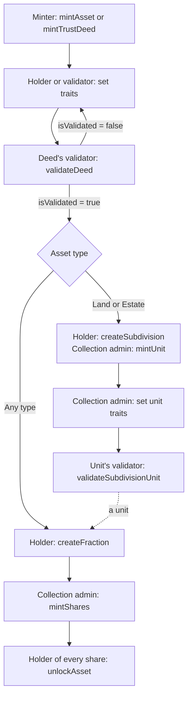

# Asset workflows

The calls that take a T-Deed through its life, in order, with who makes each one. The rules behind
each step are in [`protocol-overview.md`](./protocol-overview.md); every function's access and
events are in [`smart-contracts.md`](./smart-contracts.md). These describe the contracts on `dev`,
not the earlier build deployed on Base Sepolia.

All of these are direct contract calls. The Clear app has no screens for minting, validating,
subdividing or fractionalizing T-Deeds, and no service mints them yet.



Validation is not required before `createFraction`; the diagram shows the usual order.

---

## 1. Before the first mint

**`deploy/deploy_all.ts` does most of the wiring; a few steps depend on settings.** The list is in
[`smart-contracts.md`](./smart-contracts.md#deployment-and-wiring). In short:

1. A validator is registered and active in the `ValidatorRegistry` and supports the asset type
   ([validator lifecycle](./validation-system.md#a-validators-lifecycle)). For Vehicle and Commercial
   Equipment it has a default operating agreement; for Land and Estate it has adopted the trust
   agreement version and any riders with `adoptAgreementVersion`.
2. If mint fees are charged: `DeedNFT.setFundManager`, `FundManager.addCompatibleDeedNFT(DeedNFT)`,
   on the validator a whitelisted payment token with a non-zero `setServiceFee`, and the minter's
   own cap with `FundManager.setMaxFee(token, max)`.
3. The minter holds `MINTER_ROLE` on `DeedNFT` (`addMinter`).
4. For trust deeds: an eligible trustee (a signer of an active validator, or a licensed trustee
   listed with `ValidatorRegistry.setLicensedTrustee`), and, for the Verified policy, a
   `MembershipRegistry` set with `DeedNFT.setTrustRegistries`.

---

## 2. Mint

### Vehicle and Commercial Equipment

**The minter calls `DeedNFT.mintAsset` and names the owner.** Land and Estate revert here with
`TrustDeedRequired`.

```solidity
mintAsset(owner, assetType, uri, definition, configuration, validatorAddress, token, salt)
```

| Argument | Notes |
|---|---|
| `owner` | Receives the deed |
| `assetType` | `1` Vehicle or `3` CommercialEquipment |
| `uri` | Fallback metadata URI, used when the renderer returns nothing |
| `definition` | Required, non-empty. Becomes the metadata `description` |
| `configuration` | Optional |
| `validatorAddress` | Zero for the default validator |
| `token` | The fee token; zero when no `FundManager` is set |
| `salt` | Zero for the next sequential id; non-zero for a hashed id in [2¹²⁷, 2¹²⁸) |

### Land and Estate

**The minter calls `mintTrustDeed(params, trusteeAcceptance)` on the `DeedNFT` address, with the
`IDeedTrust` ABI.**

1. Compute the deed id with `computeDeedId(assetType, keccak256(definition), parcelRef, owner, salt,
   agreementHash, riderHashes)`. The owner can reserve it with `reserveId` first.
2. The trustee accepts: it signs the EIP-712 digest from `trusteeAcceptanceDigest(deedId, trustee)`
   (passed as `trusteeAcceptance`), or calls `approveTrustAction` on it and the minter passes empty
   bytes. The trustee must be eligible and must not be the owner or the protector.
3. The minter calls `mintTrustDeed` with the owner, `assetType` `0` or `2`, the definition,
   `parcelRef`, salt, an adopted `agreementHash` and rider hashes, configuration, URI, validator, fee
   token, trustee, protector (zero for the holder), `transferPolicy` (`0` Open, `1` Verified, `2`
   Coop) and the program, if any. Coop needs a program.

With a `FundManager`, the minter (not the owner) pays the validator's service fee, so it approves the
`FundManager` for that amount of `token` and sets `setMaxFee` first. The deed starts with
`isValidated = false`. Events: `DeedNFTMinted`, and `TrustDeedMinted` for a trust deed.

---

## 3. Describe the asset

**The details a validator checks are separate traits on the deed.** The holder, or the deed's
validator or one of its signers, sets each one with `DeedNFT.setTrait`:

```solidity
setTrait(tokenId, bytes("parcelNumber"), bytes("APN 123-456-789"), 1) // 1 = string
```

Use string values (`valueType` 1). The trait keys for each asset type are on its page:
[land](./assets/land-assets.md), [vehicles](./assets/vehicle-assets.md),
[estates](./assets/estate-assets.md), [commercial equipment](./assets/commercial-equipment.md).
Set them before validation: once the deed is validated, the holder can no longer change the traits
the validator's criteria require.

Supporting records go to the `MetadataRenderer`: the deed's validator records documents
(`manageTokenDocument`) and legal information (`setTokenLegalInfo`); the holder, the validator or the
renderer owner sets `setTokenFeatures` and `setAssetCondition`; the `image` trait or the admin's
`setTokenGallery` sets pictures ([`metadata-renderer.md`](./metadata-renderer.md#stored-details)).

---

## 4. Validate

**An operator of the deed's own validator calls `Validator.validateDeed(tokenId)`.** It checks the
asset type, operating agreement, definition and required traits, then writes the result to the deed
([`validation-system.md`](./validation-system.md#what-validatedeed-checks)). If the result is false,
fix the traits and call it again. Another validator's call reverts.

After this, a holder's `updateMetadata` (legacy deeds) or a trustee's `correctDefinition` (trust
deeds) sets the deed back to unvalidated; the validator has to run `validateDeed` again. To move a
deed to another validator, the holder calls `reassignValidator`, and on a trust deed
`completeValidatorReassignment` once the delay has passed.

---

## 5. Subdivide (Land and Estate)

**The deed's holder hands the deed to `Subdivide`, and the collection admin mints units.**

1. The holder calls `DeedNFT.approve(Subdivide, deedId)`. `Subdivide` is on `DeedNFT`'s
   approved-marketplace list after deployment.
2. `Subdivide.createSubdivision(deedId, name, description, symbol, collectionUri, totalUnits, burnable)`.
   The deed must be validated. `Subdivide` takes custody of it, and the caller becomes the
   collection admin.
3. The collection admin calls `mintUnit(deedId, unitId, to)` or
   `batchMintUnits(deedId, unitIds, recipients)`, with unit ids from 0 to `totalUnits - 1`.
4. The collection admin sets each unit's own traits with `setUnitTraitFlexible`, including every
   trait the validator's criteria require. Units copy only `assetType`, `operatingAgreement`,
   `definition` and `configuration` from the deed.
5. The unit's validator calls `Validator.validateSubdivisionUnit(Subdivide, deedId, unitId)` for
   each unit.

Units move with ERC-1155 `safeTransferFrom`. To close the subdivision, burn every unit
(`burnUnit`, while `burnable`), then the collection admin calls `deactivateSubdivision`, which
returns the deed. See [`subdivision.md`](./subdivision.md).

---

## 6. Fractionalize

**The holder locks a deed or a unit in `Fractionalize` and mints shares against it.**

1. `Fractionalize` is on `DeedNFT`'s and `Subdivide`'s approved-marketplace lists after deployment.
   Without that, the next two steps revert while royalties are enforced.
2. For a deed, the holder calls `DeedNFT.approve(Fractionalize, deedId)`. For a unit, the holder
   calls `Subdivide.setApprovalForAll(Fractionalize, true)`.
3. The holder calls `Fractionalize.createFraction(params)` with `assetType` `DeedNFT` and the deed
   id, or `SubdivisionNFT` and the unit's id `(deedId << 128) | unitId`, a name and symbol,
   `totalShares`, `burnable` and an `approvalPercentage` of 51–100.
4. The holder, now the collection admin, mints with `mintShares(fractionId, amount, to)` or
   `batchMintShares`. `getFractionToken(fractionId)` gives the ERC-20 address.

A deed with an active subdivision cannot be fractionalized, because `Subdivide` holds it. See
[`fractionalization.md`](./fractionalization.md#known-limitations).

---

## 7. Unlock

**Whoever holds every outstanding share takes the asset back out.** Collect the token's whole supply
in one wallet, then call `Fractionalize.unlockAsset({fractionId, to, checkApprovals: false})`. The
shares are burned, whether or not the fraction is burnable, and the asset goes to `to`. While no
shares are outstanding, the collection admin can do the same. For a trust deed, `to` must pass the
deed's transfer rules.

---

## 8. Transfer and burn

- **Transfer.** The holder can transfer a deed directly. Anyone else moving it, including a
  marketplace, must be on `DeedNFT`'s approved-marketplace list while royalties are enforced. A trust
  deed must also pass its transfer policy: Open, Verified (a member recipient) or Coop (only through
  the `CoopTransferAgent`); see
  [Trust transfer rules](./protocol-overview.md#trust-transfer-rules). `royaltyInfo` names the deed's
  validator as the royalty receiver.
- **Coop sale.** The seller lists with `DeedNFT.safeTransferFrom(seller, CoopTransferAgent, tokenId,
  abi.encode(buyer, termsHash))`. The program sponsor may `exercise` or `waive` its right of first
  refusal within the window; the seller then calls `complete`, or `withdraw` at any time before.
- **Burn.** The holder calls `burnAsset(tokenId)` or `burnBatchAssets(tokenIds)`, even while
  `DeedNFT` is paused. The traits stay readable, the status becomes Retired, `DeedRetired` is
  emitted, and the id is never used again. A deed held by `Subdivide` or `Fractionalize` cannot be
  burned until it comes back out.
