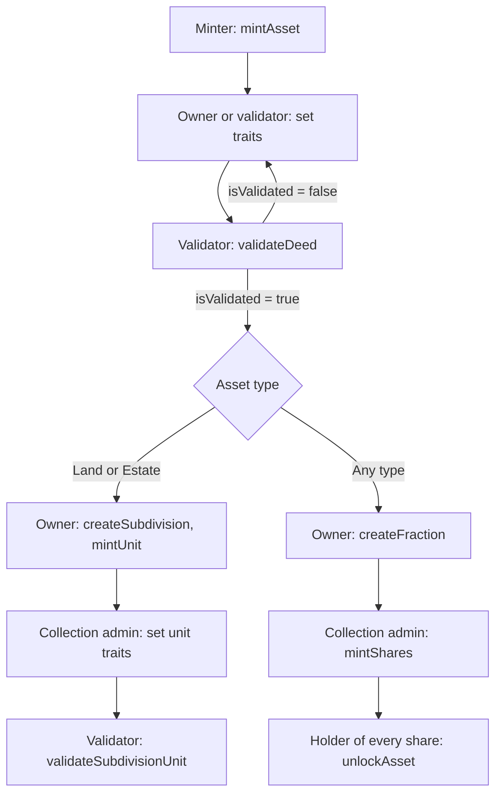

# Asset workflows

The calls that take a T-Deed through its life, in order, with who makes each one. The rules behind
each step are in [`protocol-overview.md`](./protocol-overview.md); every function's access and
events are in [`smart-contracts.md`](./smart-contracts.md).

All of these are direct contract calls. The Clear app has no screens for minting, validating,
subdividing or fractionalizing T-Deeds, and no service mints them yet.



Validation is not required before `createFraction`; the diagram shows the usual order.

---

## 1. Before the first mint

**An admin has to finish the wiring the deploy script leaves open.** The list is in
[`smart-contracts.md`](./smart-contracts.md#deployment-and-wiring). In short:

1. A validator is registered and active in the `ValidatorRegistry`, supports the asset type, and
   has a default operating agreement ([validator lifecycle](./validation-system.md#a-validators-lifecycle)).
2. If mint fees are charged: `DeedNFT.setFundManager`, `FundManager.addCompatibleDeedNFT(DeedNFT)`,
   and on the validator a whitelisted payment token with a non-zero `setServiceFee`.
3. Validation criteria are set on the validator. Until they are, every deed of a supported type
   validates.
4. The minter holds `MINTER_ROLE` on `DeedNFT` (`addMinter`).

---

## 2. Mint

**The minter calls `DeedNFT.mintAsset` and names the owner.**

```solidity
mintAsset(owner, assetType, uri, definition, configuration, validatorAddress, token, salt)
```

| Argument | Notes |
|---|---|
| `owner` | Receives the deed |
| `assetType` | `0` Land, `1` Vehicle, `2` Estate, `3` CommercialEquipment |
| `uri` | Fallback metadata URI, used when the renderer returns nothing |
| `definition` | Required, non-empty. Becomes the metadata `description` |
| `configuration` | Optional |
| `validatorAddress` | Zero for the default validator |
| `token` | The fee token; zero when no `FundManager` is set |
| `salt` | Zero for the next sequential id; non-zero for a hashed nine-digit id |

With a `FundManager`, the minter (not the owner) pays the validator's service fee, so it approves the
`FundManager` for that amount of `token` first. The deed starts with `isValidated = false`.
Event: `DeedNFTMinted`.

---

## 3. Describe the asset

**The details a validator checks are separate traits on the deed.** The owner, or a validator,
sets each one with `DeedNFT.setTrait`:

```solidity
setTrait(tokenId, bytes("parcelNumber"), bytes("APN 123-456-789"), 1) // 1 = string
```

Use string values (`valueType` 1). The trait keys for each asset type are on its page:
[land](./assets/land-assets.md), [vehicles](./assets/vehicle-assets.md),
[estates](./assets/estate-assets.md), [commercial equipment](./assets/commercial-equipment.md).

Supporting records go to the `MetadataRenderer`: `manageTokenDocument` for documents,
`setTokenFeatures`, `setAssetCondition`, `setTokenLegalInfo`, and the `image` trait or
`setTokenGallery` for pictures ([`metadata-renderer.md`](./metadata-renderer.md#stored-details)).

---

## 4. Validate

**The validator's operator calls `Validator.validateDeed(tokenId)`.** It checks the asset type,
operating agreement, definition and required traits, then writes the result to the deed
([`validation-system.md`](./validation-system.md#what-validatedeed-checks)). If the result is
false, fix the traits and call it again.

After this, an owner's `updateMetadata` sets the deed back to unvalidated; the validator has to run
`validateDeed` again.

---

## 5. Subdivide (Land and Estate)

**The deed's owner creates the subdivision and mints units.**

1. `Subdivide.createSubdivision(deedId, name, description, symbol, collectionUri, totalUnits, burnable)`.
   The deed must be validated. The caller becomes the collection admin.
2. `mintUnit(deedId, unitId, to)` or `batchMintUnits(deedId, unitIds, recipients)`, with unit ids
   from 0 to `totalUnits - 1`.
3. The collection admin sets each unit's own traits with `setUnitTraitFlexible`, including every
   trait the validator's criteria require. Units copy only `assetType`, `operatingAgreement`,
   `definition` and `configuration` from the deed.
4. The validator's operator calls `Validator.validateSubdivisionUnit(Subdivide, deedId, unitId)`
   for each unit.

Units move with ERC-1155 `safeTransferFrom`. To close the subdivision, burn every unit
(`burnUnit`, while `burnable`), then the deed's owner calls `deactivateSubdivision`. See
[`subdivision.md`](./subdivision.md).

---

## 6. Fractionalize

**The deed's owner locks it in `Fractionalize` and mints shares against it.**

1. A `DeedNFT` admin has added `Fractionalize` to the approved-marketplace list
   (`setApprovedMarketplace(Fractionalize, true)`). Without it, the next two steps revert while
   royalties are enforced.
2. The owner calls `DeedNFT.approve(Fractionalize, deedId)`.
3. The owner calls `Fractionalize.createFraction(params)` with `assetType` `DeedNFT`, the deed id,
   a name and symbol, `totalShares`, `burnable` and an `approvalPercentage` of 51–100. Choose
   `burnable = true`: a non-burnable fraction cannot be unlocked once shares exist.
4. The owner, now the collection admin, mints with `mintShares(fractionId, amount, to)` or
   `batchMintShares`. `getFractionToken(fractionId)` gives the ERC-20 address.

Subdivision units cannot be fractionalized. See
[`fractionalization.md`](./fractionalization.md#known-limitations).

---

## 7. Unlock

**Whoever holds every minted share takes the deed back out.** Collect all shares in one wallet,
then call `Fractionalize.unlockAsset({fractionId, to, checkApprovals: false})`. The shares are
burned and the deed goes to `to`. Before any shares are minted, the collection admin can do the
same.

---

## 8. Transfer and burn

- **Transfer.** The owner can transfer a deed directly. Anyone else moving it, including a
  marketplace, must be on `DeedNFT`'s approved-marketplace list while royalties are enforced. Each
  transfer rewrites the `beneficiary` trait. `royaltyInfo` names the deed's validator as the
  royalty receiver.
- **Burn.** The owner calls `burnAsset(tokenId)` or `burnBatchAssets(tokenIds)`. The deed's traits
  are cleared.
