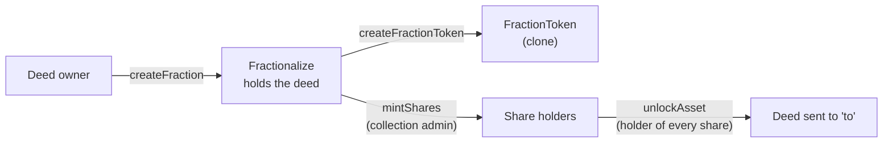

# Fractionalization

`Fractionalize` takes custody of a T-Deed and issues an ERC-20 share token against it. Each
fraction has an id, from 1, and its own `FractionToken`, cloned by `FractionTokenFactory`. The deed
comes back out through `unlockAsset`, to whoever holds every minted share.

Source: [`Fractionalize.sol`](../../../contracts/extensions/Fractionalize.sol),
[`FractionToken.sol`](../../../contracts/core/FractionToken.sol),
[`FractionTokenFactory.sol`](../../../contracts/core/factories/FractionTokenFactory.sol). Every
function, role and event is in [`smart-contracts.md`](./smart-contracts.md#fractionalize).



---

## Creating a fraction

**`createFraction(params)` moves the asset into `Fractionalize` and creates its share token.** The
caller becomes the fraction's collection admin.

`params` is a `FractionCreationParams`:

| Field | Meaning |
|---|---|
| `assetType` | `DeedNFT` (0) or `SubdivisionNFT` (1) |
| `originalTokenId` | The deed id, or a unit's ERC-1155 id `(deedId << 128) \| unitId` |
| `name`, `symbol` | The share token's ERC-20 name and symbol. `symbol` must not be empty |
| `description`, `collectionUri` | Stored on the fraction and returned by `getFractionExtendedInfo` |
| `totalShares` | The most shares that can ever be minted. Must be above zero |
| `burnable` | Whether shares can be burned. Fixed for the life of the fraction |
| `approvalPercentage` | 51–100. Stored as `requiredApprovalPercentage`; see [Known limitations](#known-limitations) |

What `createFraction` checks:

- The caller owns the asset. For a unit, the subdivision is active and the unit id is below its
  `totalUnits`.
- `totalShares`, `symbol` and `approvalPercentage`, as above.

What it does not check:

- **Validation.** An unvalidated deed can be fractionalized. `validateDeedNFTAsset` and
  `validateSubdivisionAsset` report a locked asset's validation status; nothing requires it.
- **An active subdivision.** A deed with one can still be locked. While `Fractionalize` holds the
  deed, no one can mint more units or deactivate the subdivision, because both follow the deed's
  owner.

**Moving the deed.** `Fractionalize` calls `DeedNFT.transferFrom`, so the owner must approve it
first. While `DeedNFT` enforces royalties, which it does from `initialize`, both that approval and
the transfer revert unless `Fractionalize` is on `DeedNFT`'s approved-marketplace list
(`setApprovedMarketplace(Fractionalize, true)`).

**The share token.** `FractionTokenFactory.createFractionToken` clones the `FractionToken`
implementation and initializes it with `Fractionalize` as its minter, the fraction's name and
symbol, `burnable`, and a per-wallet cap equal to `totalShares`. Events: `FractionCreated`,
`AssetLocked`.

---

## Minting and burning shares

**Only the collection admin mints, and never more than `totalShares` in all.**

```solidity
function mintShares(uint256 fractionId, uint256 amount, address to) external
function batchMintShares(BatchMintParams calldata params) external // fractionId, amounts[], recipients[]
```

- A zero recipient means the caller.
- `amount` must be above zero, and `activeShares + amount` must not exceed `totalShares`.
- The recipient's balance after minting must not exceed the per-wallet cap. The cap is
  `totalShares`, so one wallet can hold every share.
- Each mint adds to `activeShares` and emits `SharesMinted`.

**Burning.** `burnShares(fractionId, amount)` burns the caller's shares through the token's
`burnFrom` and reduces `activeShares`. It needs `burnable`. A holder can also call
`FractionToken.burn` directly, but that leaves `activeShares` unchanged; see
[Known limitations](#known-limitations).

**Transfers.** Shares are ordinary ERC-20 tokens. `transfer` and `transferFrom` revert if the
recipient would end up above the per-wallet cap.

---

## Unlocking the deed

**`unlockAsset(params)` ends the fraction and sends the asset to `params.to`.** `params` is an
`UnlockParams`: `fractionId`, `to` (not zero) and `checkApprovals`.

| State | Who can unlock |
|---|---|
| No shares minted (`activeShares == 0`) | The collection admin only |
| Shares minted, `checkApprovals` false | A caller holding every minted share (`getVotingPower == activeShares`) |
| Shares minted, `checkApprovals` true | No one; the check needs an approval nothing can set |

On unlock the fraction is marked inactive, every share the caller holds is burned, and the asset is
transferred to `to`. Validation status is not checked. Event: `AssetUnlocked`.

---

## Reading a fraction

| Function | Returns |
|---|---|
| `getFractionBasicInfo(fractionId)` | Name, symbol, `totalShares`, `activeShares`, `maxSharesPerWallet` |
| `getFractionExtendedInfo(fractionId)` | Description, `collectionUri`, `requiredApprovalPercentage`, `isActive`, `burnable` |
| `getFractionOwnershipInfo(fractionId)` | Asset type, original token id, collection admin |
| `getFractionToken(fractionId)` | The share token |
| `canReceiveShares(fractionId, account)` | Whether the account's balance is below the per-wallet cap |
| `getVotingPower(fractionId, account)` | The account's share balance |
| `getApprovals(fractionId, account)` | `(transferApproved, adminApproved)`, which are always false |
| `validateAsset`, `validateDeedNFTAsset`, `validateSubdivisionAsset` | Whether the locked asset is validated, with a short description |
| `getAssetInformation(fractionId)` | Asset kind, validation status, validator, and the deed's `tokenURI` (for a unit, its deed and unit ids) |
| `getDeedNFTAssetDetails`, `getDeedNFTAssetTrait`, `getDeedNFTAssetTraitKeys` | The locked deed's asset type, status and traits |
| `getSubdivisionAssetDetails`, `getSubdivisionAssetTrait`, `getSubdivisionAssetTraitKeys` | The same for a unit |

`getFractionToken` and the asset views revert once a fraction is inactive. `getVotingPower` is a
balance; there is no voting function.

---

## Roles and pausing

- **Collection admin**: the caller of `createFraction`. Mints shares and, before any are minted, can
  unlock. No function hands the role on.
- **`ADMIN_ROLE`** on `Fractionalize`: `pause` and `unpause`, which stop `createFraction`, minting,
  `burnShares` and `unlockAsset`. They do not stop share transfers.
- **`DEFAULT_ADMIN_ROLE`**: upgrades and role grants.

Each `FractionToken`'s own admin roles belong to `FractionTokenFactory`, which has no function that
uses them. A token's cap, `burnable` flag and pause cannot be changed after it is created.

---

## Known limitations

- **A subdivision unit cannot be fractionalized.** `createFraction` moves a unit with
  `safeTransferFrom`, which requires the receiver to implement `onERC1155Received`. `Fractionalize`
  does not, so the call reverts.
- **The `checkApprovals` unlock path never passes.** It counts the caller's shares only if
  `adminApprovals[caller]` is set, and nothing in the contract sets it. `requiredApprovalPercentage`
  has no other use.
- **A non-burnable fraction cannot be unlocked once shares are minted.** Unlocking burns the
  caller's shares through `burnFrom`, which reverts unless the token is burnable.
- **Shares burned with `FractionToken.burn` stay counted.** `activeShares` does not go down, so no
  one can hold every minted share afterwards and the deed cannot be unlocked. Burn through
  `burnShares`.
- **No tests cover `Fractionalize`, `FractionToken` or `FractionTokenFactory`.**
