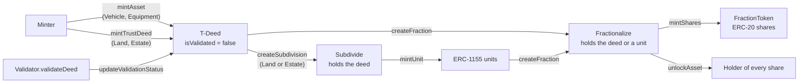

# The Deed track

> **Which build these pages describe.** They describe the Deed track contracts on `dev`: the Deed
> audit fixes (findings D-1 to D-23) and trust agreement v5. Base Sepolia runs this build since
> deploy 30, which upgraded `DeedNFT` in place and replaced the other Deed track contracts. Deeds
> minted there before the upgrade have no trust record and stay legacy deeds.

The Deed track is the part of the Clear Protocol for real-world assets. A **T-Deed** is an ERC-721
token from `DeedNFT` (name `DeedNFT`, symbol `DEED`) that stands for one asset: land, a vehicle, an
estate or a piece of commercial equipment. Its description lives on-chain as traits. The validator
recorded on the deed checks it against criteria for its asset type and records the result on the
token. Land and Estate deeds are trust deeds: each is minted with a trust agreement, a trustee, a
protector and a transfer policy. A validated land or estate deed can be split into ERC-1155 units,
and a deed or a unit can be locked against an ERC-20 share token.

**The Deed track is almost self-contained.** No contract outside it reads `DeedNFT`. It reads two
contracts from the rest of the protocol: the optional `TokenRegistry` lookup for payment tokens
([`token-registry.md`](../token-registry.md)), and the `MembershipRegistry`, which `DeedNFT` reads to
apply a trust deed's Verified transfer policy. In the app's language the Clear Deed is, on the
chain, a T-Deed ([glossary](../../overview/glossary.md)). No service mints T-Deeds yet.

Deployed addresses are in the root [`README.md`](../../../README.md#deployed-addresses) (**Deployed
addresses**). Each contract's functions, roles and events are in
[`smart-contracts.md`](./smart-contracts.md).

| Contract | Role |
|---|---|
| `DeedNFT.sol` | The T-Deed. ERC-721 with ERC-7496 traits, validation status, royalties to the validator, a marketplace allow-list. Serves the trust calls through its fallback |
| `DeedNFTMintExtension.sol`, `DeedTrustExtension.sol` | Code `DeedNFT` runs by `delegatecall` against its own storage: minting, Deed ID reservation and trait edits in the first; the trust calls and the transfer rules in the second. Pinned in `DeedNFT`'s constructor |
| `Validator.sol` | Checks a deed or a unit against its asset type's criteria and writes the result back. Sets the mint fee and the royalty rate, and adopts trust agreement versions for Land and Estate |
| `ValidatorRegistry.sol` | Which validators exist and which are active, who signs for each, and which licensed trustees are listed. Activating a validator grants it `VALIDATOR_ROLE` on `DeedNFT` |
| `FundManager.sol` | Takes the validator's service fee at mint, keeps a commission, holds the rest for the validator |
| `MetadataRenderer.sol` | Builds `tokenURI` for a deed from its traits plus stored features, condition, legal details, documents and gallery |
| `Subdivide.sol` | Takes custody of a validated land or estate deed and splits it into ERC-1155 units, one token per unit |
| `Fractionalize.sol` | Takes custody of a deed or a unit and issues ERC-20 shares against it |
| `FractionToken.sol` | The ERC-20 share token, one per fraction, with a per-wallet cap |
| `FractionTokenFactory.sol` | Clones a `FractionToken` for each fraction. Only `Fractionalize` may call it |
| `FunctionalContractRegistry.sol` | The contracts a trust deed may be deposited into under any transfer policy: `Subdivide`, `Fractionalize`, `CoopTransferAgent` |
| `CoopTransferAgent.sol` | The only route by which a Coop-policy trust deed changes hands, after the program sponsor's right-of-first-refusal window |
| `ValidatorFactory.sol` | Deploys an initialized `Validator` proxy and hands it to the caller. Not deployed |

---

## How the contracts connect

**`DeedNFT` is the hub; everything else either checks it or writes to it through a role.**

- **Minting asks the validator and the registry.** `mintAsset` and `mintTrustDeed` require
  `ValidatorRegistry.isValidatorActive`, then ask the chosen `Validator` for `supportsAssetType` and,
  if a `FundManager` is set, `getServiceFee`. `mintAsset` also reads `defaultOperatingAgreement`;
  `mintTrustDeed` reads `agreementVersionURI` for the agreement and every rider, and asks the
  registry `isEligibleTrustee` for the trustee.
- **The registry hands out the validator role.** `ValidatorRegistry.updateValidatorStatus` calls
  `DeedNFT.addValidator` or `removeValidator` for the validator whose status changed, and
  `removeValidator` revokes its role. Both also call `FundManager.updateValidatorRoles`, which gives
  each active validator `FEE_MANAGER_ROLE` on the `FundManager`.
- **Per-deed authority comes from the registry.** `DeedNFT` asks
  `ValidatorRegistry.isValidatorSigner(validator, account)` whether an account is the deed's own
  validator or one of its signers (a `VALIDATOR_ROLE` holder inside that `Validator`). That decides
  who besides the holder may edit a deed, and who may void one. `MetadataRenderer` asks
  `DeedNFT.isDeedValidator`, which uses the same check.
- **Validation is written back by the validator.** `Validator.validateDeed` reads the deed's traits
  with `getTraitValue` and records the result with `DeedNFT.updateValidationStatus`, which only the
  deed's recorded validator may call.
- **Fees route through the `FundManager`.** A mint calls `FundManager.processPayment`, which only
  accepts calls from a `DeedNFT` on its compatible list.
- **Metadata follows the traits.** `DeedNFT.tokenURI` asks `MetadataRenderer.tokenURI` first, and
  display-trait writes call `MetadataRenderer.syncTraitUpdate`. The renderer holds no role on
  `DeedNFT`.
- **Trust deeds read two more registries.** `DeedNFT.setTrustRegistries` sets the
  `FunctionalContractRegistry` and the `MembershipRegistry`, each once. The transfer rules read them on
  every transfer of a trust deed, and `beneficialOwnerOf` asks a registered Functional Contract whom
  it holds a deed for.
- **The extensions take custody.** `Subdivide` holds a deed while its subdivision is active.
  `Fractionalize` holds a deed or a unit while its fraction is active, and `FractionTokenFactory`
  clones the share token for it. `CoopTransferAgent` holds a listed Coop deed until the sale
  completes or the seller withdraws it.

---

## The asset lifecycle

### 1. Mint

**Only a `MINTER_ROLE` holder can mint, and it names the owner.** Vehicle and Commercial Equipment
deeds are minted with
`mintAsset(owner, assetType, uri, definition, configuration, validatorAddress, token, salt)`. Land
and Estate deeds are refused there (`TrustDeedRequired`) and minted with `mintTrustDeed`; see
[Trust deeds](#trust-deeds-land-and-estate).

1. The validator is `validatorAddress`, or the `DeedNFT`'s default validator if that is zero. It must
   be active in the registry, implement `IValidator`, support the asset type and have a default
   operating agreement.
2. If a `FundManager` is set, the caller — not the owner — pays the validator's service fee in
   `token` through `processPayment`, and must first have capped what it will pay with
   `FundManager.setMaxFee(token, max)`; a fee above the cap reverts `FeeAboveMax`. If no
   `FundManager` is set, `token` must be the zero address.
3. With `salt` zero the id is the next sequential id, from 1, skipping any id already taken. With a
   non-zero `salt` it is `generateUniqueTokenId(owner, assetType, definition, salt)`: 127 bits of a
   hash with bit 127 set, so it lies in [2¹²⁷, 2¹²⁸). An id ever minted, including a burned one, or
   reserved for a trust deed, is never used again (`DeedIdUnavailable`); `wasEverMinted` reports it.
4. The deed gets six traits: `assetType`, `isValidated` (false), `operatingAgreement` (the
   validator's default agreement URI with the token id appended), `definition`, `configuration` and
   `validator`. `DeedNFTMinted` is emitted. The beneficial owner is not a trait; read it with
   `beneficialOwnerOf`.

Asset types are the `DeedNFT.AssetType` enum: `Land` (0), `Vehicle` (1), `Estate` (2),
`CommercialEquipment` (3). What a validator looks for in each is under
[land](./assets/land-assets.md), [vehicles](./assets/vehicle-assets.md),
[estates](./assets/estate-assets.md) and [commercial equipment](./assets/commercial-equipment.md).

### 2. Validate

**The deed's own validator checks its traits against the criteria for its asset type.**
`Validator.validateDeed(tokenId)` needs `VALIDATOR_ROLE` on that `Validator`, and reads the deed from
the validator's `primaryDeedNFT`. If the asset type is not supported, or a required operating
agreement or definition is missing or not recognised, it records `false` on the deed and emits
`ValidationError` and `DeedValidated(tokenId, false)`. Otherwise it checks that every required trait
is present and non-empty, then calls `DeedNFT.updateValidationStatus` with the result.

- Only the validator recorded on the deed can write its status; any other caller reverts
  `NotDeedValidator`. The holder moves a deed to another active validator with
  `reassignValidator`, which resets validation. On a trust deed the change waits
  `validatorReassignDelay` (7 days by default) and completes with `completeValidatorReassignment`.
- If an asset type has no criteria, `validateDeed` marks the deed valid. `setupValidationCriteria`
  loads the built-in presets; `setValidationCriteria` sets custom ones.
- `updateMetadata` by the holder sets `isValidated` back to false and keeps the `validator` record.
  It reverts on trust deeds.
- `isValidated`, `validator`, `beneficiary` and the trust traits are reserved: `setTrait` and
  `removeTrait` refuse them for every caller. Only the deed's validator can set `assetType`, and once
  a deed is validated the holder cannot change the traits the validator vouched for. See
  [Reserved traits](./validation-system.md#reserved-traits).

The full rules are in [`validation-system.md`](./validation-system.md).

### 3. Subdivide

**A validated land or estate deed can be split into numbered units.** The deed's holder approves
`Subdivide` and calls `Subdivide.createSubdivision`, which takes custody of the deed and makes the
caller the collection admin. The collection admin mints units with `mintUnit` or `batchMintUnits`.
Each unit is its own ERC-1155 id, `(deedId << 128) | unitId`, with a supply of one, and it inherits
the deed's asset type, operating agreement, definition, configuration and validator. Units are
validated one by one with `Validator.validateSubdivisionUnit`. Once every unit is burned,
`deactivateSubdivision` returns the deed to the collection admin. See
[`subdivision.md`](./subdivision.md).

### 4. Fractionalize

**`createFraction` moves a deed or a unit into `Fractionalize` and issues an ERC-20 against it.** It
does not check that the asset is validated. The caller becomes the collection admin and is the only
one who can mint shares, up to `totalShares`. The asset comes back out through `unlockAsset`: while
no shares are outstanding, to wherever the admin sends it; otherwise only for someone holding the
token's whole supply, whose shares are burned. A deed with an active subdivision cannot be
fractionalized, because `Subdivide` holds it. More in
[`fractionalization.md`](./fractionalization.md).

### 5. Transfer and royalties

**T-Deeds move like any ERC-721, but only an approved marketplace can move one for its owner.**
Royalty enforcement is on from `initialize`. With it on, `approve` and `setApprovalForAll` revert
(`"!mkt"`) for an operator that is not on the `setApprovedMarketplace` list (clearing an approval
always works), and so does a transfer sent by anyone other than the owner or an approved
marketplace. A trust deed also has to pass the trust transfer rules below. `royaltyInfo` names the
deed's validator contract as the receiver, or the default validator if the deed names none, at that
validator's `royaltyFeePercentage` — 5% by default, and never more.

**Pausing `DeedNFT` stops minting, trait edits, `updateMetadata`, `updateValidationStatus` and
validator reassignment.** It does not stop burns, transfers or trust calls. An owner can always burn
a deed with `burnAsset` or `burnBatchAssets`. A burned deed keeps its traits, readable with
`getTraitValue`; its status becomes Retired (`statusOf` returns 1), `DeedRetired` is emitted with the
hashes of its definition, agreement and configuration, and its id is never minted again.

[`asset-workflows.md`](./asset-workflows.md) lists the calls for each step, in order.

---

## Trust deeds (Land and Estate)

**Every Land and Estate deed is minted into trust, with a trustee, a protector and a transfer
policy.** The trust applies only to these two asset types. `DeedNFT` serves the trust calls through
its `fallback`, which `delegatecall`s the extension pinned for them, so they are called on the
`DeedNFT` address with the `IDeedTrust` ABI (`contracts/core/interfaces/IDeedTrust.sol`).

### Minting into trust

`mintTrustDeed(TrustMintParams p, bytes trusteeAcceptance)` needs `MINTER_ROLE` and is paused with
minting. `p` names the owner, the asset type, the definition, a `parcelRef` (a hash of the recording
locator), a salt, the agreement hash and rider hashes, the configuration, a fallback URI, the
validator, the fee token, the trustee, the protector, the transfer policy and an optional program.

- **Agreement.** `p.agreementHash` and every rider hash must be adopted by the deed's validator for
  that asset type (`Validator.adoptAgreementVersion`); otherwise `AgreementNotAdopted`. The deed's
  `operatingAgreement` trait is the URI the validator adopted the hash under.
- **Trustee.** Must be eligible (`ValidatorRegistry.isEligibleTrustee`: a signer of an active
  validator, or a listed licensed trustee, never a validator contract), otherwise
  `TrusteeNotEligible`. It can never be the owner or the protector (`RoleConflict`). It accepts by an
  EIP-712 `TrusteeAcceptance` signature over the deed id passed as `trusteeAcceptance`, or, with that
  empty, by having called `approveTrustAction` on the same digest beforehand; otherwise
  `ConsentMissing`.
- **Protector.** `p.protector`, or, while that is zero, whoever holds the deed. With a program, the
  protector is the program sponsor (`ProtectorNotSponsor` if `p.protector` names someone else) and
  the trustee defaults to the program's title administrator.
- **Transfer policy.** `0` Open, `1` Verified, `2` Coop (`InvalidTransferPolicy` above 2). Coop
  needs a program (`ProgramRequired`), whose sponsor holds the right of first refusal.
- **`versionConsentRequired`** is true unless a program sets it otherwise.
- **Deed id.** `computeDeedId(assetType, definitionHash, parcelRef, reserver, salt, agreementHash,
  riderHashes)` hashes the agreement hash, the rider hashes and an identity hash (asset type,
  definition hash, `parcelRef`, owner, salt) into 127 bits with bit 127 set. The owner can claim the
  id in advance with `reserveId`, after which only a mint to that owner with the same inputs can use
  it. A trust id, like every id, is never reused.

The deed gets the six mint traits plus reserved trust traits: `agreementHash`, `riderHashes`,
`trustee`, `protector`, `transferPolicy`, `status` (0 Active) and `mintParamsHash`, and with a
program `programId`, `programSponsor`, `titleAdministrator` and `programParams`. Event:
`TrustDeedMinted`.

### Trust calls

| Call | Who | What it does |
|---|---|---|
| `setTrustee(tokenId, newTrustee, acceptance)` | The protector (the holder while none is recorded) | Replaces the trustee. Same eligibility, `RoleConflict` and acceptance rules as at mint. Clears a suspension |
| `setProtector(tokenId, newProtector)` | The current protector | Names a successor; never the trustee or the standby. Zero hands the role back to whoever holds the deed |
| `setStandbyTrustee(tokenId, standby, acceptance)` | The protector | An eligible standby that accepts now; not the holder, trustee or protector. Zero clears it |
| `applyLicensingDetermination(tokenId, docHash, uri, protectorConsent)` | Protector, trustee or standby | Posts the determination as a notice, then promotes the standby, or suspends the trustee if there is none. On the standby's own call it acts only with the protector's consent |
| `electAgreementVersion(tokenId, agreementHash, riderHashes, protectorConsent)` | The holder | Moves the deed to another adopted agreement version and riders. When `versionConsentRequired` is set and a protector is recorded, the protector must consent |
| `correctDefinition(tokenId, newDefinition, reasonURI, protectorConsent)` | The trustee, not suspended | Rewrites the definition with the protector's countersignature, and resets validation. Event: `MetadataCorrected` |
| `markVoid(tokenId, reasonCode, recordingRefHash, uri, cosigner, cosignerConsent)` | The deed's validator or a signer of it, or the trustee | Status Void. Codes below 128 leave the deed transferable; codes from 128 freeze it and need two distinct signers of the deed's validator, neither of them the trustee |
| `restoreFromVoid(tokenId, reasonURI, protectorConsent)` | The deed's validator or a signer of it, not the trustee | Lifts a Void with the protector's consent |
| `postNotice(tokenId, docHash, uri)` | Anyone | Emits `NoticePosted` naming the trustee and protector of the moment. Works on any deed ever minted |
| `approveTrustAction(digest)` | Anyone | Consent by a prior call instead of a signature; each approval is used once. The digests come from `trusteeAcceptanceDigest`, `standbyAcceptanceDigest`, `agreementConsentDigest`, `correctionConsentDigest`, `restoreConsentDigest`, `licensingConsentDigest` and `freezeConsentDigest` |
| `reserveId(...)`, `computeDeedId(...)`, `reservationOf(deedId)` | Anyone | Deed id reservation, as above |
| `trustRecordOf`, `isTrustDeed`, `statusOf`, `isRetired`, `protectorOf`, `lastFromOf`, `beneficialOwnerOf`, `trustRegistries` | Anyone | Reads. `statusOf` is 0 Active, 1 Retired, 2 Void. `beneficialOwnerOf` is the holder, or, when the holder is a registered Functional Contract, whoever it holds the deed for |

Signatures are EIP-712 in the domain `DeedNFT Trust`, version `5`, bound to the `DeedNFT` proxy, and
each consent is tied to the deed's trust nonce, which every consented action moves on. None of the
calls in this table is paused. No admin, validator or trustee path changes a deed's agreement or rider hashes, and none
moves value.

### Trust transfer rules

**Every transfer of a trust deed runs `DeedTrustExtension._onTransfer` after the marketplace check.**

1. A burn by the holder always passes and retires the deed.
2. A deed Void with a freezing code (128 or above) cannot move (`DeedFrozen`).
3. A transfer to the current trustee reverts (`TransferToTrustee`), unless the trustee is an active
   Functional Contract, in which case the transfer goes through and the trustee is marked suspended.
4. Otherwise the transfer passes if it returns the deed to the address it last came from
   (`lastFromOf`; not if that is a removed Functional Contract), goes into an active Functional
   Contract, or meets the policy:
   - **Open**: any recipient.
   - **Verified**: the recipient has a `MembershipRegistry` record that is not revoked or suspended.
     With no registry set, or one that cannot be read, no recipient meets it.
   - **Coop**: only a transfer sent from a registered `CoopTransferAgent`.

   Anything else reverts `TransferPolicyBlocked(policy)`.

So `Subdivide` and `Fractionalize` can take a Verified or Coop deed only because they are registered
Functional Contracts. A trustee, standby or protector cannot transfer, burn or freeze the deed.

---

## Roles

**Every contract starts with its deployer holding all of its roles.**
`deploy/deed_admin_handover.ts` moves every admin and upgrade power to `DEED_ADMIN`, a Deed
`TimelockController` with at least a 7-day delay, and the deployer renounces everything. Who holds
them now is in [Governance](../../governance/README.md).

| Role | Where | Allows |
|---|---|---|
| `DEFAULT_ADMIN_ROLE` | `DeedNFT`, `FundManager`, `Subdivide`, `Fractionalize` | Upgrades and granting roles. On `DeedNFT`, every setting: registry, default validator, renderer, `FundManager`, minters, marketplaces, royalty enforcement, pause, the trust registries (once each) and the validator reassignment delay. No admin path changes a deed's holder, definition, agreement, trustee or protector |
| Owner (`Ownable`) | `Validator`, `ValidatorRegistry`, `MetadataRenderer`, `FractionTokenFactory`, `ValidatorFactory` | Upgrades and configuration. On the registry, every registration, status change and licensed-trustee listing |
| `MINTER_ROLE` | `DeedNFT` | `mintAsset`, `mintTrustDeed` |
| `VALIDATOR_ROLE` | `DeedNFT` | `updateValidationStatus`, only for deeds that name the caller. Granted to active validators by the registry |
| `VALIDATOR_ROLE` | `Validator` | Calling `validateDeed` and `validateSubdivisionUnit`. Its holders are the validator's signers: they may edit and void the deeds that name it, and are eligible trustees |
| `CRITERIA_MANAGER_ROLE`, `METADATA_ROLE`, `FEE_MANAGER_ROLE` | `Validator` | Criteria and asset types; operating agreements and agreement versions; fees, royalties and payment tokens |
| `ADMIN_ROLE`, `FEE_MANAGER_ROLE` | `FundManager` | Commission, fee receiver, compatible `DeedNFT`s; withdrawing validator fees |
| `ADMIN_ROLE` | `Subdivide`, `Fractionalize` | Pause, and on `Subdivide` the marketplace list and granting `VALIDATOR_ROLE` |
| `VALIDATOR_ROLE` | `Subdivide` | `updateUnitValidationStatus`, for units whose recorded validator, or whose subdivision's validator, is the caller |
| `REGISTRAR_ROLE`, `REMOVER_ROLE` | `FunctionalContractRegistry` | Adding Functional Contracts (the Deed timelock); removing them at once (also the Foundation Safe) |
| Collection admin | Per subdivision or fraction | Minting units, unit metadata and traits, burnability and the unit validator; minting shares |

---

## Networks

**The Deed track is deployed on Base Sepolia only, at v5.** `deployments/base-sepolia/` records
`DeedNFT`, `Validator`, `ValidatorRegistry`, `FundManager`, `MetadataRenderer`, `Subdivide`,
`Fractionalize`, `FractionTokenFactory`, `FunctionalContractRegistry`, `CoopTransferAgent` and
`RedemptionAgent`. The contracts they replaced are recorded as `<Name>Legacy`. The deployer is still
the Deed admin; the Deed timelock is not deployed yet, and no trust agreement version is adopted yet,
so `mintTrustDeed` reverts `AgreementNotAdopted` until one is. `FractionToken`s are clones made per
fraction. `ValidatorFactory` has no deploy script and is
not deployed. Nothing on Base mainnet or Ethereum Sepolia belongs to the Deed track.

How the contracts are deployed and wired, and what the scripts leave for an admin to do afterwards,
is in [`smart-contracts.md`](./smart-contracts.md#deployment-and-wiring) and
[Operators](../../operators/deploying-contracts.md).

---

## Known limitations

- **The `checkApprovals` unlock path never passes.** `adminApprovals` is never set. See
  [`fractionalization.md`](./fractionalization.md#known-limitations).
- **`additionalCriteria` is stored and never checked**, and required traits must be strings. See
  [`validation-system.md`](./validation-system.md#known-limitations).
- **A subdivided deed's units are not affected by changes to the deed.** Units copy the deed's traits
  at mint. See [`subdivision.md`](./subdivision.md#known-limitations).

Tests for the audited Deed track are in `test/audit/deed/`: deployment and handover, lifecycle and
ids, metadata, subdivision and fractionalization, and the trust surface and its transfer rules.
