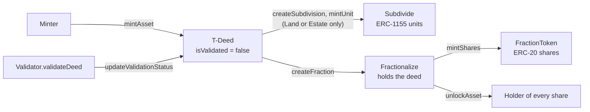

# The Deed track

The Deed track is the part of the Clear Protocol for real-world assets. A **T-Deed** is an ERC-721
token from `DeedNFT` (name `DeedNFT`, symbol `DEED`) that stands for one asset: land, a vehicle, an
estate or a piece of commercial equipment. Its description lives on-chain as traits. A validator
contract checks it against criteria for its asset type and records the result on the token. A
validated land or estate deed can be split into ERC-1155 units, and a deed can be locked against an
ERC-20 share token.

**The Deed track stands on its own.** No contract outside it reads `DeedNFT`, and the only piece it
shares with the rest of the protocol is the optional `TokenRegistry` lookup for payment tokens
([`token-registry.md`](../token-registry.md)). In the app's language the Clear Deed is, on the
chain, a T-Deed ([glossary](../../overview/glossary.md)). No service mints T-Deeds yet.

Deployed addresses are in the root [`README.md`](../../../README.md#deployed-addresses) (**Deployed
addresses**). Each contract's functions, roles and events are in
[`smart-contracts.md`](./smart-contracts.md).

| Contract | Role |
|---|---|
| `DeedNFT.sol` | The T-Deed. ERC-721 with ERC-7496 traits, validation status, royalties to the validator, a marketplace allow-list |
| `Validator.sol` | Checks a deed or a unit against its asset type's criteria and writes the result back. Sets the mint fee and the royalty rate |
| `ValidatorRegistry.sol` | Which validators exist and which are active. Activating one grants it `VALIDATOR_ROLE` on `DeedNFT` |
| `FundManager.sol` | Takes the validator's service fee at mint, keeps a commission, holds the rest for the validator |
| `MetadataRenderer.sol` | Builds `tokenURI` for a deed from its traits plus stored features, condition, legal details, documents and gallery |
| `Subdivide.sol` | Splits a validated land or estate deed into ERC-1155 units, one token per unit |
| `Fractionalize.sol` | Takes custody of a deed and issues ERC-20 shares against it |
| `FractionToken.sol` | The ERC-20 share token, one per fraction, with a per-wallet cap |
| `FractionTokenFactory.sol` | Clones a `FractionToken` for each fraction. Only `Fractionalize` may call it |
| `ValidatorFactory.sol` | Meant to deploy and register new validators. Not deployed; its `createValidator` always reverts |

---

## How the contracts connect

**`DeedNFT` is the hub; everything else either checks it or writes to it through a role.**

- **Minting asks the validator and the registry.** `DeedNFT.mintAsset` requires
  `ValidatorRegistry.isValidatorActive`, then asks the chosen `Validator` for `supportsAssetType`,
  `defaultOperatingAgreement` and, if a `FundManager` is set, `getServiceFee`.
- **The registry hands out the validator role.** `ValidatorRegistry.updateValidatorStatus` and
  `removeValidator` call `DeedNFT.addValidator` / `removeValidator` so that the active validators
  hold `VALIDATOR_ROLE` there and inactive ones do not. They also call
  `FundManager.updateValidatorRoles`, which gives each active validator `FEE_MANAGER_ROLE` on the
  `FundManager`.
- **Validation is written back by the validator.** `Validator.validateDeed` reads the deed's traits
  with `getTraitValue` and records the result with `DeedNFT.updateValidationStatus`.
- **Fees route through the `FundManager`.** `mintAsset` calls `FundManager.processPayment`, which
  only accepts calls from a `DeedNFT` on its compatible list.
- **Metadata follows the traits.** `DeedNFT.tokenURI` asks `MetadataRenderer.tokenURI` first, and
  every trait write calls `MetadataRenderer.syncTraitUpdate`. `setMetadataRenderer` gives the
  renderer `VALIDATOR_ROLE` on `DeedNFT` so it can write the `customMetadata` trait back.
- **The extensions read the deed and act for its owner.** `Subdivide` checks `DeedNFT.ownerOf`,
  `getValidationStatus` and `getTraitValue`. `Fractionalize` moves the deed into its own custody, and
  `FractionTokenFactory` clones the share token for it.

---

## The asset lifecycle

### 1. Mint

**Only a `MINTER_ROLE` holder can mint, and it names the owner.**
`mintAsset(owner, assetType, uri, definition, configuration, validatorAddress, token, salt)`:

1. The validator is `validatorAddress`, or the `DeedNFT`'s default validator if that is zero. It must
   be active in the registry, implement `IValidator`, support the asset type and have a default
   operating agreement.
2. If a `FundManager` is set, the caller — not the owner — pays the validator's service fee in
   `token` through `processPayment`. If none is set, `token` must be the zero address.
3. With a non-zero `salt` the id is `generateUniqueTokenId(owner, assetType, definition, salt)`, a
   hash reduced to nine digits. With `salt` zero it is the next sequential id, from 1.
4. The deed gets seven traits: `assetType`, `isValidated` (false), `operatingAgreement` (the
   validator's default agreement URI with the token id appended), `definition`, `configuration`,
   `validator` and `beneficiary` (the owner). `DeedNFTMinted` is emitted.

Asset types are the `DeedNFT.AssetType` enum: `Land` (0), `Vehicle` (1), `Estate` (2),
`CommercialEquipment` (3). What a validator looks for in each is under
[land](./assets/land-assets.md), [vehicles](./assets/vehicle-assets.md),
[estates](./assets/estate-assets.md) and [commercial equipment](./assets/commercial-equipment.md).

### 2. Validate

**A validator checks the deed's traits against the criteria for its asset type.**
`Validator.validateDeed(tokenId)` needs `VALIDATOR_ROLE` on that `Validator`, and reads the deed from
the validator's `primaryDeedNFT`. It fails — emitting `ValidationError` and writing nothing — if the
asset type is not supported, or if a required operating agreement or definition is missing or not
recognised. Otherwise it checks that every required trait is present and non-empty, then calls
`DeedNFT.updateValidationStatus` with the result.

- If an asset type has no criteria, `validateDeed` marks the deed valid. `setupValidationCriteria`
  loads the built-in presets; `setValidationCriteria` sets custom ones.
- `validateDeed` does not check which validator the deed names. Any active validator can validate
  any deed in its primary `DeedNFT`, and the `validator` trait becomes that validator.
- `updateMetadata` by the owner sets `isValidated` back to false and clears `validator`.
- `isValidated`, `validator` and `beneficiary` are reserved: `setTrait` and `removeTrait` refuse them
  for every caller, and only `VALIDATOR_ROLE` can set `assetType`. See
  [Reserved traits](./validation-system.md#reserved-traits).

The full rules are in [`validation-system.md`](./validation-system.md).

### 3. Subdivide

**A validated land or estate deed can be split into numbered units.** The deed's owner calls
`Subdivide.createSubdivision` and becomes the collection admin. The deed stays with its owner:
subdivision does not take custody. Whoever owns the deed at the time mints units with `mintUnit` or
`batchMintUnits`. Each unit is its own ERC-1155 id, `(deedId << 128) | unitId`, with a supply of one,
and it inherits the deed's asset type, operating agreement, definition, configuration and validator.
Units are validated one by one with `Validator.validateSubdivisionUnit`. See
[`subdivision.md`](./subdivision.md).

### 4. Fractionalize

**`createFraction` moves the deed into `Fractionalize` and issues an ERC-20 against it.** It does not
check that the deed is validated. The caller becomes the collection admin and is the only one who can
mint shares, up to `totalShares`. The deed comes back out through `unlockAsset`: before any shares
are minted, to wherever the admin sends it; after, only for someone holding every minted share, whose
shares are burned, which needs the fraction to be burnable. `createFraction` also accepts a
subdivision unit, but that path always reverts; see
[`smart-contracts.md`](./smart-contracts.md#fractionalize). More in
[`fractionalization.md`](./fractionalization.md).

### 5. Transfer and royalties

**T-Deeds move like any ERC-721, but only an approved marketplace can move one for its owner.**
Royalty enforcement is on from `initialize`. With it on, `approve` and `setApprovalForAll` revert
(`"!mkt"`) for an operator that is not on the `setApprovedMarketplace` list, and so does a transfer
sent by anyone other than the owner or an approved marketplace. Each transfer rewrites the
`beneficiary` trait to the new owner. `royaltyInfo` names the deed's validator contract as the
receiver, at that validator's `royaltyFeePercentage` — 5% by default, and never more.

Pausing `DeedNFT` stops minting, burning and `updateMetadata`, not transfers. An owner can burn a
deed with `burnAsset` or `burnBatchAssets`.

[`asset-workflows.md`](./asset-workflows.md) lists the calls for each step, in order.

---

## Roles

**Every contract starts with its deployer holding all of its roles.** Who holds them now is in
[Governance](../../governance/README.md).

| Role | Where | Allows |
|---|---|---|
| `DEFAULT_ADMIN_ROLE` | `DeedNFT`, `FundManager`, `Subdivide`, `Fractionalize` | Upgrades and granting roles. On `DeedNFT`, every setting: registry, default validator, renderer, `FundManager`, minters, marketplaces, royalty enforcement, pause |
| Owner (`Ownable`) | `Validator`, `ValidatorRegistry`, `MetadataRenderer`, `FractionTokenFactory` | Upgrades and configuration. On the registry, every registration and status change |
| `MINTER_ROLE` | `DeedNFT` | `mintAsset` |
| `VALIDATOR_ROLE` | `DeedNFT`, `Subdivide` | Writing validation status and traits. On `DeedNFT`, granted to active validators by the registry; on `Subdivide`, by `addValidator` |
| `VALIDATOR_ROLE` | `Validator` | Calling `validateDeed` and `validateSubdivisionUnit` |
| `CRITERIA_MANAGER_ROLE`, `METADATA_ROLE`, `FEE_MANAGER_ROLE` | `Validator` | Criteria and asset types; operating agreements; fees, royalties and payment tokens |
| `ADMIN_ROLE`, `FEE_MANAGER_ROLE` | `FundManager` | Commission, fee receiver, compatible `DeedNFT`s; withdrawing validator fees |
| `ADMIN_ROLE` | `Subdivide`, `Fractionalize` | Pause, and on `Subdivide` the marketplace list and granting `VALIDATOR_ROLE` |
| Collection admin | Per subdivision or fraction | Unit metadata and traits, burnability and the unit validator; minting shares |

---

## Networks

**The Deed track is deployed on Base Sepolia only.** `deployments/base-sepolia/` records `DeedNFT`,
`Validator`, `ValidatorRegistry`, `FundManager`, `MetadataRenderer`, `Subdivide`, `Fractionalize`
and `FractionTokenFactory`. `FractionToken`s are clones made per fraction. `ValidatorFactory` has no
deploy script and is not deployed. Nothing on Base mainnet or Ethereum Sepolia belongs to the Deed
track.

How the contracts are deployed and wired, and what the scripts leave for an admin to do afterwards,
is in [`smart-contracts.md`](./smart-contracts.md#deployment-and-wiring) and
[Operators](../../operators/deploying-contracts.md).

---

## Known limitations

- **`DeedNFT` has no `getAssetType`.** `Subdivide` calls it, so setting a unit's `assetType` trait
  reverts. See [`subdivision.md`](./subdivision.md#known-limitations).
- **A subdivision unit cannot be fractionalized.** `Fractionalize` has no `onERC1155Received`, so
  receiving a unit reverts.
- **The `checkApprovals` unlock path never passes.** `adminApprovals` is never set.
- **A non-burnable fraction cannot be unlocked once shares are minted.** Unlocking burns the shares.
  See [`fractionalization.md`](./fractionalization.md#known-limitations).
- **`ValidatorFactory.createValidator` reverts.** `Validator` disables initializers in its
  constructor, so the factory cannot initialize the validator it deploys.
- **No tests cover `Subdivide`, `Fractionalize` or `ValidatorFactory`.** `DeedNFT`, `Validator`,
  `ValidatorRegistry`, `FundManager` and `MetadataRenderer` have tests in `test/core/`.
