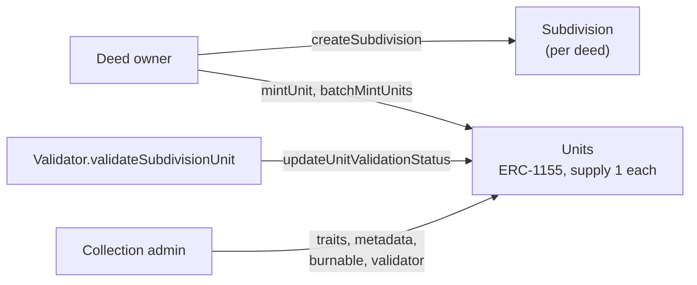

# Subdivision

`Subdivide` splits a validated Land or Estate T-Deed into numbered units. Each unit is its own
ERC-1155 token with a supply of one, so a unit behaves like a non-fungible token inside one
collection per deed. The deed itself stays with its owner.

Source: [`Subdivide.sol`](../../../contracts/extensions/Subdivide.sol). Every function, role and
event is in [`smart-contracts.md`](./smart-contracts.md#subdivide).



---

## Unit token ids

**A unit's token id packs the deed id and the unit id into one number.**

```solidity
tokenId = (deedId << 128) | unitId
```

The high 128 bits are the deed id; the low 128 bits are the unit id, from 0 to `totalUnits - 1`.
`uri` and `royaltyInfo` take this combined id. Most other functions take `deedId` and `unitId`
separately.

---

## Creating a subdivision

```solidity
function createSubdivision(
    uint256 deedId,
    string memory name,
    string memory description,
    string memory symbol,
    string memory collectionUri,
    uint256 totalUnits,
    bool burnable
) external
```

The caller must own the deed, and the deed must:

- be validated (`DeedNFT.getValidationStatus`), and
- have asset type Land (0) or Estate (2). Vehicles and commercial equipment cannot be subdivided;
  `supportsSubdivision(assetType)` reports this.

`totalUnits` must be above zero, `symbol` and `collectionUri` must not be empty, and the deed must
not already have an active subdivision. The caller becomes the collection admin. Event:
`SubdivisionCreated`.

**Subdivision does not take custody of the deed.** Its owner can still transfer or burn it. Minting
units and deactivating the subdivision follow whoever owns the deed at the time; the collection admin
stays whoever created the subdivision until the role is handed on.

---

## Minting units

```solidity
function mintUnit(uint256 deedId, uint256 unitId, address to) external
function batchMintUnits(uint256 deedId, uint256[] calldata unitIds, address[] calldata recipients) external
```

- **Only the deed's current owner can mint.** The subdivision must be active and the contract not
  paused.
- Each unit id must be below `totalUnits` and not already minted. A zero recipient means the deed's
  owner.
- Minting does not check the deed's validation status again.

Each new unit gets these traits:

| Trait | Value |
|---|---|
| `isValidated` | `false` |
| `parentDeed` | The deed id |
| `unitType` | `"Subdivision Unit"` |
| `beneficiary` | The recipient |
| `assetType`, `operatingAgreement`, `definition`, `configuration` | Copied from the deed |
| `validator` | The subdivision's validator if one is set, otherwise the deed's `validator` trait |

Event: `UnitMinted`, one per unit.

---

## Holding, transferring and burning units

- **Transfers** use the standard ERC-1155 `safeTransferFrom` and `safeBatchTransferFrom`, one unit
  at a time (`amount` must be 1). Each transfer rewrites the unit's `beneficiary` trait to the new
  holder. `ownerOf(tokenId)` returns the current holder.
- **Burning**: `burnUnit(deedId, unitId)` by the unit's holder, only while the subdivision is
  `burnable`. Event: `UnitBurned`.
- **Deactivating**: `deactivateSubdivision(deedId)` by the deed's current owner, once every minted
  unit has been burned. A deactivated subdivision's views revert, and the deed can be subdivided
  again. Event: `SubdivisionDeactivated`.

---

## The collection admin

**The collection admin manages a subdivision's units after they are minted.**

| Function | What it does |
|---|---|
| `setUnitMetadata(deedId, unitId, metadata)` | A per-unit metadata URI, returned by `uri` in place of the collection URI |
| `setBurnable(deedId, burnable)` | Whether holders can burn units |
| `setSubdivisionValidator(deedId, validator)` | A validator for units minted from now on. It must be active in the `ValidatorRegistry`; zero clears it |
| `setUnitTrait(deedId, unitId, traitKey, traitValue)` | Sets a trait from a `bytes32` key and raw bytes |
| `setUnitTraitFlexible(deedId, unitId, traitKey, traitValue, valueType)` | Like `DeedNFT.setTrait`: a 32-byte key is used as is, anything else is hashed and recorded as the trait's name. `valueType` 0 raw bytes, 1 string, 2 number, 3 boolean |
| `removeUnitTrait(deedId, unitId, traitName)` | Deletes a trait |
| `transferCollectionAdmin(deedId, newAdmin)` | Hands the role on |

`setUnitTraitName` (by `ADMIN_ROLE`) names a trait key for every unit.

---

## Validating units

**Units are validated one at a time, against their own traits.** A validator holding
`VALIDATOR_ROLE` on its `Validator` contract calls:

```solidity
function validateSubdivisionUnit(address subdivideContract, uint256 deedId, uint256 unitId) external
```

The check is the same as for a deed ([`validation-system.md`](./validation-system.md)), applied to
the unit's traits. Three things must be in place:

- `Subdivide` is on the `Validator`'s compatible list (`addCompatibleDeedNFT`).
- The `Validator` holds `VALIDATOR_ROLE` on `Subdivide` (`addValidator`, by `ADMIN_ROLE`) and is
  active in the `ValidatorRegistry`. The registry does not grant this role on `Subdivide`; only on
  `DeedNFT`.
- Every trait the criteria require is set on the unit itself. A unit copies only `assetType`,
  `operatingAgreement`, `definition` and `configuration` from its deed, so traits such as `country`
  or `parcelNumber` have to be set on each unit by the collection admin.

The result is written by `Subdivide.updateUnitValidationStatus`, which sets the unit's
`isValidated` and `validator` traits. Event: `UnitValidated`.

---

## Metadata and royalties

- **`uri(tokenId)`** returns the unit's own metadata URI if the collection admin set one, otherwise
  `collectionUri/unitId`.
- **`royaltyInfo(tokenId, salePrice)`** names the unit's `validator` contract as the receiver, at
  that validator's royalty rate. A unit with no validator falls back to the parent deed's `royaltyInfo`.
- **ERC-7496 reads**: `getUnitTraitValue`, `getUnitTraitValues`, `getUnitTraitKeys`,
  `getUnitTraitName`, `getUnitTraitMetadataURI`.
- **Status reads**: `getUnitValidationStatus`, `isUnitValidated`, `getUnitAssetType`,
  `getSubdivisionValidator`, `subdivisionExists`, `unitExists`, `getUnitMetadata`.

`Subdivide` stores an approved-marketplace list, a royalty-enforcement flag and a transfer validator
(`setApprovedMarketplace`, `setRoyaltyEnforcement`, `setToDefaultSecurityPolicy`,
`setTransferValidator`, all `ADMIN_ROLE`). No approval or transfer reads them, so unit transfers
are not restricted to approved marketplaces.

---

## Roles and pausing

- **Deed owner**: creates the subdivision, mints units, deactivates it.
- **Collection admin**: the table above.
- **`VALIDATOR_ROLE`** on `Subdivide`: `updateUnitValidationStatus`. Granted with `addValidator`.
- **`ADMIN_ROLE`**: pause, `addValidator` and `removeValidator`, trait names, the marketplace
  settings.
- **`DEFAULT_ADMIN_ROLE`**: upgrades.

`pause` stops `createSubdivision`, `mintUnit` and `batchMintUnits`. Transfers, burning and the
collection admin's functions keep working.

---

## Known limitations

- **`DeedNFT` has no `getAssetType`.** `Subdivide` calls it through `IDeedNFT`, so
  `setUnitTrait` and `setUnitTraitFlexible` revert on the `assetType` key, and `getUnitAssetType`
  reverts for a unit without its own `assetType` trait. Units minted normally copy `assetType` from
  the deed, so `getUnitAssetType` works for them.
- **A unit cannot be fractionalized.** `Fractionalize` cannot receive ERC-1155 tokens; see
  [`fractionalization.md`](./fractionalization.md#known-limitations).
- **The deed is not locked.** If its owner transfers it, the new owner controls minting and
  deactivation. If it is burned, no more units can be minted, the subdivision can never be
  deactivated, and `royaltyInfo` for a unit without a validator reverts.
- **A unit's validation does not follow the deed's.** Units start unvalidated, and a later change to
  the deed's status does not reach them.
- **No tests cover `Subdivide`.**
