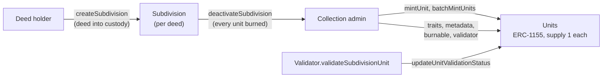

# Subdivision

`Subdivide` splits a validated Land or Estate T-Deed into numbered units. Each unit is its own
ERC-1155 token with a supply of one, so a unit behaves like a non-fungible token inside one
collection per deed. `Subdivide` holds the deed for as long as the subdivision is active.

Source: [`Subdivide.sol`](../../../contracts/extensions/Subdivide.sol). Every function, role and
event is in [`smart-contracts.md`](./smart-contracts.md#subdivide).



---

## Unit token ids

**A unit's token id packs the deed id and the unit id into one number.**

```solidity
tokenId = (deedId << 128) | unitId
```

The high 128 bits are the deed id; the low 128 bits are the unit id, from 0 to `totalUnits - 1`.
Every deed id is below 2¹²⁸ (sequential, or salted and trust ids in [2¹²⁷, 2¹²⁸)), and `totalUnits`
must fit in 128 bits (`IdOutOfRange`), so ids never collide. `uri` and `royaltyInfo` take this
combined id. Most other functions take `deedId` and `unitId` separately.

---

## Creating a subdivision

```solidity
function createSubdivision(
    uint256 deedId,
    string memory name,
    string memory description,
    string memory symbol,
    string memory collectionUri,
    uint256 totalUnits,
    bool burnable
) external
```

The caller must hold the deed, and the deed must:

- be validated (`DeedNFT.getValidationStatus`), and
- have asset type Land (0) or Estate (2). Vehicles and commercial equipment cannot be subdivided;
  `supportsSubdivision(assetType)` reports this.

`totalUnits` must be above zero, `symbol` and `collectionUri` must not be empty, the deed must not
already have an active subdivision, and the contract must not be paused. The caller becomes the
collection admin. Event: `SubdivisionCreated`.

**Subdivision takes custody of the deed.** `createSubdivision` moves the deed into `Subdivide` with
`DeedNFT.transferFrom`, so before calling it:

- the holder approves `Subdivide` for the deed (`DeedNFT.approve`);
- `Subdivide` must be on `DeedNFT`'s approved-marketplace list, which the deploy scripts set;
- for a trust deed with the Verified or Coop policy, `Subdivide` must be an active Functional
  Contract, which `deploy_all.ts` registers. An Open trust deed and a legacy deed need nothing more.

While `Subdivide` holds the deed, it cannot be sold, burned or fractionalized. The collection admin
is its beneficial owner (`Subdivide.beneficialOwnerOf`, and so `DeedNFT.beneficialOwnerOf`), and gets
it back when the subdivision is deactivated.

---

## Minting units

```solidity
function mintUnit(uint256 deedId, uint256 unitId, address to) external
function batchMintUnits(uint256 deedId, uint256[] calldata unitIds, address[] calldata recipients) external
```

- **Only the collection admin can mint.** The subdivision must be active and the contract not
  paused.
- Each unit id must be below `totalUnits` and not already minted. A zero recipient means the
  collection admin.
- Minting does not check the deed's validation status again.

Each new unit gets these traits:

| Trait | Value |
|---|---|
| `isValidated` | `false` |
| `parentDeed` | The deed id |
| `unitType` | `"Subdivision Unit"` |
| `beneficiary` | The recipient |
| `assetType`, `operatingAgreement`, `definition`, `configuration` | Copied from the deed |
| `validator` | The subdivision's validator if one is set, otherwise the deed's `validator` trait |

Event: `UnitMinted`, one per unit.

---

## Holding, transferring and burning units

- **Transfers** use the standard ERC-1155 `safeTransferFrom` and `safeBatchTransferFrom`, one unit
  at a time (`amount` must be 1). While royalties are enforced, which they are from `initialize`, a
  transfer sent by an operator other than the holder reverts (`"!mkt"`) unless the operator is on
  `Subdivide`'s approved-marketplace list (`setApprovedMarketplace`, by `ADMIN_ROLE`). The holder's
  own transfers are never blocked, and pausing does not stop them. Each transfer rewrites the unit's
  `beneficiary` trait to the new holder, except a transfer into an approved marketplace such as
  `Fractionalize`, which keeps the depositor. `ownerOf(tokenId)` returns the current holder.
- **Burning**: `burnUnit(deedId, unitId)` by the unit's holder, only while the subdivision is
  `burnable`. Not paused. Event: `UnitBurned`.
- **Deactivating**: `deactivateSubdivision(deedId)` by the collection admin, once every minted unit
  has been burned. It returns the deed to the caller, is never paused, and the deed can be subdivided
  again. A deactivated subdivision's views revert. Event: `SubdivisionDeactivated`. For a trust deed,
  the return passes the transfer rules when the admin is the address the deed came from. A new admin
  after `transferCollectionAdmin` must meet the deed's policy, which for a Coop deed no direct
  transfer does.

---

## The collection admin

**The collection admin is the beneficial owner of the held deed and manages the subdivision's
units.** Every function below needs the contract unpaused.

| Function | What it does |
|---|---|
| `setUnitMetadata(deedId, unitId, metadata)` | A per-unit metadata URI, returned by `uri` in place of the collection URI |
| `setBurnable(deedId, burnable)` | Whether holders can burn units |
| `setSubdivisionValidator(deedId, validator)` | A validator for the subdivision's units: written on units minted from now on, and allowed to validate every unit of the subdivision. It must be active in the `ValidatorRegistry`; zero clears it |
| `setUnitTrait(deedId, unitId, traitKey, traitValue)` | Sets a trait from a `bytes32` key and raw bytes |
| `setUnitTraitFlexible(deedId, unitId, traitKey, traitValue, valueType)` | Like `DeedNFT.setTrait`: a 32-byte key is used as is, anything else is hashed and recorded as the trait's name. `valueType` 0 raw bytes, 1 string, 2 number, 3 boolean |
| `removeUnitTrait(deedId, unitId, traitName)` | Deletes a trait |
| `transferCollectionAdmin(deedId, newAdmin)` | Hands the role on, and with it the right to the deed when the subdivision is deactivated |

**Unit trait limits.** The collection admin cannot write `isValidated`, `validator`, `beneficiary`
or `parentDeed` (`ReservedUnitTrait`), and cannot remove `assetType`. Setting `assetType` accepts
only Land or Estate. Any trait edit on a validated unit sets it back to unvalidated and emits
`UnitValidated(deedId, unitId, false)`, until its validator looks again.

`setUnitTraitName` (by `ADMIN_ROLE`) names a trait key for every unit.

For a subdivision created before `Subdivide` took custody, where the deed is still with its holder,
the collection admin's rights follow the deed's current holder instead.

---

## Validating units

**Units are validated one at a time, against their own traits.** A validator holding
`VALIDATOR_ROLE` on its `Validator` contract calls:

```solidity
function validateSubdivisionUnit(address subdivideContract, uint256 deedId, uint256 unitId) external
```

The check is the same as for a deed ([`validation-system.md`](./validation-system.md)), applied to
the unit's traits; a rejected unit is recorded as unvalidated. Four things must be in place:

- `Subdivide` is on the `Validator`'s compatible list (`addCompatibleDeedNFT`).
- The `Validator` holds `VALIDATOR_ROLE` on `Subdivide` (`addValidator`, by `ADMIN_ROLE`) and is
  active in the `ValidatorRegistry`. The registry does not grant this role on `Subdivide`; only on
  `DeedNFT`. The deploy scripts grant it to the default validator.
- The `Validator` is the unit's recorded `validator` or the subdivision's validator. Any other
  validator reverts `NotUnitValidator`.
- Every trait the criteria require is set on the unit itself. A unit copies only `assetType`,
  `operatingAgreement`, `definition` and `configuration` from its deed, so traits such as `country`
  or `parcelNumber` have to be set on each unit by the collection admin.

The result is written by `Subdivide.updateUnitValidationStatus`, which sets the unit's
`isValidated` and `validator` traits. It is paused with `Subdivide`. Event: `UnitValidated`.

---

## Metadata and royalties

- **`uri(tokenId)`** returns the unit's own metadata URI if the collection admin set one, otherwise
  `collectionUri/unitId`.
- **`royaltyInfo(tokenId, salePrice)`** names the unit's `validator` contract as the receiver, at
  that validator's royalty rate, if that validator is active in the registry. Otherwise it falls
  back to the parent deed's `royaltyInfo`.
- **ERC-7496 reads**: `getUnitTraitValue`, `getUnitTraitValues`, `getUnitTraitKeys`,
  `getUnitTraitName`, `getUnitTraitMetadataURI`.
- **Status reads**: `getUnitValidationStatus`, `isUnitValidated`, `getUnitAssetType` (the unit's
  own `assetType` trait), `getSubdivisionValidator`, `subdivisionExists`, `unitExists`,
  `getUnitMetadata`, `beneficialOwnerOf(deedId)`.

---

## Roles and pausing

- **Deed holder**: creates the subdivision.
- **Collection admin**: mints units, deactivates the subdivision, and the table above.
- **`VALIDATOR_ROLE`** on `Subdivide`: `updateUnitValidationStatus`, for the units it validates.
  Granted with `addValidator`.
- **`ADMIN_ROLE`**: pause, `addValidator` and `removeValidator`, trait names, the marketplace
  settings.
- **`DEFAULT_ADMIN_ROLE`**: upgrades.

`pause` stops `createSubdivision`, minting units, unit validation and every collection-admin
function. Transfers, burning units and `deactivateSubdivision` keep working.

---

## Known limitations

- **A unit's validation does not follow the deed's.** Units start unvalidated, and a later change to
  the deed's status does not reach them.
- **Units copy the deed's traits once, at mint.** A later change to the deed's traits, such as a
  validator's edit or a trustee's `correctDefinition`, does not reach units already minted.
- **A held trust deed's holder calls wait.** While `Subdivide` holds a trust deed, the calls only
  the holder can make, such as `electAgreementVersion` and `reassignValidator`, cannot be made, nor,
  when no protector is recorded, the protector's calls such as `setTrustee`.
- **A unit has no trust record of its own.** The trust transfer policies apply to the deed, which
  `Subdivide` holds; units move under `Subdivide`'s own rules above.
