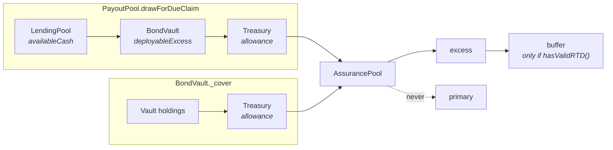

# The reserve

The reserve is the money that makes a member default survivable. It lives in one contract,
`AssurancePool`, priced by `AssuranceOracle`, with token policy held in `TokenRegistry`. Bond
proceeds are not here — they sit in `BondVault` ([Bonds](./bonds.md)) — and merchant payables are
not here either — they sit in `PayoutPool` ([Settlement](./settlement.md)).

Deployed addresses are in the root [`README.md`](../../README.md) (**Deployed addresses**).

| Contract | Role |
|---|---|
| `AssurancePool.sol` | Holds the reserve in three tiers, measures it against pool exposure (RTD), reimburses lost debt, and lends to the PayoutPool and BondVault as a last resort |
| `AssuranceOracle.sol` | Prices any accepted token in the reserve token (Uniswap V3 TWAP, registry fallback) and serves the target RTD |
| `TokenRegistry.sol` | Whitelist, stablecoin flags and fallback prices the oracle reads |
| `ITargetRTDSource` | Optional risk model the oracle defers to for the target RTD |
| `IExposureSource` | What the pool would pay if every member defaulted — the RTD denominator. `CollateralRegistry` implements it |

## Three tiers

**Only the primary reserve counts toward the RTD.** The buffer and the excess are real money in the
same contract, but the ratio never sees them.

| Tier | Storage | What it is for | What spends it |
|---|---|---|---|
| Primary | `primaryReserve` | The cover the RTD is measured on | `reimburse` only, once the buffer is empty |
| Buffer | `bufferReserve` | First-loss cushion | `reimburse` first; lent by `lendToPayoutPool` / `lendToBondVault` while `hasValidRTD()` |
| Excess | `excessReserve` | Overflow above target | `withdraw` / `withdrawToken` by an approved instrument; lent first by both lend functions |

Each tier is one number in reserve-token units, keyed by the current `reserveToken`
(`primaryBalance()`, `bufferBalance()`, `excessBalance()`). The tokens themselves are commingled:
any accepted token can fund any tier, and its oracle value is what gets booked.

Every token the pool has taken in is recorded by `_registerHeldToken`, capped at
`MAX_HELD_TOKENS = 16` (`AssurancePoolTooManyTokens`). `heldReserveValue()` prices that whole set
and is a monitoring view, not a revert condition: comparing it with the three tiers is the solvency
check. A token the oracle cannot price is skipped and counted by `unpricedTokenCount()` /
`unpricedTokens()`, so accounting understates rather than reverts. The payout path does not tolerate
this — it uses the reverting conversion, so an unpriceable token is never paid out.

## RTD

**RTD is the primary reserve divided by what it stands behind.** `AssurancePool.RTD()`:

```
RTD = primaryBalance × 1e18 / ( convertStableCreditToReserveToken(poolExposure()) + bondExposure() )
```

| Input | Source |
|---|---|
| `poolExposure()` | `exposureSource.poolExposure()`, clamped to `stableCredit.totalSupply()`. With no source set, total supply — every credit treated as unsecured |
| `bondExposure()` | `BondVault.uncoveredNearTerm()`: face value due inside the vault's window that neither the vault nor the treasury's allowance can pay. Zero while `bondVault` is unset |
| `targetRTD()` | `assuranceOracle.targetRTD()` |

`deploy/20` points `exposureSource` at `CollateralRegistry`, which excludes savings-backed debt,
counts asset-backed debt at its shortfall after haircut, and counts unsecured debt in full (see
[Credit](./credit.md)).

`RTD()` returns 0 when the primary reserve is empty or there is no exposure. Read `hasValidRTD()`
instead: it is true when exposure is zero, at any balance. `neededReserves()` is
`(target − RTD) × exposure / 1e18` while below target, and 0 otherwise.

### Target RTD

`AssuranceOracle.targetRTD()` returns `targetRTDSource.targetRTD()` when a source is registered
(`setTargetRTDSource`), and `staticTargetRTD` otherwise. `deploy/09` initialises the static target
at `0.8e18`; `scripts/set_target_rtd.ts` changes it.

`setTargetRTD` (oracle owner) writes `staticTargetRTD` and, when the new value is above the current
effective target and the pool holds excess, calls `AssurancePool.reallocateExcessBalance()` — the
oracle passes the pool's `onlyOperator` check.

## Money in

| Function | Caller | Where it lands |
|---|---|---|
| `depositRepayment(amount)` | Anyone. `StableCredit._routeRepayment` sends it what is left after the PayoutPool's need | Primary up to `neededReserves()`, the rest to the buffer |
| `deposit(amount)` / `depositToken(token, amount)` | Anyone | Primary up to `neededReserves()`, the rest to excess |
| `depositIntoPrimaryReserve` / `depositIntoBufferReserve` / `depositIntoExcessReserve` | Anyone | The named tier, reserve token |
| `depositTokenIntoPrimary` / `…IntoBuffer` / `…IntoExcess` | Anyone | The named tier, any accepted token at its oracle value |

A token is accepted (`_isTokenAccepted`) if it is the reserve token, an oracle stablecoin, or
whitelisted by the oracle.

**Repayments fill the primary reserve to target first.** Only the part of a repayment above
`neededReserves()` reaches the buffer. A repayment therefore stops filling primary once the target is
met, and an empty book (`neededReserves() == 0`) sends all of it to the buffer.

## Moving between tiers

| Function | Caller | Effect |
|---|---|---|
| `moveBufferToPrimary(amount)` | Operator | Moves up to `bufferBalance()` into primary. The only way to build primary cover while no exposure is out |
| `reallocateExcessBalance()` | Operator or the oracle | Moves excess into primary, up to `neededReserves()` |
| `rebalanceRTD()` | Operator | Reprices, then below target tops primary up (buffer first, then excess); above target moves the surplus out |
| `rebalanceRTDPublic()` | Anyone | Reprices, then only the top-up half. It never moves primary out |

Repricing (`_updateReserveValues`) moves nothing between tiers. A gain in held value lands in excess.
A loss comes out of excess, then buffer, then primary. While any held token is unpriceable it writes
nothing. Moving surplus out of primary (`_rebalanceFromPrimary`) sends half to the buffer when the
buffer is empty and the rest to excess; it never takes primary below `targetRTD × exposure`.

## Money out

### Lost debt

**Lost debt is the only thing primary pays for.** `StableCredit.writeOffCreditLine` (a credit
issuer) is the only place `lostDebtOutstanding` grows. A credit holder, or an operator for them,
retires it with `StableCredit.burnLostDebt(member, amount)`:

1. `amount` must not exceed the member's balance or `lostDebt()`.
2. The member's credits move to the lost-debt account and `lostDebtOutstanding` falls by `amount`.
3. `AssurancePool.reimburse(member, amount in reserve token)` (`onlyStableCredit`) pays from the
   buffer first, then primary, and never from excess.

Redemption is capped twice: by lost debt outstanding, and by `primaryBalance + bufferBalance`. When
the two reserves cannot cover the request, `reimburse` empties both and pays what they held; step 2
has already moved the full `amount`.

### Excess withdrawals

`withdraw` and `withdrawToken` take from excess only, and only for an address on the
`withdrawalCallers` allowlist (`onlyWithdrawalCaller`, managed by `setWithdrawalCaller`, admin).
Operator or admin access is not enough. The list is empty on a fresh deployment and no deploy script
adds anyone.

`withdrawToken` pays in the requested token when the pool has enough of it, and otherwise makes up
the value through `_withdrawEquivalentValue`: the requested token, then `withdrawalPriority()` —
reserve token, the configured USDC / USDT / DAI (`setTokenAddresses`), then every other held token.
Both functions end in `_assertLossAbsorptionUntouched`, which reverts if primary or buffer moved.

### Lending as a last resort

**The pool lends spare money to the PayoutPool and the BondVault, never primary cover.** Both
`lendToPayoutPool` and `lendToBondVault` take from excess first, then from the buffer only while
`hasValidRTD()` holds, and never from primary. Each is callable only by the address set with
`setPayoutPool` / `setBondVault` (operator), and returns what it could lend, which may be zero.



The pool is last in both waterfalls. A payout claim reaches it only after the lending pool, the bond
vault's deployable excess and the treasury's allowance to the PayoutPool; a maturing bond only after
the vault's own holdings and the treasury's allowance to the vault. The treasury is the Safe:
each contract reads `min(allowance(treasury → contract), balanceOf(treasury))`, and the Safe's
owners set those allowances themselves.

What is out is tracked in `lentToPayoutPool` / `lentToBondVault`, and the part that came from the
buffer in `bufferOwed` / `bondBufferOwed`. `repayFromPayoutPool` and `repayFromBondVault` pull the
repayment from the caller and restore the buffer first, the rest to excess. Carry the PayoutPool
pays on a reserve loan arrives through `repayFromPayoutPool`, so it lands in excess once the buffer
is whole. `BondVault` repays from new proceeds before the Safe can withdraw (see
[Bonds](./bonds.md#redemption)).

Lending the buffer does not change the RTD, because the buffer is not in it. The bond gap the pool
backs is in it, through `bondExposure()`.

## Pricing — AssuranceOracle

**The oracle prices from a time-weighted average, never from spot.** `getTokenPriceInUSD(token)`,
18 decimals, in order:

1. A stablecoin — the configured USDC / USDT / DAI, or one the registry flags — is `1e18`.
2. If `forceRegistryFallback[token]` is set and the registry has a price, that price.
3. `getUniswapPrice`: the token's USDC pool at the 0.3% fee tier, or else its WETH pool times
   WETH/USDC.
4. The registry's fallback price.
5. Otherwise revert `"No price data"`.

Pool prices come from `_twapSqrtPriceX96`, which calls `observe` over `twapPeriod` (default 1,800
seconds, settable from `MIN_TWAP_PERIOD = 300` to `MAX_TWAP_PERIOD = 86400`) and rounds the average
tick down. A pool that cannot serve the window returns 0 — there is no `slot0` fallback — and pricing
moves on to the registry, then fails closed.

`quote(depositToken, reserveToken, amount)` multiplies by `getPriceRatio` and rescales between the
two tokens' decimals. `isTokenWhitelisted` is true for the configured stablecoins and for anything the
registry whitelists.

| Owner function | Effect |
|---|---|
| `setTargetRTD`, `setTargetRTDSource` | The target, as above |
| `setForceRegistryFallback(token, force)` | Prefer the registry price; refused unless the registry has one |
| `setPricingAddresses` | Uniswap factory, WETH, USDC, USDT, DAI |
| `setTwapPeriod` | Averaging window, within bounds (`TwapPeriodOutOfBounds`) |

## TokenRegistry

`TokenRegistry` is `Ownable`. `registerToken` whitelists a token and sets its fallback price
(`1e18` when given 0); `setFallbackPrice` also whitelists; `setStablecoin` sets the flag the oracle
treats as $1; `removeToken` clears all of it. The oracle reads `getIsWhitelisted`,
`getIsStablecoin`, `getFallbackPrice` and `getWhitelistedTokens`. The pool never reads the registry
directly. Detail is in [`token-registry.md`](./token-registry.md).

## Authority

| Gate | Who | Functions |
|---|---|---|
| `onlyAdmin` | `AccessManager` admin | `setReserveToken`, `setWithdrawalCaller`, `setExposureSource`, `setAssuranceOracle`, `setTokenAddresses` |
| `onlyOperator` | `AccessManager` operator, or the oracle | `moveBufferToPrimary`, `reallocateExcessBalance`, `rebalanceRTD`, `setPayoutPool`, `setBondVault` |
| `onlyStableCredit` | The ledger | `reimburse` |
| `onlyWithdrawalCaller` | Allowlisted instruments | `withdraw`, `withdrawToken` |
| Named caller | `payoutPool` / `bondVault` | `lendToPayoutPool` / `lendToBondVault` |
| Owner | Pool owner; oracle owner | UUPS upgrades of each |
| Anyone | | Deposits, `rebalanceRTDPublic`, `repayFromPayoutPool`, `repayFromBondVault` |

A token stays in the held set once it has arrived, so `setReserveToken` does not hide the outgoing
reserve token's balance from accounting or from the payout path. Both contracts are UUPS proxies; the
pool's fields added after its first deployment sit below every earlier one. The upgrade scripts for
the reserve are `scripts/upgrade_assurance_reserves.ts` (the three tiers and repayment routing),
`upgrade_reserve_draw.ts` and `upgrade_bond_backstops.ts` (lending to the PayoutPool and BondVault).
