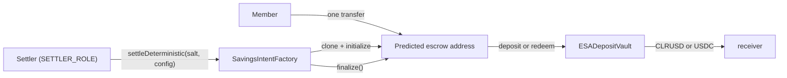
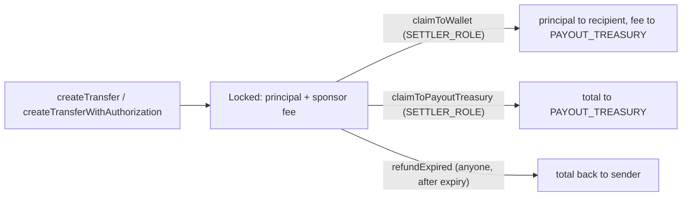

# Savings and send

**USDC goes into `ESADepositVault` and CLRUSD comes out one-for-one; CLRUSD goes back in and the
same USDC comes out.** The rest of the savings layer is built around those two calls: gasless ways
to reach them, a lock that stops CLRUSD backing drawn credit from leaving, and the escrow behind
link-based send.

Scope: `ClearUSD`, `ClearUSDUpgradeable`, `ESADepositVault`, `SavingsIntentFactory`,
`SavingsIntentEscrow`, `ClaimEscrow`, and the CCIP pool for CLRUSD. Addresses are in the root
README under [Deployed addresses](../../README.md#deployed-addresses).

| Contract | Role |
|---|---|
| `ClearUSD` | The original CLRUSD. Chainlink `BurnMintERC20`, 6 decimals, constructor-deployed, not upgradeable, no lock |
| `ClearUSDUpgradeable` | The replacement CLRUSD. Chainlink `BurnMintERC20UUPS`, 6 decimals, carries the redemption lock and `seize` |
| `ESADepositVault` | Holds the USDC (or other accepted token) behind CLRUSD. Mints on deposit, burns on redeem. UUPS |
| `SavingsIntentFactory` | Deploys single-use escrows at predictable addresses and settles or refunds them |
| `SavingsIntentEscrow` | One clone per intent. Holds one transfer until the factory turns it into a vault deposit or redeem |
| `ClaimEscrow` | Holds USDC for link-based send until a settler releases it or the sender is refunded after expiry. UUPS |
| `BurnMintTokenPool` | Chainlink CCIP pool for CLRUSD. Not in `contracts/`; deployed from `@chainlink/contracts-ccip` by `deploy/15_deploy_CLRUSDTokenPool.ts` |

---

## CLRUSD

Both tokens are named "Clear USD", symbol `CLRUSD`, 6 decimals, with an optional `maxSupply` that
`mint` enforces when non-zero. Neither pays anything to holders; there is no accrual logic in either
contract.

### Two tokens, one vault at a time

`ClearUSD` cannot be upgraded, so it could not be given the lock. `ClearUSDUpgradeable` replaces it
rather than changing it, and `ESADepositVault.setClrusd` is how the vault moves from one to the other.

**`setClrusd` refuses while any of the old token exists.** It reads `totalSupply()` on the token the
vault currently points at and reverts with `ESADepositVaultTokenStillOutstanding` if it is non-zero.
It then caches the new token's `decimals()` beside the address, because every conversion reads that
cache. The order is fixed by the guard: redeem the old supply to zero, then re-point.

The check reads supply on the vault's own chain. CLRUSD bridged out through a burn/mint pool is
burned here, so it does not count toward that figure.

### Roles

| Role | `ClearUSD` | `ClearUSDUpgradeable` |
|---|---|---|
| `DEFAULT_ADMIN_ROLE` | Grants and revokes roles; `grantIssuerRoles` / `revokeIssuerRoles` (mint + burn together); `setCCIPAdmin` | Grants and revokes roles; `setEncumbranceSource`; `setCCIPAdmin` |
| `MINTER_ROLE` | `mint` | `mint` |
| `BURNER_ROLE` | `burn(amount)`, `burnFrom` (spends the holder's allowance) | Same |
| `UPGRADER_ROLE` | — | `_authorizeUpgrade` |
| `LIQUIDATOR_ROLE` | — | `seize` |

`ClearUSD`'s constructor hands `DEFAULT_ADMIN_ROLE` and the CCIP admin slot to the `admin` argument
and revokes the deployer's admin role if they differ. `ClearUSDUpgradeable` takes `defaultAdmin` and
`defaultUpgrader` in the inherited `initialize`.

`ClearUSDUpgradeable` inherits OpenZeppelin's `AccessControlDefaultAdminRulesUpgradeable`, so
handing over `DEFAULT_ADMIN_ROLE` is a two-step begin/accept. The base initializer calls plain
`__AccessControl_init`, which leaves `defaultAdminDelay()` at zero until `changeDefaultAdminDelay`
is called. `deploy/21_deploy_ClearUSDUpgradeable.ts` schedules a delay after deployment.

### The redemption lock

**`ClearUSDUpgradeable._update` refuses to let a holder's balance drop below what is encumbered.**
Every outflow passes through `_update`: transfers, `burnFrom` during a vault redemption, and the
transfer into the CCIP pool. Minting has no `from` and is exempt, so an encumbered holder can still receive.

| Function | Behaviour |
|---|---|
| `freeBalanceOf(holder)` | `balanceOf(holder)` minus `encumberedOf(holder)`, floored at zero |
| `_update(from, to, value)` | Reverts `ClearUSDEncumbered` if `from` is non-zero and `value > freeBalanceOf(from)` |
| `_encumberedOf(holder)` | Asks the `IEncumbranceSource`. Returns zero if no source is set, or if the call reverts |
| `setEncumbranceSource(source)` | Admin only. Setting it to zero lifts the lock for everyone |

A fresh `ClearUSDUpgradeable` has no source and locks nothing. A source that reverts also locks
nothing: `_encumberedOf` catches the revert and returns zero.

### Seizure

**`seize(holder, to, amount)` is the one move allowed past the lock, and only up to the lock.** It
requires `LIQUIDATOR_ROLE`, reverts with `ClearUSDSeizureExceedsEncumbrance` if `amount` exceeds
`_encumberedOf(holder)`, and then calls the parent `_update` directly, skipping the check. It needs no
allowance from the holder. It cannot reach a free balance, and a holder with nothing encumbered has
nothing seizable.

`seize` does not decide whether a default has happened. Its caller is `Liquidator`; see the next
section and [Credit](./credit.md).

---

## Savings as credit collateral

**The encumbrance source is `CollateralRegistry`, and what it locks follows what is drawn, not what is
pledged.** `CollateralRegistry.encumberedOf(holder)` reads the kind named by `clrusdKind`
(`setClrusdKind`, `OPERATOR_ROLE`), and returns the units of that kind needed to cover the principal
the holder has drawn under it across their issuers (`_requiredUnits`, from the kind's `haircutBps`
and `unitPrice`). It returns zero if `clrusdKind` is unset or unregistered, and zero for a holder
who has drawn nothing. It does not read `pledgedOf`.

Pledges are recorded by `CollateralRegistry.pledge` and freed by `release`, both `OPERATOR_ROLE`.
Since Phase 4b (re-review L-I) a pledge also needs the member's EIP-712 signature over it.
`release` refuses to free units that `freeCollateralOf` says are backing drawn credit. The registry
holds no CLRUSD; the member's account does, and the token enforces the lock.

When the registry cannot be read, CLRUSD falls back to the last lock it read for the holder. Since
Phase 4b (re-review L-B) the revolving issuer calls `syncEncumbrance(member)` after every draw on
the Savings tier, a plain transfer or a card settlement (`RevolvingIssuer.setClrusdToken`, set once
by the owner), so that record is never older than the member's last Savings draw. If the registry
is down at that moment the draw reverts.

`Liquidator` uses `seize` in two places. `liquidate` (`OPERATOR_ROLE`) checks that the issuer reports
the member in default, seizes up to the tier's outstanding principal, records the seizure in the
registry, redeems the CLRUSD through `ESADepositVault.redeem` and settles the tier.
`settleFromSavings` is the member-initiated version against a trusted issuer's savings tier. Both
are bounded by the token to what is encumbered. The rest is in [Credit](./credit.md).

---

## ESADepositVault

**The vault holds the accepted reserve tokens and nothing else.** Its only outflow of reserve is
`_executeRedeem`; there is no sweep or admin withdrawal. It can be upgraded by `DEFAULT_ADMIN_ROLE`
(`_authorizeUpgrade`).

### Deposit and redeem

`deposit(token, amount, receiver)` pulls `amount` of an accepted token from the caller and mints
CLRUSD to `receiver`. `redeem(token, clrusdAmount, receiver)` burns the caller's CLRUSD with
`burnFrom` and sends the reserve token to `receiver`. Both are `whenNotPaused`.

Conversion is by decimals only (`_convertToClrUsd`, `_convertFromClrUsd`). With USDC and CLRUSD both
at six, the amounts are equal. For a token with more decimals, both directions revert with
`ESADepositVaultNonExactAmount` unless the amount converts back exactly, so no dust is rounded away.
`previewDeposit` and `previewRedeem` return the converted figure without those checks.

A redemption names the token it wants back and reverts with `ESADepositVaultInsufficientLiquidity` if
the vault holds less of it than the conversion requires. `burnFrom` spends an allowance, so the
redeemer must have approved the vault for at least `clrusdAmount`. Under `ClearUSDUpgradeable` the
burn also passes the lock, so encumbered CLRUSD cannot be redeemed.

The vault needs `MINTER_ROLE` and `BURNER_ROLE` on whichever CLRUSD it points at.

### Gasless paths

Each of these is `OPERATOR_ROLE` and `whenNotPaused`. The relayer holding `OPERATOR_ROLE` pays gas;
the member signs.

| Function | What the member signs | Replay protection |
|---|---|---|
| `depositWithAuthorization` | An EIP-3009 `receiveWithAuthorization` on the reserve token, payee = vault | The token's own authorization nonce |
| `redeemWithAuthorization` | EIP-712 `Redeem(redeemer, token, clrusdAmount, receiver, nonce, deadline)` | `redeemNonces[redeemer]`, used in order; `deadline` |
| `executeMandateDeposit` | EIP-712 `DepositMandate(depositor, token, amountPerRun, interval, maxRuns, startAt, expiry, nonce)` | `depositMandates[digest]` run count |

`redeemWithAuthorization` recovers an ECDSA signer and requires it to equal `redeemer`. It still
burns through `burnFrom`, so the redeemer needs a standing CLRUSD allowance to the vault.

`executeMandateDeposit` is autopay: one signature authorizes up to `maxRuns` deposits of
`amountPerRun`, each pulled with `safeTransferFrom` against an allowance the depositor has already
granted, and minted to the depositor. The signature is checked with `SignatureChecker`, so EOAs and
EIP-1271 contract wallets both work. Run `i` is allowed from `startAt + interval * i` until `expiry`,
so runs that fell behind can execute back to back. `cancelMandate(digest)` is `OPERATOR_ROLE`; a
depositor can also stop it by removing the allowance.

### Roles

| Role | May call |
|---|---|
| `DEFAULT_ADMIN_ROLE` | `setClrusd`, upgrades, role grants |
| `OPERATOR_ROLE` | `setAcceptedToken`, the three gasless functions, `cancelMandate` |
| `PAUSER_ROLE` | `pause`, `unpause` |
| Anyone | `deposit`, `redeem` (for their own CLRUSD), previews |

`initialize` gives all three roles to `admin`. Pausing stops deposits, redemptions and mandate runs;
it does not stop `setAcceptedToken`, `setClrusd` or `cancelMandate`.

---

## Savings intents

**A member funds an address before any contract exists there, with one ordinary transfer.**
`SavingsIntentFactory.predictIntentAddress(salt)` returns the EIP-1167 clone address for a salt. The
member sends USDC (to save) or CLRUSD (to withdraw) to it. A settler later deploys the escrow and
runs the vault call in one transaction.

`IntentConfig` carries `depositor`, `receiver`, `transferToken` (what the member sent), `vaultToken`
(the reserve token passed to the vault), `vault`, `amount`, `expiry` and `action` (`0` deposit,
`1` redeem).

| Function | Role | Behaviour |
|---|---|---|
| `createIntentDeterministic` | `CREATOR_ROLE` | Deploys and initializes the clone, or checks the config against an existing one |
| `settleDeterministic` | `SETTLER_ROLE` | Same provisioning, then `SavingsIntentEscrow.finalize` |
| `refundDeterministic` | `SETTLER_ROLE` | Same provisioning, then `SavingsIntentEscrow.refund` |

The salt is not derived from the config. The first provisioning call initializes the clone with
whatever config it passes; every later call must match that config field for field
(`_assertConfigMatches`). Neither contract checks `vault` against a known vault.

The escrow accepts calls only from its factory (`onlyFactory`).

- `finalize` requires status `Pending` and a balance of exactly `amount` (`SavingsIntentEscrowFundingIncomplete`
  otherwise). It approves the vault and calls `deposit` or `redeem` as itself, so the vault sees the
  escrow as caller. It does not check `expiry`.
- `refund` requires status `Pending` and `block.timestamp > expiry`, and returns the escrow's whole
  balance of `transferToken` to `depositor`.

`initialize` rejects an `expiry` that has already passed, and `refund` rejects one that has not. An
escrow must therefore be provisioned (by `createIntentDeterministic` or a settle attempt) before its
expiry for `refundDeterministic` to succeed later. A balance that is not exactly `amount` cannot be
finalized and leaves only through `refund`.

Both factory roles and `DEFAULT_ADMIN_ROLE` go to `admin` in the constructor. The factory is not
upgradeable; the escrow implementation is deployed inside its constructor.

---

## Link-based send

**`ClaimEscrow` holds a sender's USDC under a `transferId` until a settler releases it or it expires.**
It holds only the USDC set at `initialize`. `PAYOUT_TREASURY` is also set there and has no setter.

`_record` requires a non-zero, unused `transferId`, a non-zero principal and an expiry in the future,
and stores `principalUsdc + sponsorFeeUsdc` as `totalLockedUsdc`. The `recipientHintHash` is stored
and emitted; no function reads it.

| Function | Caller | Behaviour |
|---|---|---|
| `createTransfer` | Anyone | Records the transfer and pulls the total from `msg.sender` |
| `createTransferWithAuthorization` | `SETTLER_ROLE` | Records it for `sender` and pulls the total with EIP-3009 `receiveWithAuthorization` |
| `claimToWallet` | `SETTLER_ROLE` | Principal to `recipientWallet`, sponsor fee to `PAYOUT_TREASURY` |
| `claimToPayoutTreasury` | `SETTLER_ROLE` | The whole total to `PAYOUT_TREASURY` |
| `refundExpired` | Anyone | After `expiry`, the whole total back to the recorded sender |

Each record ends once: claims and refund all require `!claimed && !refunded`. The claim functions do
not check `expiry`, so a settler can still claim an expired transfer that nobody has refunded.
`refundExpired` pays only the recorded sender, whoever calls it.

`initialize` grants `DEFAULT_ADMIN_ROLE` and `SETTLER_ROLE` to `admin`. `DEFAULT_ADMIN_ROLE` authorizes
upgrades. The contract has no pause.

---

## Cross-chain

CLRUSD crosses chains through Chainlink CCIP with a `BurnMintTokenPool`. On the way out the pool
calls the token's `burn(amount)` on what the router sent it; on the way in it calls `mint`. It needs
`MINTER_ROLE` and `BURNER_ROLE` on the token. Under `ClearUSDUpgradeable` the member's transfer to the
pool passes `_update`, so encumbered CLRUSD cannot be bridged.

The pool's token is fixed at construction. `deploy/15_deploy_CLRUSDTokenPool.ts` binds it to the
`ClearUSD` deployment record, or to `CLRUSD_ADDRESS`, so a pool for `ClearUSDUpgradeable` is a
separate deployment.

---

## Not on-chain

Equity credits are not recorded by any contract; no contract under `contracts/` refers to them.
Savings in this layer are CLRUSD balances and the reserve in the vault.
