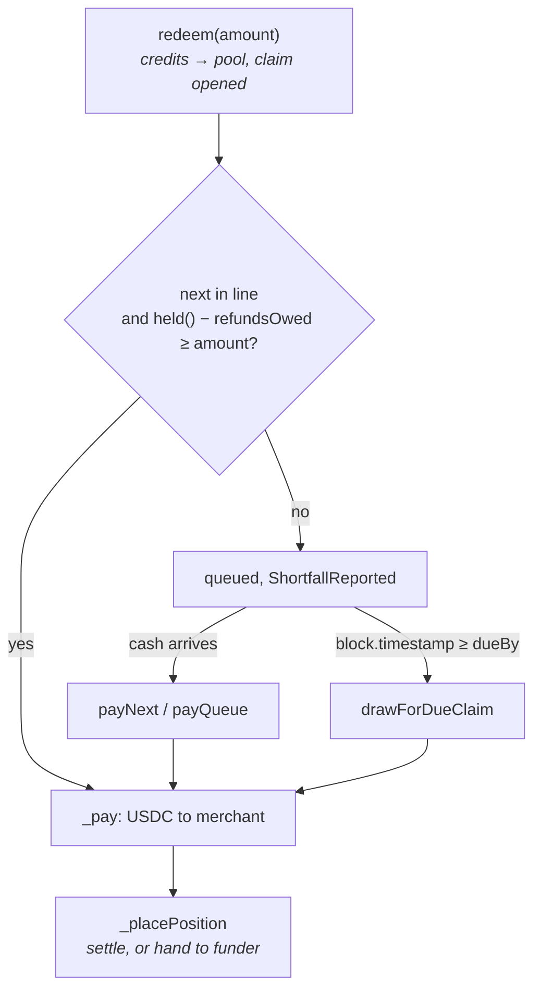

# Merchant settlement and the float

How a merchant's positive balance on the ledger becomes USDC, who puts up the cash when members
have not yet repaid, and how that cash and its carry come back. Deployed addresses are in the root
[`README.md`](../../README.md) (**Deployed addresses**). The ledger, the issuers and carry accrual
are in [`credit.md`](./credit.md); the AssurancePool and BondVault, as lenders, are in
[`reserve.md`](./reserve.md).

| Contract | Role |
|---|---|
| `MerchantRegistry` | Per-merchant terms: payout window, approval cap, discount, active flag |
| `PayoutPool` | Turns a positive balance into reserve tokens. Queues claims, borrows for due ones, repays lenders, splits carry |
| `LendingPool` | The Clear Earn Yield Pool (Phase 2f): an ERC-4626 vault of Pool Shares. Lends only to Clear Lending, as recorded Deployments |
| `IPayoutSink` | The five calls the ledger makes on the PayoutPool |
| `IPayoutLenders` | `ILendingPool` and `IAssuranceLender`: the calls the PayoutPool makes on its lenders |
| `StableCredit` | Routes members' repayments (`_routeRepayment`) and burns claims the pool settles (`settleClaim`) |

`MerchantRegistry`, `PayoutPool` and `LendingPool` are UUPS proxies with `AccessControl`; upgrades need `DEFAULT_ADMIN_ROLE`.
`LendingPool`'s `DEFAULT_ADMIN_ROLE` moves to the separate 7-day Earn timelock (Phase 2f decision 2).
`PayoutPool` storage is append-only, and its file marks where new variables go.

## The payable

**A merchant's positive ledger balance is what the co-op owes them.** There is no separate payables
record. `PayoutPool.redeemableOf(merchant)` is `stableCredit.balanceOf(merchant)`, nothing more.

A merchant who also draws credit is paid by drawdown first **when value reaches them by transfer**.
`MutualCredit._afterTransfer` burns incoming credits against the recipient's `creditBalance`, so
only the surplus shows in `balanceOf` and only the surplus can be redeemed. No code in the pool
enforces this.

Credits minted by `_accrueCredit` do not net. `StableCredit.originatePurchase` (a partner purchase)
and `accrueCarry` use it, so a merchant who owes and is then paid for a sale holds both a
`creditBalance` and a positive `balanceOf`, and `redeem` will take the positive balance.

The pool pays `claim.amount` in reserve tokens for `claim.amount` of credits. It does no
conversion, so credits and the reserve token are treated as the same unit.

## Merchant terms

`MerchantRegistry` stores one `Terms` struct per merchant. `registerMerchant` and `updateTerms` need
`OPERATOR_ROLE` and revert if `discountBps` exceeds 10,000. A new merchant is registered active.

| Field | Read by |
|---|---|
| `payoutWindow` | `PayoutPool.redeem`, through `payoutWindowOf` |
| `active` | `PayoutPool.redeem`, through `isActive` |
| `approvalCap` | No contract. The API checks each charge against `approvalCapOf` (`apps/api/src/services/chargeService.ts`) |
| `discountBps` | No contract. The API computes each charge's payout from `discountBpsOf` (same file) |

`payoutWindowOf` returns `defaultPayoutWindow` when the merchant is unregistered **or** registered
with a window of zero, so a per-merchant zero means the default. `setDefaultPayoutWindow` itself
accepts any value, zero included. The deploy script
(`deploy/22_deploy_BondsAndPool.ts`) initialises the default at thirty days.

There is no priority field. Payout order is claim age, set by the order of `redeem` calls.

## Redemption

**`PayoutPool.redeem(amount)` moves the merchant's credits into the pool and opens a claim.** It
does not burn them.

1. If the caller is registered and inactive, it reverts (`PayoutPoolMerchantInactive`). An
   unregistered address with a positive balance may redeem, on the default window.
2. The amount is capped at `redeemableOf`. Zero reverts.
3. `stableCredit.transferFrom(merchant, pool, amount)`. The merchant must have approved the pool.
   `inFlight` rises by the amount.
4. If the caller is a funder carrying positions (`advancedOf`), that figure falls by what they
   redeem.
5. A `Claim` is pushed with `dueBy = now + payoutWindowOf(merchant)`; `queuedTotal` rises.
6. If this claim is the next unpaid one and the pool's cash less `refundsOwed` covers it, it is
   paid in the same call.
   Otherwise `ShortfallReported(shortfall())` is emitted.



Claims are paid strictly in index order. `payNext()` pays the claim at `nextUnpaid` and reverts if
the pool's cash less `refundsOwed` does not cover it; it takes no argument. `payQueue(maxClaims)` calls `payNext` until it
reaches a claim it cannot cover. Both are permissionless. `canPayNext()` reports whether the next
claim is covered.

`shortfall()` is `queuedTotal + refundsOwed − held()`, floored at zero: refunds owed come first, so
they are part of what the pool is short. It is a view; nothing acts on it.

## Where the position goes

**When a claim is paid, `_placePosition` decides whose cash paid it.** The amount is capped at
`inFlight`, so carry the pool holds is never treated as a position. Then, in order:

| Cash that paid | What happens to the credits | State |
|---|---|---|
| Members' repayments (`memberFunded`) | Burned through `StableCredit.settleClaim` | `memberFunded` falls |
| A funder's capital (`capitalOf`) | Transferred to that funder | `advancedOf[funder]` rises |
| Borrowed cash, up to `borrowed()` less what the pool already holds for it | Kept by the pool | `advancedOf[pool]` rises |
| Anything left | Transferred to `coopTreasury` | none |

Funders are walked in the order of the `funders` array. Entries are appended on first funding and
removed by swap-and-pop in `_forgetSpentFunders`, so the order is insertion order until a funder is
removed.

`settleClaim` is callable only by the ledger's configured `payoutPool`. Only the pool knows which
cash paid a claim, so only the pool may burn one.

## Drawing for a due claim

**`drawForDueClaim()` finds cash for the next unpaid claim once its window has run out.** It is
permissionless. It reverts if the claim is not yet due (`PayoutPoolClaimNotDue`), and returns zero
without drawing if the pool's cash, less `refundsOwed`, already covers it.

The shortfall is drawn from each source in turn, each only for what the one before could not cover:

1. **Lending pool.** `ILendingPool(yieldPool).borrow(take, pool)`, up to the lesser of its
   `availableCash()` and `borrowableToday(pool)`. Recorded in `borrowedFromYield`. Since Phase 2f
   the Yield Pool reports `borrowableToday` as zero and `borrow` reverts, so this step takes nothing
   (decision 17); `setYieldPool(0)` switches it off once `borrowedFromYield` is repaid.
2. **Bond vault.** `IAssuranceLender(bondVault).lendToPayoutPool(short)`. The vault lends from its
   deployable excess only. Recorded in `borrowedFromVault`.
3. **Treasury.** `safeTransferFrom(coopTreasury, pool, take)`, up to `treasuryAvailable()` (the
   lesser of the treasury's allowance to the pool and its balance). This is **capital, not a loan**:
   it is added to `capitalOf[coopTreasury]` and buys positions like `fund` does.
4. **AssurancePool.** `IAssuranceLender(reserve).lendToPayoutPool(short)`. The AssurancePool lends
   from excess, then from its buffer while `hasValidRTD()` holds, and never from primary. Recorded
   in `borrowedFromReserve`.

If nothing was drawn it reverts (`PayoutPoolInsufficientFunds`). If the pool now holds the claim
plus `refundsOwed`, it pays the claim in the same call.

Each lender is set by `OPERATOR_ROLE`: `setLenders(yieldPool, reserve)` and `setBondVault(vault)`.
An unset address is skipped. The AssurancePool and BondVault accept `lendToPayoutPool` only from
their configured payout pool; the LendingPool no longer lends to it (decision 17). The
AssurancePool's and BondVault's side of this is in [`reserve.md`](./reserve.md).

## Repayment comes back

**A member's repayment repays whoever lent before it settles anything.** The ledger's `_repay`
calls `_routeRepayment`, which offers the PayoutPool `totalSupply() − payoutPool.held()` (every
positive balance on the ledger, less the cash already there) and sends the rest to
`AssurancePool.depositRepayment`. With no payout pool set, all of it goes to the AssurancePool.

`PayoutPool.receiveRepayment(amount)` accepts calls from the ledger only. It then:

1. **Repays principal** in `_repayPrincipal`: lending pool, then bond vault, then AssurancePool, each
   up to what is owed to it, through `repay` or `repayFromPayoutPool`.
2. **Pays interest** in `_repayLenders` from what is left, up to `carryEarned`. The interest is split
   by each lender's share of `borrowed()` measured before step 1; the lending pool takes the rounding
   remainder, and all of it when nothing was owed. The lending pool's share is sent as a plain
   transfer, not through `repay`, so it raises the share price rather than reducing another
   borrower's loan; the vault's and the reserve's go through `repayFromPayoutPool`. Only what
   actually reaches a lender counts as paid and has its credits burned with `settleClaim` — a
   lender unset since it lent keeps its share in `carryEarned` until it is named again.
3. **Settles the pool's own positions.** The principal repaid in step 1 is burned from
   `advancedOf[pool]`, up to what the pool holds.
4. **Adds the rest to `memberFunded`.** That cash settles claims when they are paid.

The AssurancePool takes repayment into its buffer first, up to what it lent from the buffer, then
into excess. The BondVault credits principal against `lentToPayoutPool` and keeps the rest.

`LendingPool.repay` does not track principal per borrower: it lowers `totalBorrowed` by the amount
paid, floored at zero. That is why the PayoutPool sends interest as a transfer. The card settler
repays through `repay` too, and what it repays includes carry
([Card settlement](#card-settlement)).

## Carry, by who bore the float

**Carry is split by the positions each party holds, against every claim outstanding.** Carry
reaches the pool as credits when an issuer names the pool as its recipient.
`scripts/configure-carry-recipients.mjs` points `TermIssuer.carryTreasury` and
`RevolvingIssuer.carryTreasury` at the pool, after setting `TermIssuer.feeRecipient` so the co-op's
discount does not follow. It leaves per-tier recipients (`tierCarryRecipient`) unchanged.

`distributableCarry()` is the pool's credit balance less `inFlight`, `advancedOf[pool]` and
`carryEarned`. `distributeCarry()` is permissionless and pays each carrier:

```
share = distributed × advancedOf[carrier] / (totalSupply − distributed − inFlight)
```

A carrier that is the pool itself adds its share to `carryEarned`, which is paid to the lenders in
`receiveRepayment`. Other carriers receive credits. Whatever is left (the float no funder bore,
and rounding) goes to `coopTreasury`. Shares use positions held at the moment of the call, not
time-weighted holdings.

## Funders and the co-op's income

| Call | Who | What it does |
|---|---|---|
| `fund(amount)` | `FUNDER_ROLE` | Pulls reserve tokens in, adds to `capitalOf[caller]`. That capital buys positions in `_placePosition` |
| `withdrawCapital(amount, to)` | Any funder | Returns unspent capital, capped by `idleCapitalOf`: the lesser of own capital, `unencumbered()`, and `held() − memberFunded` |
| `withdrawCoopIncome(amount)` | `OPERATOR_ROLE` | Pays the co-op from members' cash. Capped by the treasury's credit balance, `unencumbered()` and `memberFunded`. Burns that much of the treasury's credits and sends cash to `coopIncomeRecipient`, or to `coopTreasury` if unset |
| `setCoopTreasury`, `setCoopIncomeRecipient` | `OPERATOR_ROLE` | Where the co-op's positions are held, and where its income is paid |

`unencumbered()` is `held() − queuedTotal − refundsOwed`, floored at zero. Capital already spent
on a claim cannot be withdrawn; the funder holds the position instead, which settles as the member
repays.

## LendingPool

**The Clear Earn Yield Pool.** Since Phase 2f (decision 16) the `LendingPool` proxy is the Yield
Pool, upgraded in place: same name, address and balances, storage append-only against Base Sepolia.
Pool Shares are limited-recourse subordinated demand notes (IV-02). The requirements are in
[`earn-contract-requirements.md`](../audit/specs/earn-contract-requirements.md) §§6–8; the change
record is [`PHASE-2F-YIELD-POOL.md`](../audit/PHASE-2F-YIELD-POOL.md). Valuation, the holdback
ledger, Suspension, the rate model and Deployments run in the `YieldPoolValuation` module by
delegatecall, pinned at construction ([`deploy/poolModules.ts`](../../deploy/poolModules.ts)).

- **Share Value.** `shareValue()` = Pool Assets ÷ outstanding Pool Shares (WAD, `1e18` = $1.00),
  where Pool Assets (`totalAssets()`) = Vault Cash + the Deployed Balance + accrued unpaid Pool
  Interest. Vault Cash (`vaultCash()`) is the pool's USDC less Holdback Amounts, cash still owed to
  requests queued before 2f, payments waiting to be claimed and any restart leftover not yet
  recognized. A Pool Loss Allowance never lowers it. USDC sent straight to the pool is Vault Cash
  and raises the Share Value at once (decision 28). With no Pool Share outstanding the next
  subscription issues at exactly $1.00, and whatever is left in the pool is set aside and
  recognized into Vault Cash over 30 days (`leftover()`, decision 29).
- **Subscriptions.** `subscribe(assets, receiver, attestation)`, or ERC-4626 `deposit`/`mint` with no
  attestation. At least $250 (FIXED). The shared Earn controls (`earnControls()`, the
  `IPoolEarnControls` interface) check eligibility and refuse Clear-contract payers, return the
  `exemptionCode` that `Subscribed` records, and report the Equity Cushion and Reserve Shortfall
  pauses. Subscriptions also stop during a Suspension, while a loss charge is being applied, and
  from the Final Maturity Date. The 10% holder cap is the controls' (per household, above
  `holderCapFloor`). The first subscription records `initialClosing`.
- **Deployments and Returns (decision 17).** `deploy(amount, ref)`: two `DEPLOYER_ROLE` signers
  (one proposes, a different one sends), only to `deploymentAccount()`, only with no open queue
  request, no Suspension and no pending loss charge, before Final Maturity, and only if afterwards
  Utilization is at most 90% (FIXED) and the Deployed Balance is within the Pool Tier principal two
  `VALUATION_ROLE` signers last posted (`postPoolTierPrincipal`, IV-02 §4.3; none before it is
  posted). Each is recorded (`Deployed`, `deploymentCount`, `totalDeployed`).
- **Pool Interest (IV-02 §4.6, decision 24).** It accrues per second on the Deployed Balance at the
  Funding Rate, on a 365-day year. At each Pacific month end the interest accrued and unpaid is
  billed (`billedInterest()`), due by 23:59:59 Pacific on the 5th weekday after; whatever is still
  unpaid then is capitalized into the Deployed Balance and earns interest itself. Booking is lazy:
  it happens at every change, and anyone may call `accrue()`; the views project it to now.
  `returnFunds(amount)` (anyone; `repay` is the same call, kept for the PayoutPool) pays accrued
  interest first, the billed month's first, then the Deployed Balance; any excess stays as cash.
  `borrow` reverts and `borrowableToday` is zero for everyone.
- **Utilization** (`utilization()`) is the Deployed Balance ÷ (the Deployed Balance + Vault Cash);
  accrued interest is not in it. `lowUtilizationSince()` is the time since which it has stayed
  below 50%, or 0; `EarnControls` reads it for the L-01 §2.9(c) pause (IV-02 §2.6).
- **Funding Rate.** `fundingRate()` and `fundingRateAt(u)`: R₀ + S₁·U/K up to the kink, then
  R₀ + S₁ + S₂·(U−K)/(1−K), initially 2%, 3%, 80%, 5% (IV-02 Sch. 2), with FIXED bounds.
  `proposeRateModel` (`DEFAULT_ADMIN_ROLE`) takes effect through `applyRateModel` after 48 hours, or
  after 30 days for a change that lowers the rate anywhere, at most one per calendar quarter (UTC).
- **Redemptions.** `redeem`/`withdraw` pay on demand only while no queue request is open, there is
  no Suspension or pending loss charge, and Vault Cash covers the full gross amount; `maxRedeem` and
  `maxWithdraw` say so (zero while the queue is open). `redeemOrQueue(shares, receiver)` pays what it
  can now and queues the rest; `requestWithdrawal` queues all of it.
- **The queue.** Strict FIFO. Queued shares wait in escrow in the pool, keep earning and bear
  losses, and are filled by anyone (`fillQueue(maxCount)`), whole or partial, at the Share Value at
  fill less the Loss Holdback then applying (C4; this replaces audit fix X-7's cap at the value when
  queued). Owners cancel (`cancelRequest`) at any time. `oldestRequestAge()` feeds the off-chain 30-
  and 90-day rules. A payment the token refuses is kept in `unpaidOf` for `claimUnpaid`, so it cannot
  block the queue.
- **Loss Holdback (§6A).** `postAllowance(value, evidence)` (two `VALUATION_ROLE` signers) sets the
  Holdback Percentage `holdbackRate()` = allowance ÷ Pool Assets (WAD; `holdbackBps()` rounds it up
  for display), and nothing else. While it is above zero, every redemption pays G less
  G × the percentage rounded up, and records the rest to the Holder
  (`holdbackAt`, `holdbackOf`, `totalHoldback`). A lower posting starts a release pass, and
  `releaseHoldbacks(maxCount)` (anyone) pays releases and age releases (`holdbackMaxAge`, 540 days;
  `releasableAt(id)`) only to the Holder. `postLossCharge(value, evidence)` (two signers) is applied
  first to the open holdbacks ratably (`applyHoldbacks`), then to the Deployed Balance, then to
  accrued interest; only what exceeds both leaves the vault, to Clear Lending (Exhibit A, A2).
  `postRecovery(value, evidence)` (two signers, the same rules) adds unrestored charges back to the
  Deployed Balance, up to `unrestoredCharges()` (IV-02 §5.4, decision 25).
- **Suspension (§8).** `suspend(reason, evidence, resolution)` for LOSS_EVENT, LEGAL_ORDER,
  USDC_OR_NETWORK or VALUATION_PENDING only, by two different authorized individuals
  (`SUSPENSION_ROLE`, `CCO_ROLE`, `TREASURER_ROLE`), one of them the CCO or treasurer. 72 hours
  (VALUATION_PENDING 48 and not renewable); `renewSuspension` by a different signer; a Lending Board
  resolution hash beyond 240 hours; never past 30 days except a LEGAL_ORDER with an order hash.
  Both limits count the total on the same facts, across suspensions. VALUATION_PENDING is allowed
  once per Valuation Event, recorded by two `VALUATION_ROLE` signers (`recordValuationEvent`), and
  the next allowance posting clears the event and ends that Suspension (decision 26).
  It stops subscriptions, redemptions, fills and Deployments; cancellations go on and interest
  accrues.
- **Final Maturity.** `finalMaturity()` is the 20th anniversary of `initialClosing`. From then,
  subscriptions and Deployments stop, and `requestRunOff(holder)` (anyone) queues a holder's free
  shares in queue order (decision 15).
- **Transfers.** Only between two accounts of one Holder, or by the Successor path, as the Earn
  controls report (`transferAllowed`); every other transfer reverts (FIXED). A plain transfer into
  the pool reverts: shares enter escrow only through the queue. Redemption proceeds go only to the
  account that held the shares (IV-02 §6.5).
- **Legend.** `legend()` and `legendHash()` carry IV-02 §8.4's legend. It is written once at setup
  (`setLegend`, `DEFAULT_ADMIN_ROLE`); a later change waits 7 days (`applyLegend`, decision 27).
- **Modules.** Pool Interest, Suspension, the rate model, recoveries, the legend and the restart
  leftover run in `YieldPoolLedger`. The functions added in the IV-02 conformance pass are served
  by the pool's fallback, so clients need the joined ABI (`deploy/poolModules.ts`, `poolAt`).
- **Shares as collateral.** Pledged shares (`encumberedOf`, from the source set by
  `setEncumbranceSource`) cannot be transferred, redeemed or queued by the holder
  (`LendingPoolEncumbered`); if the source can't be read, a holder last seen pledged is treated as
  fully locked (audit M-3). An MB-05 enforcement redemption, `enforcementRedeem(holder, shares)`
  (`ENFORCER_ROLE`, held by `PoolShareEnforcer`), queues pledged shares in order and pays only
  `enforcementDestination()` (the enforcer); any holdback goes to the holder, and
  `enforcementFilledOf(holder)` records what each holder's fills burned and paid. `previewRedeem(shares)`
  is the Pool Share Value of MB-05 §1.3, and CollateralRegistry values pledged shares by it. Nothing
  seizes a share: `seizeShares` and the Liquidator's exemption are gone (Phase 2f stage 2, C5), and
  `LIQUIDATOR_ROLE` is kept only so scripts can revoke it.
- **Requests queued before 2f** were fixed in assets with their shares burned. `claimWithdrawal(id)`
  still pays them to the owner; until then their cash is outside Pool Assets.

**Known limitations**

- **Governance.** The Earn timelock and the Lending Board resolution hash for role grants (§10) are
  built separately (decision 2). Until then the pool's admin is whatever holds `DEFAULT_ADMIN_ROLE`.
- **No Earn controls yet.** `EarnControls` is built separately; until `setEarnControls` names it,
  subscriptions and holder-to-holder transfers revert (the pool fails closed).
- **Contract reference.** The generated [contract page](./contracts/LendingPool.md) reads access
  from the function declaration, so the module-forwarded functions show as callable by anyone; the
  module checks the caller.

## Card settlement

`RevolvingIssuer.settleCardSpend(ref, member, amount)` records a cleared card purchase. Only an
address allowed by `setCardSettler` may call it. It reverts unless the member's active tiers have
headroom for the whole amount, draws the tiers in tier order (`_draw`), and calls `originatePurchase` with the full amount credited to `cardSettlementAccount` and no
discount. That account then holds an ordinary positive balance. `reverseCardSpend` undoes it through
`reversePurchase`. Details are in [`credit.md`](./credit.md).

**Since Phase 2f the card settler no longer borrows from the pool** (decision 17): `borrow` reverts
and `borrowableToday` is zero, and Clear Lending funds card settlement from what it draws as
Deployments. The API path below
([`poolFunding.ts`](../../apps/api/src/services/chain/poolFunding.ts)) describes the pre-2f flow; the
held app PRs (#887, #890) must stop drawing from the pool directly.

- **Which tiers.** `POOL_FUNDED_TIER_KINDS`, by default `INCOME,BOOST`: the unsecured tiers.
  Savings-backed and asset-backed credit is not funded from the pool.
- **Borrowing.** The API reads `TierDrawn` on a pool-funded tier from the receipts of the
  transactions it sends (settlement, reversal, netting, re-issue) and borrows the same amount to
  the card-funding wallet. The merchant is still paid in fiat from the co-op's float; moving the
  borrowed USDC into that float is a periodic off-ramp outside the API.
- **Repaying.** On `TierRepaid` it calls `LendingPool.repay` for the amount repaid. Carry is
  materialised into the tier's principal (`RevolvingIssuer._materialiseCarry`) before any payment
  is placed, so that amount includes the carry accrued on the tier.
- **Where the carry lands.** `repay` lowers `totalBorrowed` by the whole amount. While other loans
  are outstanding, the carry part therefore lowers `totalBorrowed` instead of raising
  `totalAssets`, and does not move the share price. It reaches the share price once
  `totalBorrowed` has fallen to zero.
- **Waiting.** A borrow waits while the pool's `availableCash()` is short; a repayment waits while
  the card-funding wallet holds too little USDC, and the row says to top it up from treasury. Each
  movement is one row, keyed by transaction and log index, so a receipt read twice is recorded
  once.

## Refunds

**A refund returns what the member already paid, from the PayoutPool.** The issuer calls
`StableCredit.repayRefund`, which reverts unless the merchant's and co-op's shares sum to what the
member paid. `_takeBack` burns each share from the merchant's or co-op's balance. Where that
balance is too small (a merchant who has redeemed), the rest becomes their obligation. Credits they
later receive by transfer burn against it; credits minted to them by a new purchase do not (see
[The payable](#the-payable)). The ledger
then calls `PayoutPool.payRefund(member, paid − carryWithheld)`.

`payRefund` accepts calls from the ledger only. It pays from `held() − refundsOwed`. Anything it
cannot cover is recorded in `refundOwedTo[member]` and `refundsOwed`. `payRefundsOwed()` is
permissionless and pays those from the pool's whole cash balance.

`refundsOwed` is held back by every path that pays a claim — `redeem`, `payNext`, `payQueue`,
`canPayNext` and `drawForDueClaim` — and by `unencumbered` and `payRefund`. There is no draw for a
refund shortfall. The arithmetic and worked examples are in
[Refunds and repayments](./refund-repayment-plan.md).

## Who can call what

| Function | Access |
|---|---|
| `redeem` | Any account with a positive balance, unless registered and inactive |
| `payNext`, `payQueue`, `drawForDueClaim`, `distributeCarry`, `payRefundsOwed`, `withdrawCapital` | Anyone |
| `receiveRepayment`, `payRefund` | The ledger only |
| `fund` | `FUNDER_ROLE` |
| `setLenders`, `setBondVault`, `setCoopTreasury`, `setCoopIncomeRecipient`, `withdrawCoopIncome` | `OPERATOR_ROLE` |
| `MerchantRegistry.registerMerchant`, `updateTerms`, `setActive`, `setDefaultPayoutWindow` | `OPERATOR_ROLE` |
| `LendingPool.subscribe`, `deposit`, `mint` | Eligible accounts, as the Earn controls report |
| `LendingPool.withdraw`, `redeem`, `redeemOrQueue`, `requestWithdrawal` | The share owner (or an approved spender for `withdraw`/`redeem`). Only free shares |
| `LendingPool.cancelRequest` | The request's owner; an enforcement request only `ENFORCER_ROLE` |
| `LendingPool.fillQueue`, `returnFunds`, `repay`, `releaseHoldbacks`, `applyHoldbacks`, `requestRunOff`, `applyRateModel`, `syncEncumbrance`, `accrue`, `applyLegend` | Anyone |
| `LendingPool.claimWithdrawal` (pre-2f requests), `claimUnpaid` | The request's owner; the payee |
| `LendingPool.deploy` | Two different `DEPLOYER_ROLE` signers; pays only `deploymentAccount` |
| `LendingPool.postAllowance`, `postLossCharge`, `postRecovery`, `recordValuationEvent`, `postPoolTierPrincipal` | Two different `VALUATION_ROLE` signers |
| `LendingPool.suspend` | Two different authorized individuals, one the CCO or treasurer |
| `LendingPool.renewSuspension`, `liftSuspension` | An authorized individual (renewal: not the last signer) |
| `LendingPool.enforcementRedeem` | `ENFORCER_ROLE`; pays only `enforcementDestination` |
| `LendingPool.borrow` | Nobody (reverts) |
| `LendingPool.initializeYieldPool`, `setEarnControls`, `setDeploymentAccount`, `setEnforcementDestination`, `setEncumbranceSource`, `setHoldbackMaxAge`, `proposeRateModel`, `setLegend`, role grants and upgrades (UUPS) | `DEFAULT_ADMIN_ROLE` (the Earn timelock) |

Tests: `test/peripherals/PayoutPool.spec.ts`, `test/peripherals/LendingPool.spec.ts`,
`test/earn/YieldPool.spec.ts`, `test/earn/YieldPoolConformance.spec.ts`, `test/earn/YieldPoolUpgrade.spec.ts`,
`test/core/PayoutLifecycle.spec.ts`, `test/core/RepaymentRouting.spec.ts`,
`test/core/SharedBalance.spec.ts`. To rehearse a redemption against a fork of a live deployment,
use `scripts/drill_redemption.ts`.
