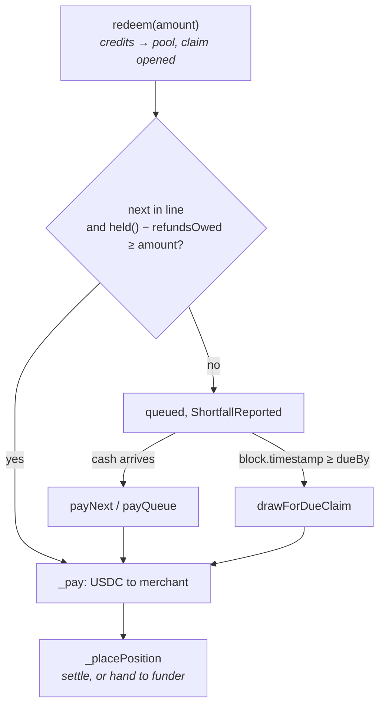

# Merchant settlement and the float

How a merchant's positive balance on the ledger becomes USDC, who puts up the cash when members
have not yet repaid, and how that cash and its carry come back. Deployed addresses are in the root
[`README.md`](../../README.md) (**Deployed addresses**). The ledger, the issuers and carry accrual
are in [`credit.md`](./credit.md); the AssurancePool and BondVault, as lenders, are in
[`reserve.md`](./reserve.md).

| Contract | Role |
|---|---|
| `MerchantRegistry` | Per-merchant terms: payout window, approval cap, discount, active flag |
| `PayoutPool` | Turns a positive balance into reserve tokens. Queues claims, borrows for due ones, repays lenders, splits carry |
| `LendingPool` | ERC-4626 vault. Lends cash to `BORROWER_ROLE` holders and takes it back through `repay` |
| `IPayoutSink` | The five calls the ledger makes on the PayoutPool |
| `IPayoutLenders` | `ILendingPool` and `IAssuranceLender`: the calls the PayoutPool makes on its lenders |
| `StableCredit` | Routes members' repayments (`_routeRepayment`) and burns claims the pool settles (`settleClaim`) |

`MerchantRegistry`, `PayoutPool` and `LendingPool` are UUPS proxies with `AccessControl`; upgrades need `DEFAULT_ADMIN_ROLE`.
`PayoutPool` storage is append-only, and its file marks where new variables go.

## The payable

**A merchant's positive ledger balance is what the co-op owes them.** There is no separate payables
record. `PayoutPool.redeemableOf(merchant)` is `stableCredit.balanceOf(merchant)`, nothing more.

A merchant who also draws credit is paid by drawdown first **when value reaches them by transfer**.
`MutualCredit._afterTransfer` burns incoming credits against the recipient's `creditBalance`, so
only the surplus shows in `balanceOf` and only the surplus can be redeemed. No code in the pool
enforces this.

Credits minted by `_accrueCredit` do not net. `StableCredit.originatePurchase` (a partner purchase)
and `accrueCarry` use it, so a merchant who owes and is then paid for a sale holds both a
`creditBalance` and a positive `balanceOf`, and `redeem` will take the positive balance.

The pool pays `claim.amount` in reserve tokens for `claim.amount` of credits. It does no
conversion, so credits and the reserve token are treated as the same unit.

## Merchant terms

`MerchantRegistry` stores one `Terms` struct per merchant. `registerMerchant` and `updateTerms` need
`OPERATOR_ROLE` and revert if `discountBps` exceeds 10,000. A new merchant is registered active.

| Field | Read by |
|---|---|
| `payoutWindow` | `PayoutPool.redeem`, through `payoutWindowOf` |
| `active` | `PayoutPool.redeem`, through `isActive` |
| `approvalCap` | No contract. `scripts/register_merchant.ts` describes it as enforced off-chain per charge |
| `discountBps` | No contract. Same as above |

`payoutWindowOf` returns `defaultPayoutWindow` when the merchant is unregistered **or** registered
with a window of zero, so a per-merchant zero means the default. `setDefaultPayoutWindow` itself
accepts any value, zero included. The deploy script
(`deploy/22_deploy_BondsAndPool.ts`) initialises the default at thirty days.

There is no priority field. Payout order is claim age, set by the order of `redeem` calls.

## Redemption

**`PayoutPool.redeem(amount)` moves the merchant's credits into the pool and opens a claim.** It
does not burn them.

1. If the caller is registered and inactive, it reverts (`PayoutPoolMerchantInactive`). An
   unregistered address with a positive balance may redeem, on the default window.
2. The amount is capped at `redeemableOf`. Zero reverts.
3. `stableCredit.transferFrom(merchant, pool, amount)`. The merchant must have approved the pool.
   `inFlight` rises by the amount.
4. If the caller is a funder carrying positions (`advancedOf`), that figure falls by what they
   redeem.
5. A `Claim` is pushed with `dueBy = now + payoutWindowOf(merchant)`; `queuedTotal` rises.
6. If this claim is the next unpaid one and the pool's cash less `refundsOwed` covers it, it is
   paid in the same call.
   Otherwise `ShortfallReported(shortfall())` is emitted.



Claims are paid strictly in index order. `payNext()` pays the claim at `nextUnpaid` and reverts if
the pool's cash less `refundsOwed` does not cover it; it takes no argument. `payQueue(maxClaims)` calls `payNext` until it
reaches a claim it cannot cover. Both are permissionless. `canPayNext()` reports whether the next
claim is covered.

`shortfall()` is `queuedTotal + refundsOwed − held()`, floored at zero: refunds owed come first, so
they are part of what the pool is short. It is a view; nothing acts on it.

## Where the position goes

**When a claim is paid, `_placePosition` decides whose cash paid it.** The amount is capped at
`inFlight`, so carry the pool holds is never treated as a position. Then, in order:

| Cash that paid | What happens to the credits | State |
|---|---|---|
| Members' repayments (`memberFunded`) | Burned through `StableCredit.settleClaim` | `memberFunded` falls |
| A funder's capital (`capitalOf`) | Transferred to that funder | `advancedOf[funder]` rises |
| Borrowed cash, up to `borrowed()` less what the pool already holds for it | Kept by the pool | `advancedOf[pool]` rises |
| Anything left | Transferred to `coopTreasury` | none |

Funders are walked in the order of the `funders` array. Entries are appended on first funding and
removed by swap-and-pop in `_forgetSpentFunders`, so the order is insertion order until a funder is
removed.

`settleClaim` is callable only by the ledger's configured `payoutPool`. Only the pool knows which
cash paid a claim, so only the pool may burn one.

## Drawing for a due claim

**`drawForDueClaim()` finds cash for the next unpaid claim once its window has run out.** It is
permissionless. It reverts if the claim is not yet due (`PayoutPoolClaimNotDue`), and returns zero
without drawing if the pool's cash, less `refundsOwed`, already covers it.

The shortfall is drawn from each source in turn, each only for what the one before could not cover:

1. **Yield pool.** `ILendingPool(yieldPool).borrow(take, pool)`, up to its `availableCash()`.
   Recorded in `borrowedFromYield`.
2. **Bond vault.** `IAssuranceLender(bondVault).lendToPayoutPool(short)`. The vault lends from its
   deployable excess only. Recorded in `borrowedFromVault`.
3. **Treasury.** `safeTransferFrom(coopTreasury, pool, take)`, up to `treasuryAvailable()` (the
   lesser of the treasury's allowance to the pool and its balance). This is **capital, not a loan**:
   it is added to `capitalOf[coopTreasury]` and buys positions like `fund` does.
4. **AssurancePool.** `IAssuranceLender(reserve).lendToPayoutPool(short)`. The AssurancePool lends
   from excess, then from its buffer while `hasValidRTD()` holds, and never from primary. Recorded
   in `borrowedFromReserve`.

If nothing was drawn it reverts (`PayoutPoolInsufficientFunds`). If the pool now holds the claim
plus `refundsOwed`, it pays the claim in the same call.

Each lender is set by `OPERATOR_ROLE`: `setLenders(yieldPool, reserve)` and `setBondVault(vault)`.
An unset address is skipped. The AssurancePool and BondVault accept `lendToPayoutPool` only from
their configured payout pool; the LendingPool requires `BORROWER_ROLE`. The
AssurancePool's and BondVault's side of this is in [`reserve.md`](./reserve.md).

## Repayment comes back

**A member's repayment repays whoever lent before it settles anything.** The ledger's `_repay`
calls `_routeRepayment`, which offers the PayoutPool `totalSupply() − payoutPool.held()` (every
positive balance on the ledger, less the cash already there) and sends the rest to
`AssurancePool.depositRepayment`. With no payout pool set, all of it goes to the AssurancePool.

`PayoutPool.receiveRepayment(amount)` accepts calls from the ledger only. It then:

1. **Repays principal** in `_repayPrincipal`: yield pool, then bond vault, then AssurancePool, each
   up to what is owed to it, through `repay` or `repayFromPayoutPool`.
2. **Pays interest** in `_repayLenders` from what is left, up to `carryEarned`. The interest is split
   by each lender's share of `borrowed()` measured before step 1; the yield pool takes the rounding
   remainder, and all of it when nothing was owed. The yield pool's share is sent as a plain
   transfer, not through `repay`, so it raises the share price rather than reducing another
   borrower's loan; the vault's and the reserve's go through `repayFromPayoutPool`. Only what
   actually reaches a lender counts as paid and has its credits burned with `settleClaim` — a
   lender unset since it lent keeps its share in `carryEarned` until it is named again.
3. **Settles the pool's own positions.** The principal repaid in step 1 is burned from
   `advancedOf[pool]`, up to what the pool holds.
4. **Adds the rest to `memberFunded`.** That cash settles claims when they are paid.

The AssurancePool takes repayment into its buffer first, up to what it lent from the buffer, then
into excess. The BondVault credits principal against `lentToPayoutPool` and keeps the rest.

`LendingPool.repay` does not track principal per borrower: it lowers `totalBorrowed` by the amount
paid, floored at zero. That is why the PayoutPool sends interest as a transfer. The card settler
repays principal only.

## Carry, by who bore the float

**Carry is split by the positions each party holds, against every claim outstanding.** Carry
reaches the pool as credits when an issuer names the pool as its recipient.
`scripts/configure-carry-recipients.mjs` points `TermIssuer.carryTreasury` and
`RevolvingIssuer.carryTreasury` at the pool, after setting `TermIssuer.feeRecipient` so the co-op's
discount does not follow. It leaves per-tier recipients (`tierCarryRecipient`) unchanged.

`distributableCarry()` is the pool's credit balance less `inFlight`, `advancedOf[pool]` and
`carryEarned`. `distributeCarry()` is permissionless and pays each carrier:

```
share = distributed × advancedOf[carrier] / (totalSupply − distributed − inFlight)
```

A carrier that is the pool itself adds its share to `carryEarned`, which is paid to the lenders in
`receiveRepayment`. Other carriers receive credits. Whatever is left (the float no funder bore,
and rounding) goes to `coopTreasury`. Shares use positions held at the moment of the call, not
time-weighted holdings.

## Funders and the co-op's income

| Call | Who | What it does |
|---|---|---|
| `fund(amount)` | `FUNDER_ROLE` | Pulls reserve tokens in, adds to `capitalOf[caller]`. That capital buys positions in `_placePosition` |
| `withdrawCapital(amount, to)` | Any funder | Returns unspent capital, capped by `idleCapitalOf`: the lesser of own capital, `unencumbered()`, and `held() − memberFunded` |
| `withdrawCoopIncome(amount)` | `OPERATOR_ROLE` | Pays the co-op from members' cash. Capped by the treasury's credit balance, `unencumbered()` and `memberFunded`. Burns that much of the treasury's credits and sends cash to `coopIncomeRecipient`, or to `coopTreasury` if unset |
| `setCoopTreasury`, `setCoopIncomeRecipient` | `OPERATOR_ROLE` | Where the co-op's positions are held, and where its income is paid |

`unencumbered()` is `held() − queuedTotal − refundsOwed`, floored at zero. Capital already spent
on a claim cannot be withdrawn; the funder holds the position instead, which settles as the member
repays.

## LendingPool

**An ERC-4626 vault over the reserve token whose `totalAssets` counts what is lent out.**
`totalAssets()` is cash plus `totalBorrowed`, less `queuedAssets`. `availableCash()` is cash less
`queuedAssets`, and caps both `borrow` and `maxWithdraw`.

- **Borrowing.** `borrow(amount, to)` needs `BORROWER_ROLE`. Nothing grants it at deploy.
  `scripts/upgrade_reserve_draw.ts` grants it to the PayoutPool, and `scripts/grant_pool_borrower.ts`
  to the card-settler wallet.
- **Repaying.** `repay(amount)` is open to anyone and is treated as principal while anything is
  owed. Interest arrives as a plain transfer (see above).
- **The queue.** A depositor whose cash is lent out calls `requestWithdrawal(shares, receiver)`. The
  shares are burned now and the claim is fixed in assets. `claimWithdrawal(id)` pays it, by the
  owner, whenever the pool's cash covers that request. Requests are not paid in order.
- **The rate curve is a view.** `borrowRatePerCycle()` and `supplyRatePerCycle()` compute a kinked
  curve from `utilizationBps()`, set by `setRateCurve`. No contract reads either; `borrow` and
  `repay` move principal only. What depositors earn is what comes back above principal, which for
  the PayoutPool's loans is their share of member carry.
- **Losses.** `absorbLoss` (`LOSS_REPORTER_ROLE`) writes down `totalBorrowed`. No contract calls it.
- **Shares as collateral.** Shares reported encumbered by `encumbranceSource` cannot be
  transferred, and `seizeShares` (`LIQUIDATOR_ROLE`) can take only those. See
  [`credit.md`](./credit.md).

## Card settlement

`RevolvingIssuer.settleCardSpend(ref, member, amount)` records a cleared card purchase. Only an
address allowed by `setCardSettler` may call it. It reverts unless the member's active tiers have
headroom for the whole amount, draws the tiers in tier order (`_draw`), and calls `originatePurchase` with the full amount credited to `cardSettlementAccount` and no
discount. That account then holds an ordinary positive balance. `reverseCardSpend` undoes it through
`reversePurchase`. The card-settler wallet's borrowing from the LendingPool happens off this path,
through `borrow`. Details are in [`credit.md`](./credit.md).

## Refunds

**A refund returns what the member already paid, from the PayoutPool.** The issuer calls
`StableCredit.repayRefund`, which reverts unless the merchant's and co-op's shares sum to what the
member paid. `_takeBack` burns each share from the merchant's or co-op's balance. Where that
balance is too small (a merchant who has redeemed), the rest becomes their obligation. Credits they
later receive by transfer burn against it; credits minted to them by a new purchase do not (see
[The payable](#the-payable)). The ledger
then calls `PayoutPool.payRefund(member, paid − carryWithheld)`.

`payRefund` accepts calls from the ledger only. It pays from `held() − refundsOwed`. Anything it
cannot cover is recorded in `refundOwedTo[member]` and `refundsOwed`. `payRefundsOwed()` is
permissionless and pays those from the pool's whole cash balance.

`refundsOwed` is held back by every path that pays a claim — `redeem`, `payNext`, `payQueue`,
`canPayNext` and `drawForDueClaim` — and by `unencumbered` and `payRefund`. There is no draw for a
refund shortfall. The full design and worked examples are in
[`refund-repayment-plan.md`](./refund-repayment-plan.md).

## Who can call what

| Function | Access |
|---|---|
| `redeem` | Any account with a positive balance, unless registered and inactive |
| `payNext`, `payQueue`, `drawForDueClaim`, `distributeCarry`, `payRefundsOwed`, `withdrawCapital` | Anyone |
| `receiveRepayment`, `payRefund` | The ledger only |
| `fund` | `FUNDER_ROLE` |
| `setLenders`, `setBondVault`, `setCoopTreasury`, `setCoopIncomeRecipient`, `withdrawCoopIncome` | `OPERATOR_ROLE` |
| `MerchantRegistry.registerMerchant`, `updateTerms`, `setActive`, `setDefaultPayoutWindow` | `OPERATOR_ROLE` |
| `LendingPool.borrow` | `BORROWER_ROLE` |
| `LendingPool.setRateCurve`, `setEncumbranceSource` | `OPERATOR_ROLE` |

Tests: `test/peripherals/PayoutPool.spec.ts`, `test/peripherals/LendingPool.spec.ts`,
`test/core/PayoutLifecycle.spec.ts`, `test/core/RepaymentRouting.spec.ts`,
`test/core/SharedBalance.spec.ts`. To rehearse a redemption against a fork of a live deployment,
use `scripts/drill_redemption.ts`.
