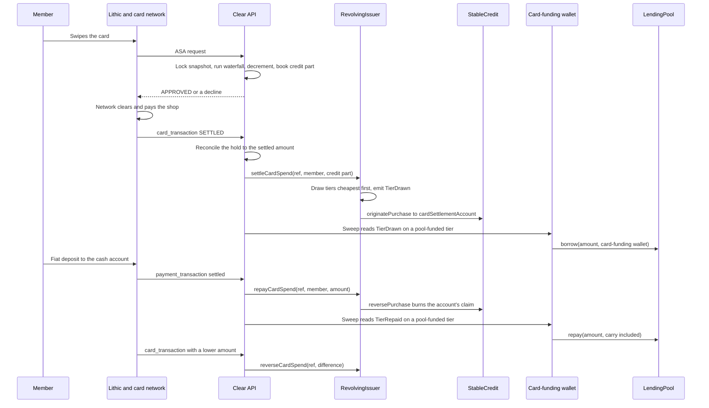

# How a Visa card purchase works

One purchase on a Clear Visa card, from the swipe to the last repayment. The card runs in Lithic's
sandbox and its credit runs on Base Sepolia, so nothing here is real money yet
([Status, security and licensing](../overview/status-and-security.md#which-app)).

The Lithic side (the money model, provisioning, deposits, the savings sweep) is in
[Lithic integration](../developers/integrations/lithic.md). The contracts are in
[`credit.md`](./credit.md) and [`settlement.md`](./settlement.md).

| Part | What it does in a purchase |
|---|---|
| Lithic | Asks the API to approve each authorisation (Auth Stream Access), then reports what happened to the transaction as `card_transaction` events |
| Clear API | Decides the authorisation from a precomputed snapshot, keeps double-entry books in Postgres, and writes to the chain with the card-settler key (`CARD_SETTLER_PRIVATE_KEY`) |
| `RevolvingIssuer` | Draws the member's tiers when the purchase settles, and clears them on a refund or a repayment |
| `StableCredit` (`ClearCredit`) | The ledger. Records the member's obligation and the matching claim |
| `cardSettlementAccount` | The operator-set address that holds the claim for every settled card purchase |
| Card-funding wallet | The card-settler key's own address. Borrows from and repays the `LendingPool` |
| `LendingPool` | Funds the pool-funded tiers (`POOL_FUNDED_TIER_KINDS`, by default `INCOME,BOOST`) |

---

## 1. The authorisation

Lithic's Auth Stream Access posts each authorisation to `/api/webhooks/lithic/auth-stream`
([`lithicAuthStream.ts`](../../apps/api/src/routes/lithicAuthStream.ts)). The API answers from one
Postgres row and makes no outside call: no chain read, no Lithic call, no HTTP.

**The snapshot.** Each card has a row in `lithic_tier_snapshots` holding what is spendable in each
source, in cents ([`snapshotService.ts`](../../apps/api/src/services/lithic/snapshotService.ts)):

- **Cash** is the available balance of the member's Lithic cash account and nothing else. USDC in
  the member's wallet is not counted, because it cannot settle a card authorisation.
- **Credit tiers** (savings-backed, asset-backed, income-backed, Clear Boost) are each tier's limit
  less what is outstanding on it in the API's books, disputed amounts included. The limits and their
  percentages are in [Card authorisations](../developers/integrations/lithic.md#card-authorisations).
  Where the on-chain `LimitCalculator` answers, its savings and asset ceilings are used instead.
- **Pulled funds** inside their return window are taken out of savings before the limit is computed.

The row is rewritten after a deposit, a savings sweep, a card being issued, activated or frozen, a dispute
decision, pulled funds being released, and every `SNAPSHOT_REFRESH_MINUTES` (default 15). When the
chain cannot be read, cash is written fresh and the previous credit figures are carried forward.

**The decision** ([`authDecision.ts`](../../apps/api/src/services/lithic/authDecision.ts),
[`authStore.ts`](../../apps/api/src/services/lithic/authStore.ts)) runs in one database transaction:

1. **Replay check.** The decision row is keyed by Lithic's transaction token. A token already
   decided returns its stored verdict and draws nothing.
2. **Lock.** The card's snapshot row is read `FOR UPDATE`, so two swipes on one card at the same
   moment are decided one after the other.
3. **Waterfall.** The amount is taken in a fixed order, each source up to what it has:
   cash, then savings-backed, asset-backed, income-backed, Clear Boost. That is cheapest first.
   The order is not configurable.
4. **All or nothing.** If the sources together cannot cover the whole amount, the authorisation is
   declined. Partial approval is not offered.
5. **Hold.** On an approval the snapshot is decremented by every draw, cash included. For each
   credit draw the books get a balanced pair grouped by the transaction token: a debit to
   `member_credit_<tier>` and a credit to `coop_settlement_float`, event `card_auth`. The cash part
   issues no credit and writes no ledger pair.
6. **Record.** The decision, its draws, the credit total, the availability it saw, the merchant and
   the latency are stored in `lithic_auth_decisions`.

**Verdicts.** The response is always HTTP 200; the verdict is in the body.

| Case | Verdict |
|---|---|
| Funded in full | `APPROVED` |
| Amount of zero or less | `APPROVED`, nothing drawn |
| `BALANCE_INQUIRY` | `APPROVED` with the snapshot's total as the balance, nothing drawn |
| Card frozen | `CARD_PAUSED` |
| Not enough across all sources, or an amount that is not a number | `INSUFFICIENT_FUNDS` |
| No snapshot for the card, no database, missing transaction or card token, or any error | `INSUFFICIENT_FUNDS` |
| Signature fails (`LITHIC_ASA_SECRET`, falling back to `LITHIC_WEBHOOK_SECRET`) | `SUSPECTED_FRAUD` |

Nothing reaches the chain at this point. An approved authorisation is a hold in the API's books.

## 2. The co-op's float pays the shop

The card network clears the purchase and Lithic settles it with the merchant. The API makes no
payment call for it. What the code records:

- **The cash part** is the member's own Lithic balance. It is not credit and is never issued on
  chain.
- **The credit part** is fronted by the co-op. In the API's books it is the `coop_settlement_float`
  side of each `card_auth` pair. On chain, when the purchase settles, the claim for it is minted to
  `cardSettlementAccount` ([section 3](#3-settlement-on-chain)).
- **There is no funded float account the API reads.** The only `coop_settlement_float` rows are the
  draws' own entries, so the reconciler's float-adequacy check reports `unavailable` rather than
  comparing that figure with itself
  ([`reconcileService.ts`](../../apps/api/src/services/reconciliation/reconcileService.ts),
  [Reconciliation](../developers/integrations/lithic.md#3-reconciliation)).
- **For pool-funded tiers**, USDC borrowed from the `LendingPool` lands in the card-funding wallet
  ([section 4](#4-borrowing-from-the-lendingpool)). Moving it into the fiat float is a periodic
  off-ramp outside the API, not one per purchase.

## 3. Settlement on chain

A `card_transaction` event with status `SETTLED` first brings the hold to the settled amount
([section 6](#6-reversals-and-refunds)), then starts `syncCardSettlement` without waiting for it
([`cardSettlementService.ts`](../../apps/api/src/services/chain/cardSettlementService.ts)). A sweep
every `CARD_SETTLEMENT_SWEEP_MINUTES` (default 5) picks up anything that did not land
([`cardSettlementSweeper.ts`](../../apps/api/src/jobs/cardSettlementSweeper.ts)). Without
`CARD_SETTLER_PRIVATE_KEY` the sweep does not start and settled purchases stay off chain.

What the API does for one purchase:

1. **Only a settled approval.** A pending, declined or unknown transaction is left alone.
2. **The credit part only.** The target is the sum of the non-cash draws. A purchase paid entirely
   from cash is marked `not_needed`.
3. **The ref** is `keccak256` of the Lithic transaction token (`ethers.id`), so the chain carries no
   Lithic identifier.
4. **A lost receipt is a success.** Before sending, it asks `cardSettlementOf(ref)`. If the
   purchase is already there it is recorded as issued.
5. **The call.** `settleCardSpend(ref, member, amount)`, with cents converted to the ledger's six
   decimals (× 10⁴).
6. **The outcome is stored** beside the decision: `onchain_status`, `onchain_cents`, `onchain_tx`,
   or the error and an attempt count. After five failures it becomes `needs_review` and is not
   retried.

What `RevolvingIssuer.settleCardSpend` writes:

- It reverts unless the caller is allowed by `setCardSettler`, `cardSettlementAccount` is set, the
  amount is not zero and the ref has never been settled. A fully refunded ref stays settled.
- It materialises the member's carry, then reverts with `RevolvingIssuerCardHeadroom` unless the
  member's active tiers together have room for the whole amount.
- `_draw` fills the tiers in tier order, cheapest first, and emits `TierDrawn(member, tierId, amount)`
  for each. This is what starts carry.
- `originatePurchase(member, amount, cardSettlementAccount, amount, cardSettlementAccount, 0)`: the
  member owes the amount, and `cardSettlementAccount` holds the same amount as a claim. No discount
  leg, and no reserve token moves.
- `CardSpendSettled(ref, member, amount)` is emitted.

**The chain's split is the one that counts.** The deployed tiers are `SAVINGS`, `BOND`,
`POOL_SHARE`, `INCOME` and `BOOST` at 0, 65, 75, 150 and 300 basis points per 30-day cycle
([`20_deploy_CreditCore.ts`](../../deploy/20_deploy_CreditCore.ts)). The API's asset-backed tier
covers both `BOND` and `POOL_SHARE`. The contract draws by its own capacities, which may split the
amount differently from the hold. Once a purchase is issued, the API stops reporting its credit
part as a pending hold. The function reference is in
[RevolvingIssuer — the tiered line](./credit.md#revolvingissuer--the-tiered-line) and
[Card settlement](./settlement.md#card-settlement).

## 4. Borrowing from the LendingPool

Credit on a pool-funded tier is funded by the `LendingPool`'s depositors. The borrowing is driven
by the API, not by a contract ([`poolFunding.ts`](../../apps/api/src/services/chain/poolFunding.ts)).

1. **Read the receipt.** After every transaction the card-settler key sends (settlement, reversal,
   repayment netting, re-issue after a dispute) and every member repayment it records, the API reads
   the `RevolvingIssuer`'s `TierDrawn` and `TierRepaid` events from the receipt.
2. **Keep the pool-funded ones.** It looks up each tier's kind with `tierAt` and keeps those listed
   in `POOL_FUNDED_TIER_KINDS` (default `INCOME,BOOST`). Savings-backed and asset-backed credit is
   not funded from the pool.
3. **One row per event** in `pool_funding_movements`, keyed by transaction hash and log index, so a
   receipt read twice is recorded once. `TierDrawn` is a borrow; `TierRepaid` is a repayment.
4. **Settle the rows.** The last step of each sweep calls `LendingPool.borrow(amount, to)` with the
   card-funding wallet as `to`. `totalBorrowed` rises by the amount.

A borrow waits, with the reason stored, while the pool's `availableCash()` is below the amount. A row
that fails five times becomes `needs_review`. `borrow` needs `BORROWER_ROLE`, which
`scripts/grant_pool_borrower.ts` grants to the card-settler address; nothing grants it at deploy.
Without a `LendingPool` address the step does nothing. The pool itself is described in
[LendingPool](./settlement.md#lendingpool).

## 5. Repayment and carry

**Carry.** Each tier has one carry index. On every touch, `_materialiseCarry` writes the carry that
has accrued since into the tier's principal and mints it through `accrueCarry` to
`carryRecipientOf(tier)`: the tier's own recipient, or the issuer's `carryTreasury` when none is set.
How the index compounds is in [Carry](./credit.md#carry). Carry that reaches the PayoutPool is split
by who bore the float ([Carry, by who bore the float](./settlement.md#carry-by-who-bore-the-float)).

**There is no pay button.** A member repays in one of three ways, and each clears the tiers dearest
first.

| Route | What starts it | What happens on chain |
|---|---|---|
| Fiat deposit | A settled inbound `payment_transaction` to the member's Lithic cash account | `repayCardSpend(ref, member, amount)`: the co-op's claim is burned against the member's obligation with `reversePurchase`. No reserve token moves |
| Repay in USDC | The member's wallet calls `StableCredit.repayCreditBalance` | The USDC is routed by `_routeRepayment` to the PayoutPool, and the rest to the AssurancePool. The issuers absorb the payment, dearest position first |
| Automatic repayment | A USDC deposit, for a member who called `setAutoRepay(true)` and approved the ledger | `repayForMember(ref, member, amount)` pulls the member's USDC through `repayCreditBalanceFor` |

**A fiat deposit** is applied in the API's books first
([`depositReceiptService.ts`](../../apps/api/src/services/deposits/depositReceiptService.ts)):
whatever is due on term plans, then recorded carry, then the card tiers from the most expensive
(Clear Boost, income-backed, asset-backed, savings-backed). What is left goes to auto-save and the
member's cash. The chain is then brought into line by `syncCardRepayment`, straight after the
deposit and in every sweep. It works to a target
rather than per deposit: what should stay on chain is what the member still owes, less the part that
has not reached the chain yet. Anything above that is cleared. Each clearing has its own ref
(`card-repay:<wallet>:<seq>`, hashed), and the contract accepts a ref once. `repayCardSpend` reverts
unless the amount is within the member's principal on these tiers and `cardSettlementAccount` holds
at least that much on the ledger.

**USDC repayments** are recorded from the chain, never from the client: the API reads
`CreditBalanceRepaid` and `TierRepaid` from the transaction
([`usdcRepaymentService.ts`](../../apps/api/src/services/chain/usdcRepaymentService.ts),
[`autoRepayService.ts`](../../apps/api/src/services/chain/autoRepayService.ts)). Where the PayoutPool
sends the money next is in [Repayment comes back](./settlement.md#repayment-comes-back) and the
ledger's routing in [Repayment](./credit.md#repayment).

**Pool-funded tiers are repaid to the pool.** Every one of these routes emits `TierRepaid`. On a
pool-funded tier, the sweep calls `LendingPool.repay(amount)` from the card-funding wallet. Carry is
materialised into the tier's principal before any payment is placed, so the amount repaid includes
the carry that accrued on it. A repayment waits while the card-funding wallet holds too little USDC,
and the row says to top it up from treasury. How `repay` treats the carry part is in
[Card settlement](./settlement.md#card-settlement).

## 6. Reversals and refunds

Lithic reports everything after the swipe as `card_transaction` events at `/api/webhooks/lithic`
([`cardTransactionEvents.ts`](../../apps/api/src/services/lithic/cardTransactionEvents.ts)). Each
event carries what the transaction now holds, and the API reconciles its hold to that figure rather
than applying a change. A redelivered event therefore moves nothing.

**What the transaction holds** is `pending_amount + settled_amount`, or `amount` where Lithic sends
the older shape. `VOIDED`, `EXPIRED`, `DECLINED` and `REVERSED` hold nothing. An event with no
readable amount leaves the hold alone.

**Before settlement**, under a lock on the decision and the snapshot
([`authStore.ts`](../../apps/api/src/services/lithic/authStore.ts)):

- **Less held** (a void, a reversal, a clearing below the authorisation): the difference goes back
  to the most expensive tier first (Clear Boost, then income-backed, asset-backed, savings-backed,
  cash last), never more than each tier took. The snapshot is restored by that much, and the books
  get the reverse pair, event `card_auth_adjustment`.
- **More held** (a tip, a fuel pump settling the real figure): the extra is drawn through the same
  waterfall without the all-or-nothing rule. What no source can cover is stored as `unfunded_cents`
  on the decision.
- **A transaction the API never approved** is not adjusted.

**After settlement**, `syncCardSettlement` compares the credit part with what is on chain, on the
event itself and again in the sweep:

- **Credit part lower** (a refund on the same transaction): `reverseCardSpend(ref, difference)`. It
  reverts above what the ref has left, materialises carry, clears the tiers dearest first, and takes
  the claim back from `cardSettlementAccount` with `reversePurchase`. Its `TierRepaid` events repay
  the pool for pool-funded tiers ([section 4](#4-borrowing-from-the-lendingpool)).
- **Credit part higher**: the contract settles a ref once, so the purchase is marked
  `needs_review` with the difference in the error.

**Disputes.** A purchase under an open dispute is kept off the chain, or taken off it with
`reverseCardSpend` for the part still unpaid, so no carry accrues while it is open. If the member
loses or withdraws, it is issued again under a fresh ref, and carry starts from the decision. If
the member wins, it is marked `waived` and never issued.

## Known limitations

- **Sandbox and test network only.** The card runs in Lithic's sandbox; production needs both
  `LITHIC_ENV=production` and `LITHIC_ALLOW_PRODUCTION=true`. The credit contracts are on Base
  Sepolia only.
- **No funded settlement float.** The API reads no float balance, and float adequacy reports
  `unavailable`.
- **Clear Boost is $0.00.** Nothing sets a Boost limit, so the tier never funds a purchase.
- **A clearing above its authorisation that no source can cover** is stored as `unfunded_cents` and
  logged. Nothing collects it, and it is not issued on chain.
- **A settled credit part that rises after issuance** is marked `needs_review`. No automatic path
  adds the difference.
- **A refund Lithic sends as its own transaction is not matched to the purchase.** The
  authorisation handler treats every request other than a balance inquiry as a spend, and the event
  handler adjusts only transactions it approved.
- **Carry is not cleared by a fiat repayment on Base Sepolia.** The API nets carry against
  `cardSettlementAccount`'s claim only for tiers whose carry recipient is that account. There, every
  tier's `carryRecipientOf` is the PayoutPool (the issuer's `carryTreasury`) and
  `cardSettlementAccount` is a different address, so carry on card debt stays on chain until it is
  repaid in USDC.
- **No script sets a per-tier carry recipient.** Nothing calls `setTierCarryRecipient`, so carry on
  the pool-funded `INCOME` and `BOOST` tiers is minted to the PayoutPool. The card-funding wallet's
  `LendingPool.repay` for those tiers also includes that carry.
